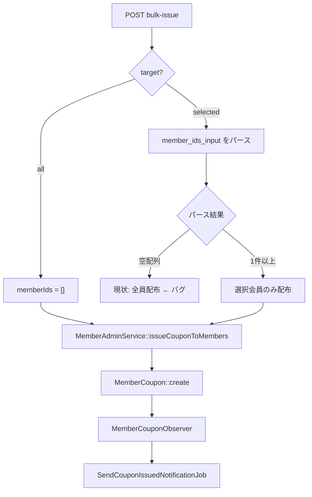

タスク指示書と参照資料を読み、コードベースを調査して実装計画を立てます。
## 実装計画: Issue #50 クーポン一括配布・通知の修正

### 参照資料

タスク指示書 `order.md` のみ指定。別途「参照資料」セクションはなし。

---

### 要件分析

| # | 要件 | 判定 | 根拠 |
|---|------|------|------|
| 1 | `target=selected` で会員IDが空または無効のみのときバリデーションエラー（全員配布にフォールバックしない） | **変更要** | `CouponController.php:159-163` が空配列を UseCase に渡し、`MemberAdminService.php:191-198` が空配列を「全員配布」と解釈 |
| 2 | POST `admin/coupons/bulk-issue` 全員配布の Feature テスト | **変更要** | `tests/Feature/` に一括配布テストなし（`AllScreensAccessibleTest.php:118` は画面アクセスのみ） |
| 3 | `SendCouponIssuedNotificationJob` で `withoutGlobalScopes()->find()` + `afterCommit` | **変更要** | `SendCouponIssuedNotificationJob.php:23` は通常 `find()`、`MemberCouponObserver.php:12` は `afterCommit` なし |
| 4 | ジョブでレコード未検出時はログ、検出時は `notifyIssued` 呼び出しをテスト | **変更要** | `SendCouponIssuedNotificationJob.php:24-26` はサイレント return、該当ジョブテストなし |
| 5 | `CouponNotificationTest` と追加 Feature テストが全パス | **変更要（検証）** | 上記修正・テスト追加の結果として満たす |

**変更不要（スコープ外）:**
- `MemberAdminService::issueCouponToMembers` の「空配列＝全員」セマンティクス → `target=all` で必要（`MemberAdminService.php:191-198`）
- `bulk-issue.blade.php` → UI は要件に含まれない
- `SendScheduledAnnouncementJob` への `afterCommit` 追加 → タスク対象外

**「SendScheduledAnnouncementJob と同様のパターン」について:**  
`withoutGlobalScopes()->find()` は `SendScheduledAnnouncementJob.php:24` と同パターン。`afterCommit` は現行 `SendScheduledAnnouncementJob` には未適用だが、受け入れ条件で `MemberCouponObserver` の dispatch に明示指定されているため、Observer のみ適用する。

---

### バグの原因と修正方針



**修正:** `target=selected` 時は Request 層で「有効な会員IDが1件以上ある」ことを保証し、空配列が Service に到達しないようにする。

---

### 設計

#### 1. バリデーション（`CouponBulkIssueRequest`）

`AnnouncementDeliveryStoreRequest.php:29-35` の `Rule::requiredIf` + `withValidator` パターンに倣う。

**追加内容:**
- `parsedMemberIds(): array` — コントローラとバリデーションで共用するパースロジック（現行 `CouponController.php:160-161` と同等）:

```php
array_values(array_filter(array_map('intval', preg_split('/[\s,]+/', trim($input)))));
```

- `withValidator()` で `target === 'selected'` のとき:
  1. パース結果が空 → `member_ids_input` にエラー（空文字・非数値のみ・`0` のみ）
  2. パース結果はあるが、当該 `project_id` の `members` に存在する ID が0件 → エラー（存在しない ID のみ）

**エラーメッセージ例（日本語）:**
- 空/非数値: 「会員を選択して配布では、対象会員のIDを1件以上入力してください」
- 存在しない ID のみ: 「入力された会員IDが見つかりません」

**project_id の取得:** `AdminContext::getCurrentProjectId()`（管理画面ミドルウェア `BindAdminProject` で設定済み）。テストでは `project_key` 付きルートで自然に解決される。

#### 2. コントローラ（`CouponController::bulkIssue`）

- インラインのパース処理を `$request->parsedMemberIds()` に置き換え
- `target=all` のときは引き続き `$memberIds = []`

#### 3. ジョブ（`SendCouponIssuedNotificationJob`）

```php
// 変更前: MemberCoupon::query()->find($this->memberCouponId);
// 変更後:
$memberCoupon = MemberCoupon::withoutGlobalScopes()->find($this->memberCouponId);
if ($memberCoupon === null) {
    LogHelper::warning('[Coupon] issued notification job: member_coupon not found', [
        'member_coupon_id' => $this->memberCouponId,
    ]);
    return;
}
```

`LogHelper` は `CouponNotificationService.php:39` と同プロジェクト慣習。

#### 4. Observer（`MemberCouponObserver`）

```php
SendCouponIssuedNotificationJob::dispatch($memberCoupon->id)->afterCommit();
```

---

### 変更ファイル一覧

| ファイル | 変更内容 |
|---------|---------|
| `app/Http/Requests/Admin/CouponBulkIssueRequest.php` | `parsedMemberIds()` + `withValidator()` |
| `app/Http/Controllers/Admin/CouponController.php` | パース処理を Request に委譲 |
| `app/Jobs/SendCouponIssuedNotificationJob.php` | `withoutGlobalScopes` + ログ |
| `app/Observers/MemberCouponObserver.php` | `afterCommit()` |
| `tests/Feature/AdminCouponBulkIssueTest.php` | **新規** 一括配布 Feature テスト |
| `tests/Feature/CouponNotificationTest.php` | ジョブ実行テスト追加 |

---

### テスト計画

#### 新規: `tests/Feature/AdminCouponBulkIssueTest.php`

既存パターン: `AdminAnnouncementsTest.php:56-107`、`AdminCouponsTest.php:14-38`

| テストケース | 検証内容 |
|-------------|---------|
| `test_bulk_issue_全員配布でmember_coupons作成とジョブ投入` | `Queue::fake()` → POST `target=all` → `member_coupons` N件、`SendCouponIssuedNotificationJob` N回 |
| `test_bulk_issue_selectedで会員ID未入力はバリデーションエラー` | `target=selected`, `member_ids_input=''` → `assertSessionHasErrors`、DB 0件 |
| `test_bulk_issue_selectedで無効なIDのみはバリデーションエラー` | `member_ids_input='abc, xyz'` → 同上 |
| `test_bulk_issue_selectedで存在しないIDのみはバリデーションエラー` | `member_ids_input='99999'` → 同上 |

**セットアップ共通:**
- `Project::firstOrCreate(['project_key' => 'default'], ...)`
- `AdminUser::factory()->create(['role' => AdminUser::ROLE_ADMIN, 'project_id' => $project->id])`
- `Member::factory()` × N、`Coupon::factory()`
- `actingAs($admin, 'admin')->post(route('admin.coupons.bulk-issue.store', ['project_key' => $project->project_key]), [...])`

#### 追加: `tests/Feature/CouponNotificationTest.php`

| テストケース | 検証内容 |
|-------------|---------|
| `test_send_coupon_issued_notification_job_レコードありでnotifyIssuedが呼ばれる` | `MemberCoupon::withoutEvents()` で作成 → `CouponNotificationService` をモック → `$job->handle($mock)` → `notifyIssued` 1回 |
| `test_send_coupon_issued_notification_job_レコードなしでログのみ` | `Log::fake()` → 存在しない ID で handle → `Log::assertLogged('warning', ...)`、モックは `shouldNotReceive` |
| `test_send_coupon_issued_notification_job_withoutGlobalScopesで取得できる`（任意・推奨） | `AdminContext::setCurrentProject($otherProject)` 設定下でもジョブが正しい `MemberCoupon` を取得して `notifyIssued` 呼び出し |

---

### 実装ガイドライン（Coder 向け）

#### 参照すべき既存パターン

| 用途 | 参照箇所 |
|------|---------|
| 条件付きバリデーション | `AnnouncementDeliveryStoreRequest.php:29-35, 68-79` |
| `withValidator` + `after` | `StampStoreRequest.php:34-54` |
| 管理画面 Feature テスト | `AdminAnnouncementsTest.php:79-107` |
| ジョブキュー検証 | `CouponNotificationTest.php:39-57` |
| `withoutGlobalScopes` in Job | `SendScheduledAnnouncementJob.php:24` |
| ログ出力 | `CouponNotificationService.php:39-42`（`LogHelper::warning`） |

#### 配線・影響範囲

- `parsedMemberIds()` 追加に伴い、`CouponController::bulkIssue` のパース行（159-161）のみ変更。UseCase / Service は変更不要。
- `MemberCouponObserver` の変更は `MemberCoupon::create` 経由の全発行パスに影響（一括配布・個別配布・お知らせ連動配布）。意図した改善。
- `SendCouponIssuedNotificationJob` の `withoutGlobalScopes` はキューワーカーで `AdminContext` が異なる場合の取得失敗を防ぐ。

#### アンチパターン（避けること）

1. **Controller にバリデーションロジックを書く** — Request 層に集約（`AnnouncementDeliveryStoreRequest` 準拠）
2. **`MemberAdminService` の空配列＝全員ロジックを削除** — `target=all` で必要
3. **`SendScheduledAnnouncementJob` に `afterCommit` を追加** — スコープ外
4. **サイレント return のまま** — 未検出時は必ず `LogHelper::warning`
5. **パースロジックの二重実装** — Request の `parsedMemberIds()` に一元化

#### 利用者到達経路

| 経路 | ファイル |
|------|---------|
| 管理画面メニュー「一括配布」 | `admin/layout.blade.php:144` |
| クーポン一覧ボタン | `admin/coupons/index.blade.php:32` |
| フォーム POST | `admin/coupons/bulk-issue.blade.php:26` → `CouponController::bulkIssue` |
| 通知ジョブ投入 | `MemberCouponObserver` → `SendCouponIssuedNotificationJob` |

---

### 検証コマンド

```bash
docker compose exec app php artisan test --filter=CouponNotificationTest
docker compose exec app php artisan test --filter=AdminCouponBulkIssueTest
```

---

### 実装順序（推奨）

1. `CouponBulkIssueRequest` にバリデーション + `parsedMemberIds()`
2. `CouponController` を Request 利用に変更
3. `SendCouponIssuedNotificationJob` 修正
4. `MemberCouponObserver` に `afterCommit()`
5. `AdminCouponBulkIssueTest` 新規作成
6. `CouponNotificationTest` にジョブテスト追加
7. 全テスト実行で受け入れ条件確認