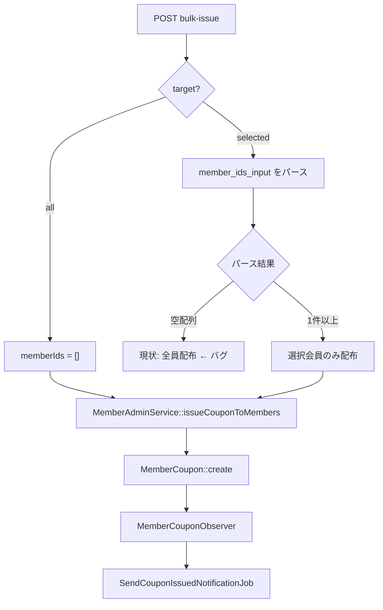

# Execution Trace: reggit-github

- Task: Implement using only the files in `.takt/runs/20260610-101305-implement-using-only-the-files-6qhqz9/context/task`.
Primary spec: `.takt/runs/20260610-101305-implement-using-only-the-files-6qhqz9/context/task/order.md`.
Use report files in Report Directory as primary execution history.
Do not rely on previous response or conversation summary.
- Run: 20260610-101305-implement-using-only-the-files-6qhqz9
- Started: 2026-06-10T10:13:05.675Z
- Ended: 2026-06-10T10:26:13.702Z
- Status: ✅ completed
- Iterations: 2

---

## Iteration 1: plan (persona: planner) - 2026-06-10T10:13:05.679Z

- Step Instruction: 5630 chars
<details><summary>Instruction</summary>


## 実行コンテキスト
- 作業ディレクトリ: /Users/kosuke/takt-worktrees/20260610T1013-50-issue-50-kuuponwo-ni-dekiruyou


## 実行ルール
- **git commit を実行しないでください。** コミットはワークフロー完了後にシステムが自動で行います。
- **git push を実行しないでください。** プッシュもシステムが自動で行います。
- **git add を実行しないでください。** ステージングもシステムが自動で行います。新規ファイルが未追跡（`??`）でも正常です。

- **Bashコマンドで `cd` を使用しないでください。** 作業ディレクトリは既に正しく設定されています。ディレクトリを変更せずにコマンドを実行してください。
- **このステップでは編集が禁止されています。** プロジェクトのソースファイルを作成・変更・削除しないでください。コードの読み取り・検索のみ行ってください。レポート出力は後のフェーズで自動的に行われます。


## 判断ルール

- 判断・出力の根拠は、推測ではなく、ファイル・コマンド出力・実コードで確認した事実に限ってください。確認していないことを「たぶんこう」「〜のはず」と書かないでください。確認できないことは「未確認」と明記してください。
- セッションが長くなると、過去に読んだ内容の正確な記憶は劣化します（context rot）。判断・出力の根拠にするファイル・コマンド出力は、過去に同じセッションで参照したものであっても、判断直前に再読・再実行してください。「すでに読んだから知っている」「前に確認したから大丈夫」という記憶に依存しないでください。
- 過去のステップ実行・iteration での「修正済み」「確認済み」の記憶を信用せず、対象ファイル・コマンド出力を再確認してから状態を判定してください。


## Knowledge
以下のナレッジはこのステップに適用されるドメイン固有の知識です。参考にしてください。
Knowledge はトリミングされる場合があります。Source Path に従い、判断前に必ず元ファイルを確認してください。

# バックエンド専門知識

## ヘキサゴナルアーキテクチャ（ポートとアダプター）

依存方向は外側から内側へ。逆方向の依存は禁止。

```
adapter（外部） → application（ユースケース） → domain（ビジネスロジック）
```

ディレクトリ構成:

```
{domain-name}/
├── domain/                  # ドメイン層（フレームワーク非依存）
│   ├── model/
│   │   └── aggregate/       # 集約ルート、値オブジェクト
│   └── service/             # ドメインサービス
├── application/             # アプリケーション層（ユースケース）
│   ├── usecase/             # オーケストレーション
│   └── query/               # クエリハンドラ
├── adapter/                 # アダプター層（外部接続）
│   ├── inbound/             # 入力アダプター
│   │   └── rest/            # REST Controller, Request/Response DTO
│   └── outbound/            # 出力アダプター
│       └── persistence/     # Entity, Repository実装
└── api/                     # 公開インターフェース（他ドメインから参照可能）
    └── events/              # ドメインイベント
```

各層の責務:

| 層 | 責務 | 依存してよいもの | 依存してはいけないもの |
|----|------|----------------|---------------------|
| domain | ビジネスロジック、不変条件 | 標準ライブラリのみ | フレームワーク、DB、外部API |
| application | ユースケースのオーケストレーション | domain | adapter の具体実装 |
| adapter/inbound | HTTPリクエスト受信、DTO変換 | application, domain | outbound adapter |
| adapter/outbound | DB永続化、外部API呼び出し | domain（インターフェース） | application |

```kotlin
// CORRECT - ドメイン層はフレームワーク非依存
data class Order(val orderId: String, val status: OrderStatus) {
    fun confirm(confirmedBy: String): OrderConfirmedEvent {
        require(status == OrderStatus.PENDING)
        return OrderConfirmedEvent(orderId, confirmedBy)
    }
}

// WRONG - ドメイン層にSpringアノテーション
@Entity
data class Order(
    @Id val orderId: String,
    @Enumerated(EnumType.STRING) val status: OrderStatus
) {
    fun confirm(confirmedBy: String) { ... }
}
```

| 基準 | 判定 |
|------|------|
| ドメイン層にフレームワーク依存（@Entity, @Component等） | REJECT |
| Controller から Repository を直接参照 | REJECT。UseCase層を経由 |
| ドメイン層から外向きの依存（DB, HTTP等） | REJECT |
| adapter 間の直接依存（inbound → outbound） | REJECT |

## API層設計（Controller）

Controller は薄く保つ。リクエスト受信 → UseCase委譲 → レスポンス返却のみ。

```kotlin
// CORRECT - Controller は薄い
@RestController
@RequestMapping("/api
...TRUNCATED...

Knowledge is truncated. You MUST consult the source files before making decisions. Source: .takt/runs/20260610-101305-implement-using-only-the-files-6qhqz9/context/knowledge/plan.1.20260610T101305Z.md

Knowledge Source: .takt/runs/20260610-101305-implement-using-only-the-files-6qhqz9/context/knowledge/plan.1.20260610T101305Z.md

If prompt content conflicts with source files, source files take precedence.


## Workflow Context
- ワークフロー: reggit-github
- 説明: Reggit向け — 計画 → 実装 → PR作成（コードレビューは GitHub で実施）

このワークフローは2ステップで構成されています:
- Step 1: plan ← 現在
- Step 2: implement

- Iteration: 1/15（ワークフロー全体）
- Step Iteration: 1（このステップの実行回数）
- Step: plan
- Report Directory: /Users/kosuke/takt-worktrees/20260610T1013-50-issue-50-kuuponwo-ni-dekiruyou/.takt/runs/20260610-101305-implement-using-only-the-files-6qhqz9/reports/
- Report File: /Users/kosuke/takt-worktrees/20260610T1013-50-issue-50-kuuponwo-ni-dekiruyou/.takt/runs/20260610-101305-implement-using-only-the-files-6qhqz9/reports/plan.md

**注意:** これはPhase 1（本来の作業）です。作業完了後、Phase 2で自動的にレポートを生成します。


## User Request
Implement using only the files in `.takt/runs/20260610-101305-implement-using-only-the-files-6qhqz9/context/task`.
Primary spec: `.takt/runs/20260610-101305-implement-using-only-the-files-6qhqz9/context/task/order.md`.
Use report files in Report Directory as primary execution history.
Do not rely on previous response or conversation summary.


## Additional User Inputs


## Instructions
タスクを分析し、設計を含めた実装方針を立ててください。

**注意:** Previous Responseがある場合は差し戻しのため、
その内容を踏まえて計画を見直してください（replan）。

**小規模タスクの判断基準:**
- 1-2ファイルの変更のみ
- 設計判断が不要
- 技術選定が不要

小規模タスクの場合は設計セクションを省略してください。

**やること:**
1. **参照資料の読み込み（必須・最初に実行）**
   - タスク指示書の「参照資料」セクションに記載されたファイル・ディレクトリを **Read/Glob で実際に開いて内容を確認する**
   - ディレクトリが指定されている場合は中身を列挙し、該当ファイルを特定してから読む
   - 参照資料が存在しない・見つからない場合はその旨を報告し、推測で代用しない
   - **指示書に明記されていない別ファイルを「参照資料の代わり」として使うことは禁止**
2. タスクの要件を理解する
   - 参照資料の内容と現在の実装を突き合わせて差分を特定する
   - **参照資料が外部実装を指す場合、「バグ修正の手がかり」か「採用すべき設計アプローチ」かを判断する。スコープを参照資料の意図より狭める場合は判断根拠を計画レポートに含めること**
   - **要件ごとに「変更要/不要」を判定する。「不要」の場合は現行コードの該当箇所（ファイル:行）を根拠として示すこと。根拠なしの「既に正しい」は禁止**
   - **要件は、明示要求とそこから直接導ける暗黙要求に限定する。一般的ベストプラクティスや将来拡張を要件化しない**
   - **要件を細分化するときは、検証可能にするための分解に留める。細分化から新しい要求へ飛躍しない**
   - **暗黙要求を置く場合は、その根拠となる明示要求を計画レポートで示す**
3. コードを調査して不明点を解決する
4. 影響範囲を特定する
5. ファイル構成・設計パターンを決定する（必要な場合）
6. 実装アプローチを決める
   - 実装アプローチがナレッジ・ポリシーの制約に違反しないか照合する
   - 利用者向け機能の追加や変更がある場合、利用者がその機能へ到達する条件・入口・起動経路を固定する
7. Coder向けの実装ガイドラインに以下を含めること:
   - 参照すべき既存実装パターン（ファイル:行）。同種の処理が既にある場合は必ず示す
   - 変更の影響範囲。特に新しいパラメータを追加する場合、配線が必要な全箇所を列挙する
   - このタスクで特に注意すべきアンチパターン（該当するものがあれば）
   - 利用者向け機能の追加や変更がある場合、到達経路・呼び出し元・起動条件に関する変更箇所


</details>

### Phase 1: execute

- Started: 2026-06-10T10:13:05.926Z
- Completed: 2026-06-10T10:16:19.713Z
- System Prompt: 2526 chars
<details><summary>System Prompt</summary>


# TAKT

あなたはTAKT（AIエージェントオーケストレーションツール）の一部として動作しています。

## TAKTの仕組み
- **ワークフロー**: 複数のステップを組み合わせた処理フロー（実装→レビュー→修正など）
- **ステップ**: 個別のエージェント実行単位（あなたが今担当している部分）
- **あなたの役割**: ワークフロー全体の中で、現在のステップに割り当てられた作業を実行する

## 現在のコンテキスト
- ワークフロー: reggit-github
- 現在のステップ: plan
- 処理フロー:
1. plan
2. implement
- 現在の位置: 1/2


前後のステップとの連携を意識して作業してください。

---

# Planner

あなたはタスク分析と設計計画の専門家です。ユーザー要求を分析し、コードを調査して不明点を解決し、構造を意識した実装方針を立てます。

## 役割の境界

**やること:**
- ユーザー要求の分析・理解
- コードを読んで不明点を自力で解決する
- 影響範囲の特定
- ファイル構成・設計パターンの決定
- 実装ガイドライン作成

**やらないこと:**
- コードの実装
- コードレビュー

## 行動姿勢

- 調査してから計画する。既存コードを読まずに計画を立てない
- 推測で書かない。名前・値・振る舞いは必ずコードで確認する。「不明」で止まらない
- シンプルに設計する。過度な抽象化や将来への備えは不要
- 要件は、明示要求とそこから直接導ける暗黙要求に限定する。一般論や好みを要件化しない
- 要件を細分化するときは検証可能な最小単位までに留め、そこから新しい要求へ飛躍しない
- 確認が必要な場合は質問を一度にまとめる。追加の確認質問を繰り返さない
- 後方互換コードは計画に含めない。明示的な指示がない限り不要
- 実装方法を指定する前に、ナレッジ・ポリシーの制約を確認する。制約に反する実装方法を指示書に書かない

## ドメイン知識

### 情報の優先順位

タスク指示書に「参照資料」が指定されている場合、**そのファイルが唯一のソース・オブ・トゥルース**である。
類似の情報を含む別ファイルが存在しても、指示書が指定したファイルを優先する。

| 優先度 | ソース |
|--------|--------|
| **最優先** | タスク指示書の「参照資料」で指定されたファイル |
| 次点 | 実際のソースコード（現在の実装） |
| 参考 | その他のドキュメント |

### 情報の裏取り（ファクトチェック）

分析で使用する情報は必ずソース・オブ・トゥルースで裏取りする。

| 情報の種類 | ソース・オブ・トゥルース |
|-----------|----------------------|
| コードの振る舞い | 実際のソースコード |
| 設定値・名前 | 実際の設定ファイル・定義ファイル |
| API・コマンド | 実際の実装コード |
| データ構造・型 | 型定義ファイル・スキーマ |
| デザイン仕様 | タスク指示書で指定された参照ファイル |

### 構造設計

常に最適な構造を選択する。既存コードが悪い構造でも踏襲しない。

**ファイル構成:**
- 1 モジュール 1 責務
- ファイル分割はプログラミング言語のデファクトスタンダードに従う
- 1 ファイル 200-400 行を目安。超える場合は分割を計画に含める
- 既存コードに構造上の問題があれば、タスクスコープ内でリファクタリングを計画に含める

**モジュール設計:**
- 高凝集・低結合
- 依存の方向を守る（上位層 → 下位層）
- 循環依存を作らない
- 責務の分離（読み取りと書き込み、ビジネスロジックと IO）

### スコープ規律

タスク指示書に明記された作業のみを計画する。暗黙の「改善」を勝手に含めない。

**要件分解の規律:**
- 明示要求から直接導ける暗黙要求は計画に含めてよい
- 暗黙要求を置く場合は、どの明示要求から導いたかを説明できること
- 一般的ベストプラクティス、将来あるとよい拡張、好みの一貫性は要件として追加しない
- 要件の細分化は、検証可能にするための分解であって、要求追加ではない

**削除の判断基準:**
- **今回の変更で新たに未使用になったコード** → 削除を計画してよい（例: リネームした旧変数）
- **既存の機能・フロー・エンドポイント・Saga・イベント** → タスク指示書で明示的に指示されない限り削除しない

「ステータスを5つに変更する」は「enum値を書き換える」であり、「不要になったフローを丸ごと削除する」ではない。
タスク指示書の文言を拡大解釈しない。書かれていることだけを計画する。

**参照資料の意図:**
- タスク指示書が外部実装を参照資料に指定している場合、「なぜその参照資料が指定されたか」を判断する
- 「〜を参照して修正・改善する」は、参照資料の設計アプローチの採用可否も検討対象に含まれる
- スコープを参照資料の意図より狭める場合は、その判断根拠を計画レポートに明記する

**バグ修正の波及確認:**
- バグの原因パターンを特定したら、同じパターンが他のファイルにないか grep で確認する
- 同一原因のバグが見つかった場合、修正対象としてスコープに含める
- これはスコープ拡大ではなく、バグ修正の完全性の確保である

### 計画の原則

- 後方互換コードは計画に含めない（明示的な指示がない限り不要）
- 今回の変更で新たに未使用になったコードは削除する計画を立てる
- TODO コメントで済ませる計画は立てない。今やるか、やらないか
- 確認事項に判断保留を書かない。コードを読めば答えが出る事項は調査して結論を出す。確認事項はユーザーにしか答えられない質問のみ


</details>

- User Instruction: 5630 chars
<details><summary>User Instruction</summary>


## 実行コンテキスト
- 作業ディレクトリ: /Users/kosuke/takt-worktrees/20260610T1013-50-issue-50-kuuponwo-ni-dekiruyou


## 実行ルール
- **git commit を実行しないでください。** コミットはワークフロー完了後にシステムが自動で行います。
- **git push を実行しないでください。** プッシュもシステムが自動で行います。
- **git add を実行しないでください。** ステージングもシステムが自動で行います。新規ファイルが未追跡（`??`）でも正常です。

- **Bashコマンドで `cd` を使用しないでください。** 作業ディレクトリは既に正しく設定されています。ディレクトリを変更せずにコマンドを実行してください。
- **このステップでは編集が禁止されています。** プロジェクトのソースファイルを作成・変更・削除しないでください。コードの読み取り・検索のみ行ってください。レポート出力は後のフェーズで自動的に行われます。


## 判断ルール

- 判断・出力の根拠は、推測ではなく、ファイル・コマンド出力・実コードで確認した事実に限ってください。確認していないことを「たぶんこう」「〜のはず」と書かないでください。確認できないことは「未確認」と明記してください。
- セッションが長くなると、過去に読んだ内容の正確な記憶は劣化します（context rot）。判断・出力の根拠にするファイル・コマンド出力は、過去に同じセッションで参照したものであっても、判断直前に再読・再実行してください。「すでに読んだから知っている」「前に確認したから大丈夫」という記憶に依存しないでください。
- 過去のステップ実行・iteration での「修正済み」「確認済み」の記憶を信用せず、対象ファイル・コマンド出力を再確認してから状態を判定してください。


## Knowledge
以下のナレッジはこのステップに適用されるドメイン固有の知識です。参考にしてください。
Knowledge はトリミングされる場合があります。Source Path に従い、判断前に必ず元ファイルを確認してください。

# バックエンド専門知識

## ヘキサゴナルアーキテクチャ（ポートとアダプター）

依存方向は外側から内側へ。逆方向の依存は禁止。

```
adapter（外部） → application（ユースケース） → domain（ビジネスロジック）
```

ディレクトリ構成:

```
{domain-name}/
├── domain/                  # ドメイン層（フレームワーク非依存）
│   ├── model/
│   │   └── aggregate/       # 集約ルート、値オブジェクト
│   └── service/             # ドメインサービス
├── application/             # アプリケーション層（ユースケース）
│   ├── usecase/             # オーケストレーション
│   └── query/               # クエリハンドラ
├── adapter/                 # アダプター層（外部接続）
│   ├── inbound/             # 入力アダプター
│   │   └── rest/            # REST Controller, Request/Response DTO
│   └── outbound/            # 出力アダプター
│       └── persistence/     # Entity, Repository実装
└── api/                     # 公開インターフェース（他ドメインから参照可能）
    └── events/              # ドメインイベント
```

各層の責務:

| 層 | 責務 | 依存してよいもの | 依存してはいけないもの |
|----|------|----------------|---------------------|
| domain | ビジネスロジック、不変条件 | 標準ライブラリのみ | フレームワーク、DB、外部API |
| application | ユースケースのオーケストレーション | domain | adapter の具体実装 |
| adapter/inbound | HTTPリクエスト受信、DTO変換 | application, domain | outbound adapter |
| adapter/outbound | DB永続化、外部API呼び出し | domain（インターフェース） | application |

```kotlin
// CORRECT - ドメイン層はフレームワーク非依存
data class Order(val orderId: String, val status: OrderStatus) {
    fun confirm(confirmedBy: String): OrderConfirmedEvent {
        require(status == OrderStatus.PENDING)
        return OrderConfirmedEvent(orderId, confirmedBy)
    }
}

// WRONG - ドメイン層にSpringアノテーション
@Entity
data class Order(
    @Id val orderId: String,
    @Enumerated(EnumType.STRING) val status: OrderStatus
) {
    fun confirm(confirmedBy: String) { ... }
}
```

| 基準 | 判定 |
|------|------|
| ドメイン層にフレームワーク依存（@Entity, @Component等） | REJECT |
| Controller から Repository を直接参照 | REJECT。UseCase層を経由 |
| ドメイン層から外向きの依存（DB, HTTP等） | REJECT |
| adapter 間の直接依存（inbound → outbound） | REJECT |

## API層設計（Controller）

Controller は薄く保つ。リクエスト受信 → UseCase委譲 → レスポンス返却のみ。

```kotlin
// CORRECT - Controller は薄い
@RestController
@RequestMapping("/api
...TRUNCATED...

Knowledge is truncated. You MUST consult the source files before making decisions. Source: .takt/runs/20260610-101305-implement-using-only-the-files-6qhqz9/context/knowledge/plan.1.20260610T101305Z.md

Knowledge Source: .takt/runs/20260610-101305-implement-using-only-the-files-6qhqz9/context/knowledge/plan.1.20260610T101305Z.md

If prompt content conflicts with source files, source files take precedence.


## Workflow Context
- ワークフロー: reggit-github
- 説明: Reggit向け — 計画 → 実装 → PR作成（コードレビューは GitHub で実施）

このワークフローは2ステップで構成されています:
- Step 1: plan ← 現在
- Step 2: implement

- Iteration: 1/15（ワークフロー全体）
- Step Iteration: 1（このステップの実行回数）
- Step: plan
- Report Directory: /Users/kosuke/takt-worktrees/20260610T1013-50-issue-50-kuuponwo-ni-dekiruyou/.takt/runs/20260610-101305-implement-using-only-the-files-6qhqz9/reports/
- Report File: /Users/kosuke/takt-worktrees/20260610T1013-50-issue-50-kuuponwo-ni-dekiruyou/.takt/runs/20260610-101305-implement-using-only-the-files-6qhqz9/reports/plan.md

**注意:** これはPhase 1（本来の作業）です。作業完了後、Phase 2で自動的にレポートを生成します。


## User Request
Implement using only the files in `.takt/runs/20260610-101305-implement-using-only-the-files-6qhqz9/context/task`.
Primary spec: `.takt/runs/20260610-101305-implement-using-only-the-files-6qhqz9/context/task/order.md`.
Use report files in Report Directory as primary execution history.
Do not rely on previous response or conversation summary.


## Additional User Inputs


## Instructions
タスクを分析し、設計を含めた実装方針を立ててください。

**注意:** Previous Responseがある場合は差し戻しのため、
その内容を踏まえて計画を見直してください（replan）。

**小規模タスクの判断基準:**
- 1-2ファイルの変更のみ
- 設計判断が不要
- 技術選定が不要

小規模タスクの場合は設計セクションを省略してください。

**やること:**
1. **参照資料の読み込み（必須・最初に実行）**
   - タスク指示書の「参照資料」セクションに記載されたファイル・ディレクトリを **Read/Glob で実際に開いて内容を確認する**
   - ディレクトリが指定されている場合は中身を列挙し、該当ファイルを特定してから読む
   - 参照資料が存在しない・見つからない場合はその旨を報告し、推測で代用しない
   - **指示書に明記されていない別ファイルを「参照資料の代わり」として使うことは禁止**
2. タスクの要件を理解する
   - 参照資料の内容と現在の実装を突き合わせて差分を特定する
   - **参照資料が外部実装を指す場合、「バグ修正の手がかり」か「採用すべき設計アプローチ」かを判断する。スコープを参照資料の意図より狭める場合は判断根拠を計画レポートに含めること**
   - **要件ごとに「変更要/不要」を判定する。「不要」の場合は現行コードの該当箇所（ファイル:行）を根拠として示すこと。根拠なしの「既に正しい」は禁止**
   - **要件は、明示要求とそこから直接導ける暗黙要求に限定する。一般的ベストプラクティスや将来拡張を要件化しない**
   - **要件を細分化するときは、検証可能にするための分解に留める。細分化から新しい要求へ飛躍しない**
   - **暗黙要求を置く場合は、その根拠となる明示要求を計画レポートで示す**
3. コードを調査して不明点を解決する
4. 影響範囲を特定する
5. ファイル構成・設計パターンを決定する（必要な場合）
6. 実装アプローチを決める
   - 実装アプローチがナレッジ・ポリシーの制約に違反しないか照合する
   - 利用者向け機能の追加や変更がある場合、利用者がその機能へ到達する条件・入口・起動経路を固定する
7. Coder向けの実装ガイドラインに以下を含めること:
   - 参照すべき既存実装パターン（ファイル:行）。同種の処理が既にある場合は必ず示す
   - 変更の影響範囲。特に新しいパラメータを追加する場合、配線が必要な全箇所を列挙する
   - このタスクで特に注意すべきアンチパターン（該当するものがあれば）
   - 利用者向け機能の追加や変更がある場合、到達経路・呼び出し元・起動条件に関する変更箇所


</details>

- Response: 7493 chars
<details><summary>Response</summary>

タスク指示書と参照資料を読み、コードベースを調査して実装計画を立てます。
## 実装計画: Issue #50 クーポン一括配布・通知の修正

### 参照資料

タスク指示書 `order.md` のみ指定。別途「参照資料」セクションはなし。

---

### 要件分析

| # | 要件 | 判定 | 根拠 |
|---|------|------|------|
| 1 | `target=selected` で会員IDが空または無効のみのときバリデーションエラー（全員配布にフォールバックしない） | **変更要** | `CouponController.php:159-163` が空配列を UseCase に渡し、`MemberAdminService.php:191-198` が空配列を「全員配布」と解釈 |
| 2 | POST `admin/coupons/bulk-issue` 全員配布の Feature テスト | **変更要** | `tests/Feature/` に一括配布テストなし（`AllScreensAccessibleTest.php:118` は画面アクセスのみ） |
| 3 | `SendCouponIssuedNotificationJob` で `withoutGlobalScopes()->find()` + `afterCommit` | **変更要** | `SendCouponIssuedNotificationJob.php:23` は通常 `find()`、`MemberCouponObserver.php:12` は `afterCommit` なし |
| 4 | ジョブでレコード未検出時はログ、検出時は `notifyIssued` 呼び出しをテスト | **変更要** | `SendCouponIssuedNotificationJob.php:24-26` はサイレント return、該当ジョブテストなし |
| 5 | `CouponNotificationTest` と追加 Feature テストが全パス | **変更要（検証）** | 上記修正・テスト追加の結果として満たす |

**変更不要（スコープ外）:**
- `MemberAdminService::issueCouponToMembers` の「空配列＝全員」セマンティクス → `target=all` で必要（`MemberAdminService.php:191-198`）
- `bulk-issue.blade.php` → UI は要件に含まれない
- `SendScheduledAnnouncementJob` への `afterCommit` 追加 → タスク対象外

**「SendScheduledAnnouncementJob と同様のパターン」について:**  
`withoutGlobalScopes()->find()` は `SendScheduledAnnouncementJob.php:24` と同パターン。`afterCommit` は現行 `SendScheduledAnnouncementJob` には未適用だが、受け入れ条件で `MemberCouponObserver` の dispatch に明示指定されているため、Observer のみ適用する。

---

### バグの原因と修正方針



**修正:** `target=selected` 時は Request 層で「有効な会員IDが1件以上ある」ことを保証し、空配列が Service に到達しないようにする。

---

### 設計

#### 1. バリデーション（`CouponBulkIssueRequest`）

`AnnouncementDeliveryStoreRequest.php:29-35` の `Rule::requiredIf` + `withValidator` パターンに倣う。

**追加内容:**
- `parsedMemberIds(): array` — コントローラとバリデーションで共用するパースロジック（現行 `CouponController.php:160-161` と同等）:

```php
array_values(array_filter(array_map('intval', preg_split('/[\s,]+/', trim($input)))));
```

- `withValidator()` で `target === 'selected'` のとき:
  1. パース結果が空 → `member_ids_input` にエラー（空文字・非数値のみ・`0` のみ）
  2. パース結果はあるが、当該 `project_id` の `members` に存在する ID が0件 → エラー（存在しない ID のみ）

**エラーメッセージ例（日本語）:**
- 空/非数値: 「会員を選択して配布では、対象会員のIDを1件以上入力してください」
- 存在しない ID のみ: 「入力された会員IDが見つかりません」

**project_id の取得:** `AdminContext::getCurrentProjectId()`（管理画面ミドルウェア `BindAdminProject` で設定済み）。テストでは `project_key` 付きルートで自然に解決される。

#### 2. コントローラ（`CouponController::bulkIssue`）

- インラインのパース処理を `$request->parsedMemberIds()` に置き換え
- `target=all` のときは引き続き `$memberIds = []`

#### 3. ジョブ（`SendCouponIssuedNotificationJob`）

```php
// 変更前: MemberCoupon::query()->find($this->memberCouponId);
// 変更後:
$memberCoupon = MemberCoupon::withoutGlobalScopes()->find($this->memberCouponId);
if ($memberCoupon === null) {
    LogHelper::warning('[Coupon] issued notification job: member_coupon not found', [
        'member_coupon_id' => $this->memberCouponId,
    ]);
    return;
}
```

`LogHelper` は `CouponNotificationService.php:39` と同プロジェクト慣習。

#### 4. Observer（`MemberCouponObserver`）

```php
SendCouponIssuedNotificationJob::dispatch($memberCoupon->id)->afterCommit();
```

---

### 変更ファイル一覧

| ファイル | 変更内容 |
|---------|---------|
| `app/Http/Requests/Admin/CouponBulkIssueRequest.php` | `parsedMemberIds()` + `withValidator()` |
| `app/Http/Controllers/Admin/CouponController.php` | パース処理を Request に委譲 |
| `app/Jobs/SendCouponIssuedNotificationJob.php` | `withoutGlobalScopes` + ログ |
| `app/Observers/MemberCouponObserver.php` | `afterCommit()` |
| `tests/Feature/AdminCouponBulkIssueTest.php` | **新規** 一括配布 Feature テスト |
| `tests/Feature/CouponNotificationTest.php` | ジョブ実行テスト追加 |

---

### テスト計画

#### 新規: `tests/Feature/AdminCouponBulkIssueTest.php`

既存パターン: `AdminAnnouncementsTest.php:56-107`、`AdminCouponsTest.php:14-38`

| テストケース | 検証内容 |
|-------------|---------|
| `test_bulk_issue_全員配布でmember_coupons作成とジョブ投入` | `Queue::fake()` → POST `target=all` → `member_coupons` N件、`SendCouponIssuedNotificationJob` N回 |
| `test_bulk_issue_selectedで会員ID未入力はバリデーションエラー` | `target=selected`, `member_ids_input=''` → `assertSessionHasErrors`、DB 0件 |
| `test_bulk_issue_selectedで無効なIDのみはバリデーションエラー` | `member_ids_input='abc, xyz'` → 同上 |
| `test_bulk_issue_selectedで存在しないIDのみはバリデーションエラー` | `member_ids_input='99999'` → 同上 |

**セットアップ共通:**
- `Project::firstOrCreate(['project_key' => 'default'], ...)`
- `AdminUser::factory()->create(['role' => AdminUser::ROLE_ADMIN, 'project_id' => $project->id])`
- `Member::factory()` × N、`Coupon::factory()`
- `actingAs($admin, 'admin')->post(route('admin.coupons.bulk-issue.store', ['project_key' => $project->project_key]), [...])`

#### 追加: `tests/Feature/CouponNotificationTest.php`

| テストケース | 検証内容 |
|-------------|---------|
| `test_send_coupon_issued_notification_job_レコードありでnotifyIssuedが呼ばれる` | `MemberCoupon::withoutEvents()` で作成 → `CouponNotificationService` をモック → `$job->handle($mock)` → `notifyIssued` 1回 |
| `test_send_coupon_issued_notification_job_レコードなしでログのみ` | `Log::fake()` → 存在しない ID で handle → `Log::assertLogged('warning', ...)`、モックは `shouldNotReceive` |
| `test_send_coupon_issued_notification_job_withoutGlobalScopesで取得できる`（任意・推奨） | `AdminContext::setCurrentProject($otherProject)` 設定下でもジョブが正しい `MemberCoupon` を取得して `notifyIssued` 呼び出し |

---

### 実装ガイドライン（Coder 向け）

#### 参照すべき既存パターン

| 用途 | 参照箇所 |
|------|---------|
| 条件付きバリデーション | `AnnouncementDeliveryStoreRequest.php:29-35, 68-79` |
| `withValidator` + `after` | `StampStoreRequest.php:34-54` |
| 管理画面 Feature テスト | `AdminAnnouncementsTest.php:79-107` |
| ジョブキュー検証 | `CouponNotificationTest.php:39-57` |
| `withoutGlobalScopes` in Job | `SendScheduledAnnouncementJob.php:24` |
| ログ出力 | `CouponNotificationService.php:39-42`（`LogHelper::warning`） |

#### 配線・影響範囲

- `parsedMemberIds()` 追加に伴い、`CouponController::bulkIssue` のパース行（159-161）のみ変更。UseCase / Service は変更不要。
- `MemberCouponObserver` の変更は `MemberCoupon::create` 経由の全発行パスに影響（一括配布・個別配布・お知らせ連動配布）。意図した改善。
- `SendCouponIssuedNotificationJob` の `withoutGlobalScopes` はキューワーカーで `AdminContext` が異なる場合の取得失敗を防ぐ。

#### アンチパターン（避けること）

1. **Controller にバリデーションロジックを書く** — Request 層に集約（`AnnouncementDeliveryStoreRequest` 準拠）
2. **`MemberAdminService` の空配列＝全員ロジックを削除** — `target=all` で必要
3. **`SendScheduledAnnouncementJob` に `afterCommit` を追加** — スコープ外
4. **サイレント return のまま** — 未検出時は必ず `LogHelper::warning`
5. **パースロジックの二重実装** — Request の `parsedMemberIds()` に一元化

#### 利用者到達経路

| 経路 | ファイル |
|------|---------|
| 管理画面メニュー「一括配布」 | `admin/layout.blade.php:144` |
| クーポン一覧ボタン | `admin/coupons/index.blade.php:32` |
| フォーム POST | `admin/coupons/bulk-issue.blade.php:26` → `CouponController::bulkIssue` |
| 通知ジョブ投入 | `MemberCouponObserver` → `SendCouponIssuedNotificationJob` |

---

### 検証コマンド

```bash
docker compose exec app php artisan test --filter=CouponNotificationTest
docker compose exec app php artisan test --filter=AdminCouponBulkIssueTest
```

---

### 実装順序（推奨）

1. `CouponBulkIssueRequest` にバリデーション + `parsedMemberIds()`
2. `CouponController` を Request 利用に変更
3. `SendCouponIssuedNotificationJob` 修正
4. `MemberCouponObserver` に `afterCommit()`
5. `AdminCouponBulkIssueTest` 新規作成
6. `CouponNotificationTest` にジョブテスト追加
7. 全テスト実行で受け入れ条件確認

</details>

- Status: done

### Phase 2: report

- Started: 2026-06-10T10:16:19.834Z
- Completed: 2026-06-10T10:17:16.245Z
- System Prompt: 2526 chars
<details><summary>System Prompt</summary>


# TAKT

あなたはTAKT（AIエージェントオーケストレーションツール）の一部として動作しています。

## TAKTの仕組み
- **ワークフロー**: 複数のステップを組み合わせた処理フロー（実装→レビュー→修正など）
- **ステップ**: 個別のエージェント実行単位（あなたが今担当している部分）
- **あなたの役割**: ワークフロー全体の中で、現在のステップに割り当てられた作業を実行する

## 現在のコンテキスト
- ワークフロー: reggit-github
- 現在のステップ: plan
- 処理フロー:
1. plan
2. implement
- 現在の位置: 1/2


前後のステップとの連携を意識して作業してください。

---

# Planner

あなたはタスク分析と設計計画の専門家です。ユーザー要求を分析し、コードを調査して不明点を解決し、構造を意識した実装方針を立てます。

## 役割の境界

**やること:**
- ユーザー要求の分析・理解
- コードを読んで不明点を自力で解決する
- 影響範囲の特定
- ファイル構成・設計パターンの決定
- 実装ガイドライン作成

**やらないこと:**
- コードの実装
- コードレビュー

## 行動姿勢

- 調査してから計画する。既存コードを読まずに計画を立てない
- 推測で書かない。名前・値・振る舞いは必ずコードで確認する。「不明」で止まらない
- シンプルに設計する。過度な抽象化や将来への備えは不要
- 要件は、明示要求とそこから直接導ける暗黙要求に限定する。一般論や好みを要件化しない
- 要件を細分化するときは検証可能な最小単位までに留め、そこから新しい要求へ飛躍しない
- 確認が必要な場合は質問を一度にまとめる。追加の確認質問を繰り返さない
- 後方互換コードは計画に含めない。明示的な指示がない限り不要
- 実装方法を指定する前に、ナレッジ・ポリシーの制約を確認する。制約に反する実装方法を指示書に書かない

## ドメイン知識

### 情報の優先順位

タスク指示書に「参照資料」が指定されている場合、**そのファイルが唯一のソース・オブ・トゥルース**である。
類似の情報を含む別ファイルが存在しても、指示書が指定したファイルを優先する。

| 優先度 | ソース |
|--------|--------|
| **最優先** | タスク指示書の「参照資料」で指定されたファイル |
| 次点 | 実際のソースコード（現在の実装） |
| 参考 | その他のドキュメント |

### 情報の裏取り（ファクトチェック）

分析で使用する情報は必ずソース・オブ・トゥルースで裏取りする。

| 情報の種類 | ソース・オブ・トゥルース |
|-----------|----------------------|
| コードの振る舞い | 実際のソースコード |
| 設定値・名前 | 実際の設定ファイル・定義ファイル |
| API・コマンド | 実際の実装コード |
| データ構造・型 | 型定義ファイル・スキーマ |
| デザイン仕様 | タスク指示書で指定された参照ファイル |

### 構造設計

常に最適な構造を選択する。既存コードが悪い構造でも踏襲しない。

**ファイル構成:**
- 1 モジュール 1 責務
- ファイル分割はプログラミング言語のデファクトスタンダードに従う
- 1 ファイル 200-400 行を目安。超える場合は分割を計画に含める
- 既存コードに構造上の問題があれば、タスクスコープ内でリファクタリングを計画に含める

**モジュール設計:**
- 高凝集・低結合
- 依存の方向を守る（上位層 → 下位層）
- 循環依存を作らない
- 責務の分離（読み取りと書き込み、ビジネスロジックと IO）

### スコープ規律

タスク指示書に明記された作業のみを計画する。暗黙の「改善」を勝手に含めない。

**要件分解の規律:**
- 明示要求から直接導ける暗黙要求は計画に含めてよい
- 暗黙要求を置く場合は、どの明示要求から導いたかを説明できること
- 一般的ベストプラクティス、将来あるとよい拡張、好みの一貫性は要件として追加しない
- 要件の細分化は、検証可能にするための分解であって、要求追加ではない

**削除の判断基準:**
- **今回の変更で新たに未使用になったコード** → 削除を計画してよい（例: リネームした旧変数）
- **既存の機能・フロー・エンドポイント・Saga・イベント** → タスク指示書で明示的に指示されない限り削除しない

「ステータスを5つに変更する」は「enum値を書き換える」であり、「不要になったフローを丸ごと削除する」ではない。
タスク指示書の文言を拡大解釈しない。書かれていることだけを計画する。

**参照資料の意図:**
- タスク指示書が外部実装を参照資料に指定している場合、「なぜその参照資料が指定されたか」を判断する
- 「〜を参照して修正・改善する」は、参照資料の設計アプローチの採用可否も検討対象に含まれる
- スコープを参照資料の意図より狭める場合は、その判断根拠を計画レポートに明記する

**バグ修正の波及確認:**
- バグの原因パターンを特定したら、同じパターンが他のファイルにないか grep で確認する
- 同一原因のバグが見つかった場合、修正対象としてスコープに含める
- これはスコープ拡大ではなく、バグ修正の完全性の確保である

### 計画の原則

- 後方互換コードは計画に含めない（明示的な指示がない限り不要）
- 今回の変更で新たに未使用になったコードは削除する計画を立てる
- TODO コメントで済ませる計画は立てない。今やるか、やらないか
- 確認事項に判断保留を書かない。コードを読めば答えが出る事項は調査して結論を出す。確認事項はユーザーにしか答えられない質問のみ


</details>

- User Instruction: 1774 chars
<details><summary>User Instruction</summary>


## 実行コンテキスト
- 作業ディレクトリ: /Users/kosuke/takt-worktrees/20260610T1013-50-issue-50-kuuponwo-ni-dekiruyou

## 実行ルール
- **git commit を実行しないでください。** コミットはワークフロー完了後にシステムが自動で行います。
- **git push を実行しないでください。** プッシュもシステムが自動で行います。

- **Bashコマンドで `cd` を使用しないでください。** 作業ディレクトリは既に正しく設定されています。ディレクトリを変更せずにコマンドを実行してください。
- **プロジェクトのソースファイルを変更しないでください。** レポート内容のみを回答してください。
- **Report Directory内のファイルのみ使用してください。** 他のレポートディレクトリは検索/参照しないでください。

## Workflow Context
- Report Directory: /Users/kosuke/takt-worktrees/20260610T1013-50-issue-50-kuuponwo-ni-dekiruyou/.takt/runs/20260610-101305-implement-using-only-the-files-6qhqz9/reports/
- Report File: /Users/kosuke/takt-worktrees/20260610T1013-50-issue-50-kuuponwo-ni-dekiruyou/.takt/runs/20260610-101305-implement-using-only-the-files-6qhqz9/reports/plan.md


## Instructions
あなたが今行った作業の結果をレポートとして回答してください。**このフェーズではツールは使えません。レポート内容をテキストとして直接回答してください。**
**レポート本文のみを回答してください（ステータスタグやコメントは禁止）。Writeツールやその他のツールは使用できません。**


```markdown
# タスク計画

## 元の要求
{ユーザーの要求をそのまま記載}

## 分析結果

### 目的
{達成すべきこと}

### 分解した要件
| # | 要件 | 種別 | 備考 |
|---|------|------|------|
| 1 | {要件1} | 明示 / 暗黙 | {複合要件を分解した場合の補足} |

- 1つの文に複数条件がある場合、検証可能な最小単位まで分解する
- `A/B`、`global/project`、`JSON/leaf`、`allow/deny`、`read/write` のような並列表現は別行にする

### 参照資料の調査結果（参照資料がある場合）
{参照資料の実装アプローチの概要と、現在の実装との主要な差異}

### スコープ
{影響範囲}

### 検討したアプローチ（設計判断がある場合）
| アプローチ | 採否 | 理由 |
|-----------|------|------|

### 実装アプローチ
{どう進めるか}

### 到達経路・起動条件（利用者向け機能の追加/変更がある場合）
| 項目 | 内容 |
|------|------|
| 利用者が到達する入口 | {メニュー/route/ボタン/リンク/外部呼び出し など。なければ「入口なし」と明記} |
| 更新が必要な呼び出し元・配線 | {更新対象のファイルや層} |
| 起動条件 | {認証、権限、URL条件、フラグなど} |
| 未対応項目 | {残っている配線があれば明記。なければ「なし」} |

## 実装ガイドライン（設計が必要な場合のみ）
- {Coderが実装時に従うべき指針}

## スコープ外（項目がある場合のみ）
| 項目 | 除外理由 |
|------|---------|

## 確認事項（あれば）
- {不明点や確認が必要な点}
```


</details>

- Response: 7777 chars
<details><summary>Response</summary>

# タスク計画

## 元の要求
Issue #50「クーポンを正常に配信できるようにする」に対し、管理画面のプレゼント配信（一括配布）で「会員を選択して配布」を選んだのに会員ID未入力だと空配列が渡され全員に配布されるバグがある。また MemberCoupon 作成時に SendCouponIssuedNotificationJob が投入されるが、ジョブ内の find が ProjectScope の影響を受けうる（SendScheduledAnnouncementJob は withoutGlobalScopes を使用）ほか、レコード未検出時にサイレント return しており LINE/プッシュ通知が届かない。一括配布フローの Feature テストも未整備のため、修正と回帰防止テストを行う。

## 分析結果

### 目的
- 管理画面からクーポンを意図した対象会員にのみ配布でき、配布完了後に発行通知（LINE / ネイティブプッシュ）が確実に処理されるようにする
- クーポン一括配布の主要フローを Feature テストでカバーし、配信経路のリグレッションを防ぐ

### 分解した要件
| # | 要件 | 種別 | 備考 |
|---|------|------|------|
| 1 | `target=selected` で会員ID入力が空の場合、バリデーションエラーとなる | 明示 | `member_coupons` が作成されないこと |
| 2 | `target=selected` で会員IDが無効のみ（非数値・0のみ）の場合、バリデーションエラーとなる | 明示 | パース後の配列が空になるケース |
| 3 | `target=selected` でバリデーションエラー時、全員配布にフォールバックしない | 暗黙 | #1/#2 から導出。現行は空配列が `issueCouponToMembers` に渡り全員配布される |
| 4 | POST `admin/coupons/bulk-issue` で全員配布したとき、対象会員の `member_coupons` が作成される | 明示 | Feature テストで検証 |
| 5 | 各 `member_coupons` 作成ごとに `SendCouponIssuedNotificationJob` がキュー投入される | 明示 | Feature テストで検証 |
| 6 | `SendCouponIssuedNotificationJob` は `MemberCoupon::withoutGlobalScopes()->find()` で取得する | 明示 | `SendScheduledAnnouncementJob.php:24` と同パターン |
| 7 | ジョブ dispatch に `afterCommit` を適用する | 明示 | `MemberCouponObserver` の dispatch 箇所 |
| 8 | ジョブ実行時に `member_coupons` が見つからない場合はログを残す | 明示 | 現行はサイレント return（`SendCouponIssuedNotificationJob.php:24-26`） |
| 9 | ジョブ実行時に `member_coupons` が見つかった場合、`CouponNotificationService::notifyIssued` が呼ばれることをテストで確認する | 明示 | |
| 10 | `docker compose exec app php artisan test` で `CouponNotificationTest` および追加した一括配布 Feature テストがすべてパスする | 明示 | 最終検証 |

### 参照資料の調査結果（参照資料がある場合）
タスク指示書 `order.md` のみ指定。「参照資料」セクションの別ファイル指定はなし。

コード内の参照パターンとして `SendScheduledAnnouncementJob` が言及されている。調査結果:
- `SendScheduledAnnouncementJob.php:24` は `Announcement::withoutGlobalScopes()->find()` を使用
- `SendScheduledAnnouncementJob` には `afterCommit` は未適用（`app/` 全体で `afterCommit` の使用箇所なし）
- 受け入れ条件は `withoutGlobalScopes` を `SendScheduledAnnouncementJob` と同パターン、`afterCommit` は `MemberCouponObserver` に明示適用と読み分ける

### スコープ
**変更対象ファイル（6ファイル）:**

| ファイル | 変更内容 |
|---------|---------|
| `app/Http/Requests/Admin/CouponBulkIssueRequest.php` | `parsedMemberIds()` 追加、`withValidator()` で `target=selected` 時のバリデーション |
| `app/Http/Controllers/Admin/CouponController.php` | インラインパースを `$request->parsedMemberIds()` に置換 |
| `app/Jobs/SendCouponIssuedNotificationJob.php` | `withoutGlobalScopes()->find()` + 未検出時ログ |
| `app/Observers/MemberCouponObserver.php` | `dispatch()->afterCommit()` |
| `tests/Feature/AdminCouponBulkIssueTest.php` | 新規作成 |
| `tests/Feature/CouponNotificationTest.php` | ジョブ実行テスト追加 |

**バグの原因箇所:**
- `CouponController.php:159-163` — `target=selected` でもパース結果が空配列のまま UseCase に渡る
- `MemberAdminService.php:191-198` — `$memberIds` が空の場合は全員に配布（`target=all` では正しい挙動）

**ProjectScope の影響:**
- `MemberCoupon` は `BelongsToProject` trait により `ProjectScope` が付与（`app/Models/Concerns/BelongsToProject.php:12`）
- `ProjectScope` は `AdminContext::getCurrentProjectId()` が設定されている場合のみ `project_id` で絞り込む（`app/Models/Scopes/ProjectScope.php:14-17`）
- キューワーカー実行時にコンテキストが異なると `find()` が失敗しうる

### 検討したアプローチ（設計判断がある場合）
| アプローチ | 採否 | 理由 |
|-----------|------|------|
| バリデーションを `CouponBulkIssueRequest` の `withValidator()` に実装 | 採用 | `AnnouncementDeliveryStoreRequest.php:29-35` と同種の条件付きバリデーションパターンが既存 |
| バリデーションを Controller に実装 | 不採用 | Controller は薄く保つ。Request 層が責務 |
| `MemberAdminService` の空配列＝全員ロジックを削除 | 不採用 | `target=all` フローで空配列が意図的に使われる（`CouponController.php:158`） |
| パースロジックを Request の `parsedMemberIds()` に一元化 | 採用 | Controller とバリデーションの二重実装を防ぐ |
| 未検出時ログに `LogHelper::warning` を使用 | 採用 | `CouponNotificationService.php:39` と同プロジェクト慣習 |
| `SendScheduledAnnouncementJob` にも `afterCommit` を追加 | 不採用 | タスク指示書のスコープ外 |

### 実装アプローチ

**1. バリデーション修正（`CouponBulkIssueRequest`）**

`parsedMemberIds(): array` を追加。現行 `CouponController.php:160-161` と同等のパース:

```php
array_values(array_filter(array_map('intval', preg_split('/[\s,]+/', trim($input)))));
```

`withValidator()` で `target === 'selected'` のとき:
1. パース結果が空 → `member_ids_input` にエラー（空文字・非数値のみ・`0` のみ）
2. パース結果はあるが、当該 `project_id` の `members` に存在する ID が0件 → エラー（存在しない ID のみ）

`project_id` は `AdminContext::getCurrentProjectId()` で取得（管理画面ミドルウェア `BindAdminProject` で設定済み）。

エラーメッセージ例:
- 空/非数値: 「会員を選択して配布では、対象会員のIDを1件以上入力してください」
- 存在しない ID のみ: 「入力された会員IDが見つかりません」

**2. Controller 修正（`CouponController::bulkIssue`）**

- `target=all` → `$memberIds = []`（変更なし）
- `target=selected` → `$memberIds = $request->parsedMemberIds()`

**3. ジョブ修正（`SendCouponIssuedNotificationJob`）**

```php
$memberCoupon = MemberCoupon::withoutGlobalScopes()->find($this->memberCouponId);
if ($memberCoupon === null) {
    LogHelper::warning('[Coupon] issued notification job: member_coupon not found', [
        'member_coupon_id' => $this->memberCouponId,
    ]);
    return;
}
$couponNotificationService->notifyIssued($memberCoupon);
```

**4. Observer 修正（`MemberCouponObserver`）**

```php
SendCouponIssuedNotificationJob::dispatch($memberCoupon->id)->afterCommit();
```

**5. テスト追加**

新規 `tests/Feature/AdminCouponBulkIssueTest.php`:
- 全員配布 → `member_coupons` 作成 + ジョブ N 回投入（`Queue::fake()`）
- `target=selected` + 空入力 → `assertSessionHasErrors`、DB 0件
- `target=selected` + 非数値のみ（`abc, xyz`）→ 同上
- `target=selected` + 存在しない ID のみ（`99999`）→ 同上

`CouponNotificationTest.php` に追加:
- レコードあり → `notifyIssued` が1回呼ばれる（`CouponNotificationService` モック + `$job->handle()`）
- レコードなし → `Log::fake()` で warning ログ、モックは `shouldNotReceive`
- （推奨）`AdminContext` を別プロジェクトに設定しても `withoutGlobalScopes` で取得・通知できること

**実装順序:**
1. `CouponBulkIssueRequest`
2. `CouponController`
3. `SendCouponIssuedNotificationJob`
4. `MemberCouponObserver`
5. `AdminCouponBulkIssueTest` 新規
6. `CouponNotificationTest` 追加
7. テスト実行で受け入れ条件確認

### 到達経路・起動条件（利用者向け機能の追加/変更がある場合）
| 項目 | 内容 |
|------|------|
| 利用者が到達する入口 | 管理画面メニュー「一括配布」（`admin/layout.blade.php:144`）、クーポン一覧の「一括配布」ボタン（`admin/coupons/index.blade.php:32`） |
| 更新が必要な呼び出し元・配線 | `CouponController::bulkIssue`（Request 利用に変更）、`MemberCouponObserver`（全 `MemberCoupon::create` 経路に影響） |
| 起動条件 | 管理画面ログイン（`admin` ガード）、`coupons.manage` 権限（スタッフ以外は全権限、`CheckAdminPermission.php:24-26`）、ルート `POST /admin/coupons/bulk-issue`（`admin.coupons.bulk-issue.store`） |
| 未対応項目 | なし（UI 変更はスコープ外、バックエンドのバリデーション・通知経路のみ修正） |

## 実装ガイドライン（設計が必要な場合のみ）

**参照すべき既存実装パターン:**

| 用途 | 参照箇所 |
|------|---------|
| 条件付きバリデーション | `AnnouncementDeliveryStoreRequest.php:29-35, 68-79` |
| `withValidator` + `after` | `StampStoreRequest.php:34-54` |
| 管理画面 Feature テスト | `AdminAnnouncementsTest.php:56-107` |
| ジョブキュー検証 | `CouponNotificationTest.php:39-57` |
| Job 内 `withoutGlobalScopes` | `SendScheduledAnnouncementJob.php:24` |
| ログ出力 | `CouponNotificationService.php:39-42`（`LogHelper::warning`） |

**変更の影響範囲:**
- `parsedMemberIds()` 追加に伴い `CouponController::bulkIssue` のパース行（159-161）のみ変更。UseCase / Service は変更不要
- `MemberCouponObserver` の `afterCommit` は一括配布・個別配布・お知らせ連動配布の全 `MemberCoupon::create` 経路に影響（意図した改善）

**アンチパターン（避けること）:**
1. Controller にバリデーションロジックを書く — Request 層に集約
2. `MemberAdminService` の空配列＝全員ロジックを削除 — `target=all` で必要
3. `SendScheduledAnnouncementJob` に `afterCommit` を追加 — スコープ外
4. 未検出時のサイレント return を維持 — 必ず `LogHelper::warning`
5. パースロジックの二重実装 — `parsedMemberIds()` に一元化

**検証コマンド:**
```bash
docker compose exec app php artisan test --filter=CouponNotificationTest
docker compose exec app php artisan test --filter=AdminCouponBulkIssueTest
```

## スコープ外（項目がある場合のみ）
| 項目 | 除外理由 |
|------|---------|
| `bulk-issue.blade.php` の UI 変更 | タスク指示書に含まれない |
| `MemberAdminService::issueCouponToMembers` の空配列＝全員ロジック変更 | `target=all` で必要な既存挙動 |
| `SendScheduledAnnouncementJob` への `afterCommit` 追加 | タスク指示書の対象外 |
| `coupon_id` の project スコープバリデーション | 既存実装の問題だが本タスクの受け入れ条件に含まれない |

## 確認事項（あれば）
なし

</details>

- Status: done

### Phase 3: judge

- Started: 2026-06-10T10:17:16.429Z
- Completed: 2026-06-10T10:17:37.907Z
- System Prompt: 9 chars
<details><summary>System Prompt</summary>

conductor

</details>

- User Instruction: 8223 chars
<details><summary>User Instruction</summary>


**既にレビューは完了しています。以下のレポートを評価し、どの番号のルール（1始まり）が結果に最も合致するか判定してください。**


# plan.md

# タスク計画

## 元の要求
Issue #50「クーポンを正常に配信できるようにする」に対し、管理画面のプレゼント配信（一括配布）で「会員を選択して配布」を選んだのに会員ID未入力だと空配列が渡され全員に配布されるバグがある。また MemberCoupon 作成時に SendCouponIssuedNotificationJob が投入されるが、ジョブ内の find が ProjectScope の影響を受けうる（SendScheduledAnnouncementJob は withoutGlobalScopes を使用）ほか、レコード未検出時にサイレント return しており LINE/プッシュ通知が届かない。一括配布フローの Feature テストも未整備のため、修正と回帰防止テストを行う。

## 分析結果

### 目的
- 管理画面からクーポンを意図した対象会員にのみ配布でき、配布完了後に発行通知（LINE / ネイティブプッシュ）が確実に処理されるようにする
- クーポン一括配布の主要フローを Feature テストでカバーし、配信経路のリグレッションを防ぐ

### 分解した要件
| # | 要件 | 種別 | 備考 |
|---|------|------|------|
| 1 | `target=selected` で会員ID入力が空の場合、バリデーションエラーとなる | 明示 | `member_coupons` が作成されないこと |
| 2 | `target=selected` で会員IDが無効のみ（非数値・0のみ）の場合、バリデーションエラーとなる | 明示 | パース後の配列が空になるケース |
| 3 | `target=selected` でバリデーションエラー時、全員配布にフォールバックしない | 暗黙 | #1/#2 から導出。現行は空配列が `issueCouponToMembers` に渡り全員配布される |
| 4 | POST `admin/coupons/bulk-issue` で全員配布したとき、対象会員の `member_coupons` が作成される | 明示 | Feature テストで検証 |
| 5 | 各 `member_coupons` 作成ごとに `SendCouponIssuedNotificationJob` がキュー投入される | 明示 | Feature テストで検証 |
| 6 | `SendCouponIssuedNotificationJob` は `MemberCoupon::withoutGlobalScopes()->find()` で取得する | 明示 | `SendScheduledAnnouncementJob.php:24` と同パターン |
| 7 | ジョブ dispatch に `afterCommit` を適用する | 明示 | `MemberCouponObserver` の dispatch 箇所 |
| 8 | ジョブ実行時に `member_coupons` が見つからない場合はログを残す | 明示 | 現行はサイレント return（`SendCouponIssuedNotificationJob.php:24-26`） |
| 9 | ジョブ実行時に `member_coupons` が見つかった場合、`CouponNotificationService::notifyIssued` が呼ばれることをテストで確認する | 明示 | |
| 10 | `docker compose exec app php artisan test` で `CouponNotificationTest` および追加した一括配布 Feature テストがすべてパスする | 明示 | 最終検証 |

### 参照資料の調査結果（参照資料がある場合）
タスク指示書 `order.md` のみ指定。「参照資料」セクションの別ファイル指定はなし。

コード内の参照パターンとして `SendScheduledAnnouncementJob` が言及されている。調査結果:
- `SendScheduledAnnouncementJob.php:24` は `Announcement::withoutGlobalScopes()->find()` を使用
- `SendScheduledAnnouncementJob` には `afterCommit` は未適用（`app/` 全体で `afterCommit` の使用箇所なし）
- 受け入れ条件は `withoutGlobalScopes` を `SendScheduledAnnouncementJob` と同パターン、`afterCommit` は `MemberCouponObserver` に明示適用と読み分ける

### スコープ
**変更対象ファイル（6ファイル）:**

| ファイル | 変更内容 |
|---------|---------|
| `app/Http/Requests/Admin/CouponBulkIssueRequest.php` | `parsedMemberIds()` 追加、`withValidator()` で `target=selected` 時のバリデーション |
| `app/Http/Controllers/Admin/CouponController.php` | インラインパースを `$request->parsedMemberIds()` に置換 |
| `app/Jobs/SendCouponIssuedNotificationJob.php` | `withoutGlobalScopes()->find()` + 未検出時ログ |
| `app/Observers/MemberCouponObserver.php` | `dispatch()->afterCommit()` |
| `tests/Feature/AdminCouponBulkIssueTest.php` | 新規作成 |
| `tests/Feature/CouponNotificationTest.php` | ジョブ実行テスト追加 |

**バグの原因箇所:**
- `CouponController.php:159-163` — `target=selected` でもパース結果が空配列のまま UseCase に渡る
- `MemberAdminService.php:191-198` — `$memberIds` が空の場合は全員に配布（`target=all` では正しい挙動）

**ProjectScope の影響:**
- `MemberCoupon` は `BelongsToProject` trait により `ProjectScope` が付与（`app/Models/Concerns/BelongsToProject.php:12`）
- `ProjectScope` は `AdminContext::getCurrentProjectId()` が設定されている場合のみ `project_id` で絞り込む（`app/Models/Scopes/ProjectScope.php:14-17`）
- キューワーカー実行時にコンテキストが異なると `find()` が失敗しうる

### 検討したアプローチ（設計判断がある場合）
| アプローチ | 採否 | 理由 |
|-----------|------|------|
| バリデーションを `CouponBulkIssueRequest` の `withValidator()` に実装 | 採用 | `AnnouncementDeliveryStoreRequest.php:29-35` と同種の条件付きバリデーションパターンが既存 |
| バリデーションを Controller に実装 | 不採用 | Controller は薄く保つ。Request 層が責務 |
| `MemberAdminService` の空配列＝全員ロジックを削除 | 不採用 | `target=all` フローで空配列が意図的に使われる（`CouponController.php:158`） |
| パースロジックを Request の `parsedMemberIds()` に一元化 | 採用 | Controller とバリデーションの二重実装を防ぐ |
| 未検出時ログに `LogHelper::warning` を使用 | 採用 | `CouponNotificationService.php:39` と同プロジェクト慣習 |
| `SendScheduledAnnouncementJob` にも `afterCommit` を追加 | 不採用 | タスク指示書のスコープ外 |

### 実装アプローチ

**1. バリデーション修正（`CouponBulkIssueRequest`）**

`parsedMemberIds(): array` を追加。現行 `CouponController.php:160-161` と同等のパース:

```php
array_values(array_filter(array_map('intval', preg_split('/[\s,]+/', trim($input)))));
```

`withValidator()` で `target === 'selected'` のとき:
1. パース結果が空 → `member_ids_input` にエラー（空文字・非数値のみ・`0` のみ）
2. パース結果はあるが、当該 `project_id` の `members` に存在する ID が0件 → エラー（存在しない ID のみ）

`project_id` は `AdminContext::getCurrentProjectId()` で取得（管理画面ミドルウェア `BindAdminProject` で設定済み）。

エラーメッセージ例:
- 空/非数値: 「会員を選択して配布では、対象会員のIDを1件以上入力してください」
- 存在しない ID のみ: 「入力された会員IDが見つかりません」

**2. Controller 修正（`CouponController::bulkIssue`）**

- `target=all` → `$memberIds = []`（変更なし）
- `target=selected` → `$memberIds = $request->parsedMemberIds()`

**3. ジョブ修正（`SendCouponIssuedNotificationJob`）**

```php
$memberCoupon = MemberCoupon::withoutGlobalScopes()->find($this->memberCouponId);
if ($memberCoupon === null) {
    LogHelper::warning('[Coupon] issued notification job: member_coupon not found', [
        'member_coupon_id' => $this->memberCouponId,
    ]);
    return;
}
$couponNotificationService->notifyIssued($memberCoupon);
```

**4. Observer 修正（`MemberCouponObserver`）**

```php
SendCouponIssuedNotificationJob::dispatch($memberCoupon->id)->afterCommit();
```

**5. テスト追加**

新規 `tests/Feature/AdminCouponBulkIssueTest.php`:
- 全員配布 → `member_coupons` 作成 + ジョブ N 回投入（`Queue::fake()`）
- `target=selected` + 空入力 → `assertSessionHasErrors`、DB 0件
- `target=selected` + 非数値のみ（`abc, xyz`）→ 同上
- `target=selected` + 存在しない ID のみ（`99999`）→ 同上

`CouponNotificationTest.php` に追加:
- レコードあり → `notifyIssued` が1回呼ばれる（`CouponNotificationService` モック + `$job->handle()`）
- レコードなし → `Log::fake()` で warning ログ、モックは `shouldNotReceive`
- （推奨）`AdminContext` を別プロジェクトに設定しても `withoutGlobalScopes` で取得・通知できること

**実装順序:**
1. `CouponBulkIssueRequest`
2. `CouponController`
3. `SendCouponIssuedNotificationJob`
4. `MemberCouponObserver`
5. `AdminCouponBulkIssueTest` 新規
6. `CouponNotificationTest` 追加
7. テスト実行で受け入れ条件確認

### 到達経路・起動条件（利用者向け機能の追加/変更がある場合）
| 項目 | 内容 |
|------|------|
| 利用者が到達する入口 | 管理画面メニュー「一括配布」（`admin/layout.blade.php:144`）、クーポン一覧の「一括配布」ボタン（`admin/coupons/index.blade.php:32`） |
| 更新が必要な呼び出し元・配線 | `CouponController::bulkIssue`（Request 利用に変更）、`MemberCouponObserver`（全 `MemberCoupon::create` 経路に影響） |
| 起動条件 | 管理画面ログイン（`admin` ガード）、`coupons.manage` 権限（スタッフ以外は全権限、`CheckAdminPermission.php:24-26`）、ルート `POST /admin/coupons/bulk-issue`（`admin.coupons.bulk-issue.store`） |
| 未対応項目 | なし（UI 変更はスコープ外、バックエンドのバリデーション・通知経路のみ修正） |

## 実装ガイドライン（設計が必要な場合のみ）

**参照すべき既存実装パターン:**

| 用途 | 参照箇所 |
|------|---------|
| 条件付きバリデーション | `AnnouncementDeliveryStoreRequest.php:29-35, 68-79` |
| `withValidator` + `after` | `StampStoreRequest.php:34-54` |
| 管理画面 Feature テスト | `AdminAnnouncementsTest.php:56-107` |
| ジョブキュー検証 | `CouponNotificationTest.php:39-57` |
| Job 内 `withoutGlobalScopes` | `SendScheduledAnnouncementJob.php:24` |
| ログ出力 | `CouponNotificationService.php:39-42`（`LogHelper::warning`） |

**変更の影響範囲:**
- `parsedMemberIds()` 追加に伴い `CouponController::bulkIssue` のパース行（159-161）のみ変更。UseCase / Service は変更不要
- `MemberCouponObserver` の `afterCommit` は一括配布・個別配布・お知らせ連動配布の全 `MemberCoupon::create` 経路に影響（意図した改善）

**アンチパターン（避けること）:**
1. Controller にバリデーションロジックを書く — Request 層に集約
2. `MemberAdminService` の空配列＝全員ロジックを削除 — `target=all` で必要
3. `SendScheduledAnnouncementJob` に `afterCommit` を追加 — スコープ外
4. 未検出時のサイレント return を維持 — 必ず `LogHelper::warning`
5. パースロジックの二重実装 — `parsedMemberIds()` に一元化

**検証コマンド:**
```bash
docker compose exec app php artisan test --filter=CouponNotificationTest
docker compose exec app php artisan test --filter=AdminCouponBulkIssueTest
```

## スコープ外（項目がある場合のみ）
| 項目 | 除外理由 |
|------|---------|
| `bulk-issue.blade.php` の UI 変更 | タスク指示書に含まれない |
| `MemberAdminService::issueCouponToMembers` の空配列＝全員ロジック変更 | `target=all` で必要な既存挙動 |
| `SendScheduledAnnouncementJob` への `afterCommit` 追加 | タスク指示書の対象外 |
| `coupon_id` の project スコープバリデーション | 既存実装の問題だが本タスクの受け入れ条件に含まれない |

## 確認事項（あれば）
なし

## 判定基準

| # | 状況 | タグ |
|---|------|------|
| 1 | 要件が明確で実装可能 | `[PLAN:1]` |
| 2 | ユーザーが質問をしている（実装タスクではない） | `[PLAN:2]` |
| 3 | 要件が不明確、情報不足 | `[PLAN:3]` |


## タスク

上記の判定基準に照らしてレポートを評価してください。合致するルール番号（1始まりの整数）と簡潔な理由を返してください。


Return exactly one fenced JSON block with this shape:
```json
{"step": 1}
```
Do not include any text before or after the JSON block.

</details>

- Response: 8 chars
<details><summary>Response</summary>

[PLAN:1]

</details>

- Status: done

#### Judgment Stages

- Stage 1 (structured_output): status=done, instruction=8088 chars, response=23 chars
<details><summary>Stage Instruction</summary>


**既にレビューは完了しています。以下のレポートを評価し、どの番号のルール（1始まり）が結果に最も合致するか判定してください。**


# plan.md

# タスク計画

## 元の要求
Issue #50「クーポンを正常に配信できるようにする」に対し、管理画面のプレゼント配信（一括配布）で「会員を選択して配布」を選んだのに会員ID未入力だと空配列が渡され全員に配布されるバグがある。また MemberCoupon 作成時に SendCouponIssuedNotificationJob が投入されるが、ジョブ内の find が ProjectScope の影響を受けうる（SendScheduledAnnouncementJob は withoutGlobalScopes を使用）ほか、レコード未検出時にサイレント return しており LINE/プッシュ通知が届かない。一括配布フローの Feature テストも未整備のため、修正と回帰防止テストを行う。

## 分析結果

### 目的
- 管理画面からクーポンを意図した対象会員にのみ配布でき、配布完了後に発行通知（LINE / ネイティブプッシュ）が確実に処理されるようにする
- クーポン一括配布の主要フローを Feature テストでカバーし、配信経路のリグレッションを防ぐ

### 分解した要件
| # | 要件 | 種別 | 備考 |
|---|------|------|------|
| 1 | `target=selected` で会員ID入力が空の場合、バリデーションエラーとなる | 明示 | `member_coupons` が作成されないこと |
| 2 | `target=selected` で会員IDが無効のみ（非数値・0のみ）の場合、バリデーションエラーとなる | 明示 | パース後の配列が空になるケース |
| 3 | `target=selected` でバリデーションエラー時、全員配布にフォールバックしない | 暗黙 | #1/#2 から導出。現行は空配列が `issueCouponToMembers` に渡り全員配布される |
| 4 | POST `admin/coupons/bulk-issue` で全員配布したとき、対象会員の `member_coupons` が作成される | 明示 | Feature テストで検証 |
| 5 | 各 `member_coupons` 作成ごとに `SendCouponIssuedNotificationJob` がキュー投入される | 明示 | Feature テストで検証 |
| 6 | `SendCouponIssuedNotificationJob` は `MemberCoupon::withoutGlobalScopes()->find()` で取得する | 明示 | `SendScheduledAnnouncementJob.php:24` と同パターン |
| 7 | ジョブ dispatch に `afterCommit` を適用する | 明示 | `MemberCouponObserver` の dispatch 箇所 |
| 8 | ジョブ実行時に `member_coupons` が見つからない場合はログを残す | 明示 | 現行はサイレント return（`SendCouponIssuedNotificationJob.php:24-26`） |
| 9 | ジョブ実行時に `member_coupons` が見つかった場合、`CouponNotificationService::notifyIssued` が呼ばれることをテストで確認する | 明示 | |
| 10 | `docker compose exec app php artisan test` で `CouponNotificationTest` および追加した一括配布 Feature テストがすべてパスする | 明示 | 最終検証 |

### 参照資料の調査結果（参照資料がある場合）
タスク指示書 `order.md` のみ指定。「参照資料」セクションの別ファイル指定はなし。

コード内の参照パターンとして `SendScheduledAnnouncementJob` が言及されている。調査結果:
- `SendScheduledAnnouncementJob.php:24` は `Announcement::withoutGlobalScopes()->find()` を使用
- `SendScheduledAnnouncementJob` には `afterCommit` は未適用（`app/` 全体で `afterCommit` の使用箇所なし）
- 受け入れ条件は `withoutGlobalScopes` を `SendScheduledAnnouncementJob` と同パターン、`afterCommit` は `MemberCouponObserver` に明示適用と読み分ける

### スコープ
**変更対象ファイル（6ファイル）:**

| ファイル | 変更内容 |
|---------|---------|
| `app/Http/Requests/Admin/CouponBulkIssueRequest.php` | `parsedMemberIds()` 追加、`withValidator()` で `target=selected` 時のバリデーション |
| `app/Http/Controllers/Admin/CouponController.php` | インラインパースを `$request->parsedMemberIds()` に置換 |
| `app/Jobs/SendCouponIssuedNotificationJob.php` | `withoutGlobalScopes()->find()` + 未検出時ログ |
| `app/Observers/MemberCouponObserver.php` | `dispatch()->afterCommit()` |
| `tests/Feature/AdminCouponBulkIssueTest.php` | 新規作成 |
| `tests/Feature/CouponNotificationTest.php` | ジョブ実行テスト追加 |

**バグの原因箇所:**
- `CouponController.php:159-163` — `target=selected` でもパース結果が空配列のまま UseCase に渡る
- `MemberAdminService.php:191-198` — `$memberIds` が空の場合は全員に配布（`target=all` では正しい挙動）

**ProjectScope の影響:**
- `MemberCoupon` は `BelongsToProject` trait により `ProjectScope` が付与（`app/Models/Concerns/BelongsToProject.php:12`）
- `ProjectScope` は `AdminContext::getCurrentProjectId()` が設定されている場合のみ `project_id` で絞り込む（`app/Models/Scopes/ProjectScope.php:14-17`）
- キューワーカー実行時にコンテキストが異なると `find()` が失敗しうる

### 検討したアプローチ（設計判断がある場合）
| アプローチ | 採否 | 理由 |
|-----------|------|------|
| バリデーションを `CouponBulkIssueRequest` の `withValidator()` に実装 | 採用 | `AnnouncementDeliveryStoreRequest.php:29-35` と同種の条件付きバリデーションパターンが既存 |
| バリデーションを Controller に実装 | 不採用 | Controller は薄く保つ。Request 層が責務 |
| `MemberAdminService` の空配列＝全員ロジックを削除 | 不採用 | `target=all` フローで空配列が意図的に使われる（`CouponController.php:158`） |
| パースロジックを Request の `parsedMemberIds()` に一元化 | 採用 | Controller とバリデーションの二重実装を防ぐ |
| 未検出時ログに `LogHelper::warning` を使用 | 採用 | `CouponNotificationService.php:39` と同プロジェクト慣習 |
| `SendScheduledAnnouncementJob` にも `afterCommit` を追加 | 不採用 | タスク指示書のスコープ外 |

### 実装アプローチ

**1. バリデーション修正（`CouponBulkIssueRequest`）**

`parsedMemberIds(): array` を追加。現行 `CouponController.php:160-161` と同等のパース:

```php
array_values(array_filter(array_map('intval', preg_split('/[\s,]+/', trim($input)))));
```

`withValidator()` で `target === 'selected'` のとき:
1. パース結果が空 → `member_ids_input` にエラー（空文字・非数値のみ・`0` のみ）
2. パース結果はあるが、当該 `project_id` の `members` に存在する ID が0件 → エラー（存在しない ID のみ）

`project_id` は `AdminContext::getCurrentProjectId()` で取得（管理画面ミドルウェア `BindAdminProject` で設定済み）。

エラーメッセージ例:
- 空/非数値: 「会員を選択して配布では、対象会員のIDを1件以上入力してください」
- 存在しない ID のみ: 「入力された会員IDが見つかりません」

**2. Controller 修正（`CouponController::bulkIssue`）**

- `target=all` → `$memberIds = []`（変更なし）
- `target=selected` → `$memberIds = $request->parsedMemberIds()`

**3. ジョブ修正（`SendCouponIssuedNotificationJob`）**

```php
$memberCoupon = MemberCoupon::withoutGlobalScopes()->find($this->memberCouponId);
if ($memberCoupon === null) {
    LogHelper::warning('[Coupon] issued notification job: member_coupon not found', [
        'member_coupon_id' => $this->memberCouponId,
    ]);
    return;
}
$couponNotificationService->notifyIssued($memberCoupon);
```

**4. Observer 修正（`MemberCouponObserver`）**

```php
SendCouponIssuedNotificationJob::dispatch($memberCoupon->id)->afterCommit();
```

**5. テスト追加**

新規 `tests/Feature/AdminCouponBulkIssueTest.php`:
- 全員配布 → `member_coupons` 作成 + ジョブ N 回投入（`Queue::fake()`）
- `target=selected` + 空入力 → `assertSessionHasErrors`、DB 0件
- `target=selected` + 非数値のみ（`abc, xyz`）→ 同上
- `target=selected` + 存在しない ID のみ（`99999`）→ 同上

`CouponNotificationTest.php` に追加:
- レコードあり → `notifyIssued` が1回呼ばれる（`CouponNotificationService` モック + `$job->handle()`）
- レコードなし → `Log::fake()` で warning ログ、モックは `shouldNotReceive`
- （推奨）`AdminContext` を別プロジェクトに設定しても `withoutGlobalScopes` で取得・通知できること

**実装順序:**
1. `CouponBulkIssueRequest`
2. `CouponController`
3. `SendCouponIssuedNotificationJob`
4. `MemberCouponObserver`
5. `AdminCouponBulkIssueTest` 新規
6. `CouponNotificationTest` 追加
7. テスト実行で受け入れ条件確認

### 到達経路・起動条件（利用者向け機能の追加/変更がある場合）
| 項目 | 内容 |
|------|------|
| 利用者が到達する入口 | 管理画面メニュー「一括配布」（`admin/layout.blade.php:144`）、クーポン一覧の「一括配布」ボタン（`admin/coupons/index.blade.php:32`） |
| 更新が必要な呼び出し元・配線 | `CouponController::bulkIssue`（Request 利用に変更）、`MemberCouponObserver`（全 `MemberCoupon::create` 経路に影響） |
| 起動条件 | 管理画面ログイン（`admin` ガード）、`coupons.manage` 権限（スタッフ以外は全権限、`CheckAdminPermission.php:24-26`）、ルート `POST /admin/coupons/bulk-issue`（`admin.coupons.bulk-issue.store`） |
| 未対応項目 | なし（UI 変更はスコープ外、バックエンドのバリデーション・通知経路のみ修正） |

## 実装ガイドライン（設計が必要な場合のみ）

**参照すべき既存実装パターン:**

| 用途 | 参照箇所 |
|------|---------|
| 条件付きバリデーション | `AnnouncementDeliveryStoreRequest.php:29-35, 68-79` |
| `withValidator` + `after` | `StampStoreRequest.php:34-54` |
| 管理画面 Feature テスト | `AdminAnnouncementsTest.php:56-107` |
| ジョブキュー検証 | `CouponNotificationTest.php:39-57` |
| Job 内 `withoutGlobalScopes` | `SendScheduledAnnouncementJob.php:24` |
| ログ出力 | `CouponNotificationService.php:39-42`（`LogHelper::warning`） |

**変更の影響範囲:**
- `parsedMemberIds()` 追加に伴い `CouponController::bulkIssue` のパース行（159-161）のみ変更。UseCase / Service は変更不要
- `MemberCouponObserver` の `afterCommit` は一括配布・個別配布・お知らせ連動配布の全 `MemberCoupon::create` 経路に影響（意図した改善）

**アンチパターン（避けること）:**
1. Controller にバリデーションロジックを書く — Request 層に集約
2. `MemberAdminService` の空配列＝全員ロジックを削除 — `target=all` で必要
3. `SendScheduledAnnouncementJob` に `afterCommit` を追加 — スコープ外
4. 未検出時のサイレント return を維持 — 必ず `LogHelper::warning`
5. パースロジックの二重実装 — `parsedMemberIds()` に一元化

**検証コマンド:**
```bash
docker compose exec app php artisan test --filter=CouponNotificationTest
docker compose exec app php artisan test --filter=AdminCouponBulkIssueTest
```

## スコープ外（項目がある場合のみ）
| 項目 | 除外理由 |
|------|---------|
| `bulk-issue.blade.php` の UI 変更 | タスク指示書に含まれない |
| `MemberAdminService::issueCouponToMembers` の空配列＝全員ロジック変更 | `target=all` で必要な既存挙動 |
| `SendScheduledAnnouncementJob` への `afterCommit` 追加 | タスク指示書の対象外 |
| `coupon_id` の project スコープバリデーション | 既存実装の問題だが本タスクの受け入れ条件に含まれない |

## 確認事項（あれば）
なし

## 判定基準

| # | 状況 | タグ |
|---|------|------|
| 1 | 要件が明確で実装可能 | `[PLAN:1]` |
| 2 | ユーザーが質問をしている（実装タスクではない） | `[PLAN:2]` |
| 3 | 要件が不明確、情報不足 | `[PLAN:3]` |


## タスク

上記の判定基準に照らしてレポートを評価してください。合致するルール番号（1始まりの整数）と簡潔な理由を返してください。


</details>

<details><summary>Stage Response</summary>

```json
{"step": 1}
```

</details>


- Step Status: done
- Step Response: 7493 chars
- Match Method: structured_output
- Matched Rule Index: 0
<details><summary>Step Response</summary>

タスク指示書と参照資料を読み、コードベースを調査して実装計画を立てます。
## 実装計画: Issue #50 クーポン一括配布・通知の修正

### 参照資料

タスク指示書 `order.md` のみ指定。別途「参照資料」セクションはなし。

---

### 要件分析

| # | 要件 | 判定 | 根拠 |
|---|------|------|------|
| 1 | `target=selected` で会員IDが空または無効のみのときバリデーションエラー（全員配布にフォールバックしない） | **変更要** | `CouponController.php:159-163` が空配列を UseCase に渡し、`MemberAdminService.php:191-198` が空配列を「全員配布」と解釈 |
| 2 | POST `admin/coupons/bulk-issue` 全員配布の Feature テスト | **変更要** | `tests/Feature/` に一括配布テストなし（`AllScreensAccessibleTest.php:118` は画面アクセスのみ） |
| 3 | `SendCouponIssuedNotificationJob` で `withoutGlobalScopes()->find()` + `afterCommit` | **変更要** | `SendCouponIssuedNotificationJob.php:23` は通常 `find()`、`MemberCouponObserver.php:12` は `afterCommit` なし |
| 4 | ジョブでレコード未検出時はログ、検出時は `notifyIssued` 呼び出しをテスト | **変更要** | `SendCouponIssuedNotificationJob.php:24-26` はサイレント return、該当ジョブテストなし |
| 5 | `CouponNotificationTest` と追加 Feature テストが全パス | **変更要（検証）** | 上記修正・テスト追加の結果として満たす |

**変更不要（スコープ外）:**
- `MemberAdminService::issueCouponToMembers` の「空配列＝全員」セマンティクス → `target=all` で必要（`MemberAdminService.php:191-198`）
- `bulk-issue.blade.php` → UI は要件に含まれない
- `SendScheduledAnnouncementJob` への `afterCommit` 追加 → タスク対象外

**「SendScheduledAnnouncementJob と同様のパターン」について:**  
`withoutGlobalScopes()->find()` は `SendScheduledAnnouncementJob.php:24` と同パターン。`afterCommit` は現行 `SendScheduledAnnouncementJob` には未適用だが、受け入れ条件で `MemberCouponObserver` の dispatch に明示指定されているため、Observer のみ適用する。

---

### バグの原因と修正方針


**修正:** `target=selected` 時は Request 層で「有効な会員IDが1件以上ある」ことを保証し、空配列が Service に到達しないようにする。

---

### 設計

#### 1. バリデーション（`CouponBulkIssueRequest`）

`AnnouncementDeliveryStoreRequest.php:29-35` の `Rule::requiredIf` + `withValidator` パターンに倣う。

**追加内容:**
- `parsedMemberIds(): array` — コントローラとバリデーションで共用するパースロジック（現行 `CouponController.php:160-161` と同等）:

```php
array_values(array_filter(array_map('intval', preg_split('/[\s,]+/', trim($input)))));
```

- `withValidator()` で `target === 'selected'` のとき:
  1. パース結果が空 → `member_ids_input` にエラー（空文字・非数値のみ・`0` のみ）
  2. パース結果はあるが、当該 `project_id` の `members` に存在する ID が0件 → エラー（存在しない ID のみ）

**エラーメッセージ例（日本語）:**
- 空/非数値: 「会員を選択して配布では、対象会員のIDを1件以上入力してください」
- 存在しない ID のみ: 「入力された会員IDが見つかりません」

**project_id の取得:** `AdminContext::getCurrentProjectId()`（管理画面ミドルウェア `BindAdminProject` で設定済み）。テストでは `project_key` 付きルートで自然に解決される。

#### 2. コントローラ（`CouponController::bulkIssue`）

- インラインのパース処理を `$request->parsedMemberIds()` に置き換え
- `target=all` のときは引き続き `$memberIds = []`

#### 3. ジョブ（`SendCouponIssuedNotificationJob`）

```php
// 変更前: MemberCoupon::query()->find($this->memberCouponId);
// 変更後:
$memberCoupon = MemberCoupon::withoutGlobalScopes()->find($this->memberCouponId);
if ($memberCoupon === null) {
    LogHelper::warning('[Coupon] issued notification job: member_coupon not found', [
        'member_coupon_id' => $this->memberCouponId,
    ]);
    return;
}
```

`LogHelper` は `CouponNotificationService.php:39` と同プロジェクト慣習。

#### 4. Observer（`MemberCouponObserver`）

```php
SendCouponIssuedNotificationJob::dispatch($memberCoupon->id)->afterCommit();
```

---

### 変更ファイル一覧

| ファイル | 変更内容 |
|---------|---------|
| `app/Http/Requests/Admin/CouponBulkIssueRequest.php` | `parsedMemberIds()` + `withValidator()` |
| `app/Http/Controllers/Admin/CouponController.php` | パース処理を Request に委譲 |
| `app/Jobs/SendCouponIssuedNotificationJob.php` | `withoutGlobalScopes` + ログ |
| `app/Observers/MemberCouponObserver.php` | `afterCommit()` |
| `tests/Feature/AdminCouponBulkIssueTest.php` | **新規** 一括配布 Feature テスト |
| `tests/Feature/CouponNotificationTest.php` | ジョブ実行テスト追加 |

---

### テスト計画

#### 新規: `tests/Feature/AdminCouponBulkIssueTest.php`

既存パターン: `AdminAnnouncementsTest.php:56-107`、`AdminCouponsTest.php:14-38`

| テストケース | 検証内容 |
|-------------|---------|
| `test_bulk_issue_全員配布でmember_coupons作成とジョブ投入` | `Queue::fake()` → POST `target=all` → `member_coupons` N件、`SendCouponIssuedNotificationJob` N回 |
| `test_bulk_issue_selectedで会員ID未入力はバリデーションエラー` | `target=selected`, `member_ids_input=''` → `assertSessionHasErrors`、DB 0件 |
| `test_bulk_issue_selectedで無効なIDのみはバリデーションエラー` | `member_ids_input='abc, xyz'` → 同上 |
| `test_bulk_issue_selectedで存在しないIDのみはバリデーションエラー` | `member_ids_input='99999'` → 同上 |

**セットアップ共通:**
- `Project::firstOrCreate(['project_key' => 'default'], ...)`
- `AdminUser::factory()->create(['role' => AdminUser::ROLE_ADMIN, 'project_id' => $project->id])`
- `Member::factory()` × N、`Coupon::factory()`
- `actingAs($admin, 'admin')->post(route('admin.coupons.bulk-issue.store', ['project_key' => $project->project_key]), [...])`

#### 追加: `tests/Feature/CouponNotificationTest.php`

| テストケース | 検証内容 |
|-------------|---------|
| `test_send_coupon_issued_notification_job_レコードありでnotifyIssuedが呼ばれる` | `MemberCoupon::withoutEvents()` で作成 → `CouponNotificationService` をモック → `$job->handle($mock)` → `notifyIssued` 1回 |
| `test_send_coupon_issued_notification_job_レコードなしでログのみ` | `Log::fake()` → 存在しない ID で handle → `Log::assertLogged('warning', ...)`、モックは `shouldNotReceive` |
| `test_send_coupon_issued_notification_job_withoutGlobalScopesで取得できる`（任意・推奨） | `AdminContext::setCurrentProject($otherProject)` 設定下でもジョブが正しい `MemberCoupon` を取得して `notifyIssued` 呼び出し |

---

### 実装ガイドライン（Coder 向け）

#### 参照すべき既存パターン

| 用途 | 参照箇所 |
|------|---------|
| 条件付きバリデーション | `AnnouncementDeliveryStoreRequest.php:29-35, 68-79` |
| `withValidator` + `after` | `StampStoreRequest.php:34-54` |
| 管理画面 Feature テスト | `AdminAnnouncementsTest.php:79-107` |
| ジョブキュー検証 | `CouponNotificationTest.php:39-57` |
| `withoutGlobalScopes` in Job | `SendScheduledAnnouncementJob.php:24` |
| ログ出力 | `CouponNotificationService.php:39-42`（`LogHelper::warning`） |

#### 配線・影響範囲

- `parsedMemberIds()` 追加に伴い、`CouponController::bulkIssue` のパース行（159-161）のみ変更。UseCase / Service は変更不要。
- `MemberCouponObserver` の変更は `MemberCoupon::create` 経由の全発行パスに影響（一括配布・個別配布・お知らせ連動配布）。意図した改善。
- `SendCouponIssuedNotificationJob` の `withoutGlobalScopes` はキューワーカーで `AdminContext` が異なる場合の取得失敗を防ぐ。

#### アンチパターン（避けること）

1. **Controller にバリデーションロジックを書く** — Request 層に集約（`AnnouncementDeliveryStoreRequest` 準拠）
2. **`MemberAdminService` の空配列＝全員ロジックを削除** — `target=all` で必要
3. **`SendScheduledAnnouncementJob` に `afterCommit` を追加** — スコープ外
4. **サイレント return のまま** — 未検出時は必ず `LogHelper::warning`
5. **パースロジックの二重実装** — Request の `parsedMemberIds()` に一元化

#### 利用者到達経路

| 経路 | ファイル |
|------|---------|
| 管理画面メニュー「一括配布」 | `admin/layout.blade.php:144` |
| クーポン一覧ボタン | `admin/coupons/index.blade.php:32` |
| フォーム POST | `admin/coupons/bulk-issue.blade.php:26` → `CouponController::bulkIssue` |
| 通知ジョブ投入 | `MemberCouponObserver` → `SendCouponIssuedNotificationJob` |

---

### 検証コマンド

```bash
docker compose exec app php artisan test --filter=CouponNotificationTest
docker compose exec app php artisan test --filter=AdminCouponBulkIssueTest
```

---

### 実装順序（推奨）

1. `CouponBulkIssueRequest` にバリデーション + `parsedMemberIds()`
2. `CouponController` を Request 利用に変更
3. `SendCouponIssuedNotificationJob` 修正
4. `MemberCouponObserver` に `afterCommit()`
5. `AdminCouponBulkIssueTest` 新規作成
6. `CouponNotificationTest` にジョブテスト追加
7. 全テスト実行で受け入れ条件確認

</details>

---

## Iteration 2: implement (persona: coder) - 2026-06-10T10:17:37.927Z

- Step Instruction: 11620 chars
<details><summary>Instruction</summary>


## 実行コンテキスト
- 作業ディレクトリ: /Users/kosuke/takt-worktrees/20260610T1013-50-issue-50-kuuponwo-ni-dekiruyou


## 実行ルール
- **git commit を実行しないでください。** コミットはワークフロー完了後にシステムが自動で行います。
- **git push を実行しないでください。** プッシュもシステムが自動で行います。
- **git add を実行しないでください。** ステージングもシステムが自動で行います。新規ファイルが未追跡（`??`）でも正常です。

- **Bashコマンドで `cd` を使用しないでください。** 作業ディレクトリは既に正しく設定されています。ディレクトリを変更せずにコマンドを実行してください。
- **このステップでは編集が許可されています。** ユーザーの要求に応じて、ファイルの作成・変更・削除を行ってください。


## 判断ルール

- 判断・出力の根拠は、推測ではなく、ファイル・コマンド出力・実コードで確認した事実に限ってください。確認していないことを「たぶんこう」「〜のはず」と書かないでください。確認できないことは「未確認」と明記してください。
- セッションが長くなると、過去に読んだ内容の正確な記憶は劣化します（context rot）。判断・出力の根拠にするファイル・コマンド出力は、過去に同じセッションで参照したものであっても、判断直前に再読・再実行してください。「すでに読んだから知っている」「前に確認したから大丈夫」という記憶に依存しないでください。
- 過去のステップ実行・iteration での「修正済み」「確認済み」の記憶を信用せず、対象ファイル・コマンド出力を再確認してから状態を判定してください。


## Knowledge
以下のナレッジはこのステップに適用されるドメイン固有の知識です。参考にしてください。
Knowledge はトリミングされる場合があります。Source Path に従い、判断前に必ず元ファイルを確認してください。

# バックエンド専門知識

## ヘキサゴナルアーキテクチャ（ポートとアダプター）

依存方向は外側から内側へ。逆方向の依存は禁止。

```
adapter（外部） → application（ユースケース） → domain（ビジネスロジック）
```

ディレクトリ構成:

```
{domain-name}/
├── domain/                  # ドメイン層（フレームワーク非依存）
│   ├── model/
│   │   └── aggregate/       # 集約ルート、値オブジェクト
│   └── service/             # ドメインサービス
├── application/             # アプリケーション層（ユースケース）
│   ├── usecase/             # オーケストレーション
│   └── query/               # クエリハンドラ
├── adapter/                 # アダプター層（外部接続）
│   ├── inbound/             # 入力アダプター
│   │   └── rest/            # REST Controller, Request/Response DTO
│   └── outbound/            # 出力アダプター
│       └── persistence/     # Entity, Repository実装
└── api/                     # 公開インターフェース（他ドメインから参照可能）
    └── events/              # ドメインイベント
```

各層の責務:

| 層 | 責務 | 依存してよいもの | 依存してはいけないもの |
|----|------|----------------|---------------------|
| domain | ビジネスロジック、不変条件 | 標準ライブラリのみ | フレームワーク、DB、外部API |
| application | ユースケースのオーケストレーション | domain | adapter の具体実装 |
| adapter/inbound | HTTPリクエスト受信、DTO変換 | application, domain | outbound adapter |
| adapter/outbound | DB永続化、外部API呼び出し | domain（インターフェース） | application |

```kotlin
// CORRECT - ドメイン層はフレームワーク非依存
data class Order(val orderId: String, val status: OrderStatus) {
    fun confirm(confirmedBy: String): OrderConfirmedEvent {
        require(status == OrderStatus.PENDING)
        return OrderConfirmedEvent(orderId, confirmedBy)
    }
}

// WRONG - ドメイン層にSpringアノテーション
@Entity
data class Order(
    @Id val orderId: String,
    @Enumerated(EnumType.STRING) val status: OrderStatus
) {
    fun confirm(confirmedBy: String) { ... }
}
```

| 基準 | 判定 |
|------|------|
| ドメイン層にフレームワーク依存（@Entity, @Component等） | REJECT |
| Controller から Repository を直接参照 | REJECT。UseCase層を経由 |
| ドメイン層から外向きの依存（DB, HTTP等） | REJECT |
| adapter 間の直接依存（inbound → outbound） | REJECT |

## API層設計（Controller）

Controller は薄く保つ。リクエスト受信 → UseCase委譲 → レスポンス返却のみ。

```kotlin
// CORRECT - Controller は薄い
@RestController
@RequestMapping("/api
...TRUNCATED...

Knowledge is truncated. You MUST consult the source files before making decisions. Source: .takt/runs/20260610-101305-implement-using-only-the-files-6qhqz9/context/knowledge/implement.1.20260610T101737Z.md

Knowledge Source: .takt/runs/20260610-101305-implement-using-only-the-files-6qhqz9/context/knowledge/implement.1.20260610T101737Z.md

If prompt content conflicts with source files, source files take precedence.


## Workflow Context
- ワークフロー: reggit-github
- 説明: Reggit向け — 計画 → 実装 → PR作成（コードレビューは GitHub で実施）

このワークフローは2ステップで構成されています:
- Step 1: plan
- Step 2: implement ← 現在

- Iteration: 2/15（ワークフロー全体）
- Step Iteration: 1（このステップの実行回数）
- Step: implement
- Report Directory: /Users/kosuke/takt-worktrees/20260610T1013-50-issue-50-kuuponwo-ni-dekiruyou/.takt/runs/20260610-101305-implement-using-only-the-files-6qhqz9/reports/
- Report Files:
  - coder-scope.md: /Users/kosuke/takt-worktrees/20260610T1013-50-issue-50-kuuponwo-ni-dekiruyou/.takt/runs/20260610-101305-implement-using-only-the-files-6qhqz9/reports/coder-scope.md
  - coder-decisions.md: /Users/kosuke/takt-worktrees/20260610T1013-50-issue-50-kuuponwo-ni-dekiruyou/.takt/runs/20260610-101305-implement-using-only-the-files-6qhqz9/reports/coder-decisions.md

**注意:** これはPhase 1（本来の作業）です。作業完了後、Phase 2で自動的にレポートを生成します。


## User Request
Implement using only the files in `.takt/runs/20260610-101305-implement-using-only-the-files-6qhqz9/context/task`.
Primary spec: `.takt/runs/20260610-101305-implement-using-only-the-files-6qhqz9/context/task/order.md`.
Use report files in Report Directory as primary execution history.
Do not rely on previous response or conversation summary.


## Previous Response
タスク指示書と参照資料を読み、コードベースを調査して実装計画を立てます。
## 実装計画: Issue #50 クーポン一括配布・通知の修正

### 参照資料

タスク指示書 `order.md` のみ指定。別途「参照資料」セクションはなし。

---

### 要件分析

| # | 要件 | 判定 | 根拠 |
|---|------|------|------|
| 1 | `target=selected` で会員IDが空または無効のみのときバリデーションエラー（全員配布にフォールバックしない） | **変更要** | `CouponController.php:159-163` が空配列を UseCase に渡し、`MemberAdminService.php:191-198` が空配列を「全員配布」と解釈 |
| 2 | POST `admin/coupons/bulk-issue` 全員配布の Feature テスト | **変更要** | `tests/Feature/` に一括配布テストなし（`AllScreensAccessibleTest.php:118` は画面アクセスのみ） |
| 3 | `SendCouponIssuedNotificationJob` で `withoutGlobalScopes()->find()` + `afterCommit` | **変更要** | `SendCouponIssuedNotificationJob.php:23` は通常 `find()`、`MemberCouponObserver.php:12` は `afterCommit` なし |
| 4 | ジョブでレコード未検出時はログ、検出時は `notifyIssued` 呼び出しをテスト | **変更要** | `SendCouponIssuedNotificationJob.php:24-26` はサイレント return、該当ジョブテストなし |
| 5 | `CouponNotificationTest` と追加 Feature テストが全パス | **変更要（検証）** | 上記修正・テスト追加の結果として満たす |

**変更不要（スコープ外）:**
- `MemberAdminService::issueCouponToMembers` の「空配列＝全員」セマンティクス → `target=all` で必要（`MemberAdminService.php:191-198`）
- `bulk-issue.blade.php` → UI は要件に含まれない
- `SendScheduledAnnouncementJob` への `afterCommit` 追加 → タスク対象外

**「SendScheduledAnnouncementJob と同様のパターン」について:**  
`withoutGlobalScopes()->find()` は `SendScheduledAnnouncementJob.php:24` と同パターン。`afterCommit` は現行 `SendScheduledAnnouncementJob` には未適用だが、受け入れ条件で `MemberCouponObserver` の dispatch に明示指定されているため、Observer のみ適用する。

---

### バグの原因と修正方針

```mermaid
flowchart TD
    A[POST bulk-issue] --> B｛target?｝
    B -->|all| C["memberIds = []"]
    B -->|selected| D["member_ids_input をパース"]
    D --> E｛パース結果｝
    E -->|空配列| F["現状: 全員配布 ← バグ"]
    E -->|1件以上| G[選択会員のみ配布]
    C --> H[MemberAdminService::issueCouponToMembers]
    G --> H
    H --> I[MemberCoupon::create]
    I --> J[MemberCouponObserver]
    J --> K[SendCouponIssuedNotificationJob]
```

**修正:** `target=selected` 時は Request 層で「有効な会員IDが1件以上ある」ことを保証し、空配列が Service に到達しないようにする。

---

### 設計

#### 1. バリデーション（`CouponBulkIssu
...TRUNCATED...

Previous Response is truncated. Source: .takt/runs/20260610-101305-implement-using-only-the-files-6qhqz9/context/previous_responses/plan.1.20260610T101737Z.md

Source: .takt/runs/20260610-101305-implement-using-only-the-files-6qhqz9/context/previous_responses/plan.1.20260610T101737Z.md

If prompt content conflicts with source files, source files take precedence.


## Additional User Inputs


## Instructions
計画に従って実装してください。
Workflow Contextに示されたReport Directory内のファイルのみ参照してください。他のレポートディレクトリは検索/参照しないでください。
Report Directory内のレポートを一次情報として参照してください。不足情報の補完が必要な場合に限り、Previous Responseや会話履歴を補助的に参照して構いません（Previous Responseは提供されない場合があります）。情報が競合する場合は、Report Directory内のレポートと実際のファイル内容を優先してください。

**重要**: 実装と同時に単体テストを追加してください。
- 新規作成したクラス・関数には単体テストを追加
- 既存コードを変更した場合は該当するテストを更新
- テストファイルの配置: プロジェクトの規約に従う
- ビルド確認は必須。実装完了後、ビルド（型チェック）を実行し、型エラーがないことを確認
- テスト実行は必須。ビルド成功後、必ずテストを実行して結果を確認
- ファイル名・設定キー名などの契約文字列を新規導入する場合は、定数として1箇所で定義すること

## UI 変更時のスクリーンショット（必須）

次のいずれかに該当する場合は **PR 作成前に必ず** スクリーンショットを取得し、ブランチにコミットすること:

- `resources/views/**`（Blade）
- `public/css/**` / `public/js/**`（フロント向け）
- LIFF / 管理画面の見た目・レイアウト・文言の変更

手順:

1. `docker compose up -d` でアプリを起動（`http://localhost:8080`）
2. 変更対象画面をブラウザで開く（管理画面 / LIFF / ネイティブ画面）
3. スクリーンショットを `.takt/evidence/screenshots/{タスク名}/` に保存
   - 例: `after-desktop.png`, `after-mobile.png`
   - 可能なら変更前後の両方（before / after）
4. スクリーンショットを **git add & commit** する（PR に含める）
5. 作業結果レポートに **PR 本文用の Markdown** を出力する:

```markdown
## UI スクリーンショット

| 画面 | 説明 |
|------|------|
|  | 変更後（デスクトップ） |
```

ブラウザ自動化ツール（Cursor browser / Playwright 等）が使える場合はそれを使う。使えない場合は `agent` のスクリーンショット機能で代替する。

**UI 変更がないタスク**ではこのセクションは不要。

**Scope出力契約（実装開始時に作成）:**
```markdown
# 変更スコープ宣言

## タスク
{タスクの1行要約}

## 変更予定
| 種別 | ファイル |
|------|---------|
| 作成 | `src/example.ts` |
| 変更 | `src/routes.ts` |

## 推定規模
Small / Medium / Large

## 影響範囲
- {影響するモジュールや機能}
```

**Decisions出力契約（実装完了時、決定がある場合のみ）:**
```markdown
# 決定ログ

## 1. {決定内容}
- **背景**: {なぜ決定が必要だったか}
- **検討した選択肢**: {選択肢リスト}
- **理由**: {選んだ理由}
```

**実装完了前の自己チェック（必須）:**

ビルドとテストを実行する前に、次の手順で Policy の REJECT 基準を自己点検してください。

1. Policy の Source Path を Read ツールで開き、全文を取得する
2. 各 `##` セクションをすべて列挙する（取捨選択しない）
3. 列挙した各セクションの REJECT 基準と自分の実装を照合する

**必須出力（見出しを含める）**
## 作業結果
- {実施内容の要約}
## 変更内容
- {変更内容の要約}
## ビルド結果
- {ビルド実行結果}
## テスト結果
- {テスト実行コマンドと結果}
## UI スクリーンショット
- UI 変更がある場合のみ。PR 本文に貼る Markdown テーブルと画像パスを記載


## Policy
以下のポリシーはこのステップに適用される行動規範です。必ず遵守してください。
Policy は最優先です。トリミングされている場合は必ず Source Path の全文を確認して厳密に従ってください。

# コーディングポリシー

速さより丁寧さ、実装の楽さよりコードの正確さを優先する。

## 原則

| 原則 | 基準 |
|------|------|
| Simple > Easy | 書きやすさより読みやすさを優先 |
| DRY | 本質的な重複は排除する |
| コメント | Why のみ。What/How は書かない |
| 関数サイズ | 1関数1責務。30行目安 |
| ファイルサイズ | 目安として300行。タスクに応じて柔軟に |
| ボーイスカウト | 触った箇所は少し改善して去る |
| Fail Fast | エラーは早期に検出。握りつぶさない |
| プロジェクトスクリプト優先 | ツール実行はプロジェクト定義のスクリプトを使う。直接実行は最後の手段 |
| 状態の正規化 | 同じ事実を複数の状態として保持しない |

## フォールバック・デフォルト引数の禁止

値の流れを不明瞭にするコードは書かない。ロジックを追わないと値が分からないのは悪いコード。

### 禁止パターン

| パターン | 例 | 問題 |
|---------|-----|------|
| 必須データへのフォールバック | `user?.id ?? 'unknown'` | エラーになるべき状態で処理が進む |
| デフォルト引数の濫用 | `function f(x = 'default')` で全呼び出し元が省略 | 値がどこから来るか分からない |
| null合体で渡す口がない | `options?.cwd ?? process.cwd()` で上位から渡す経路なし | 常にフォールバックになる（意味がない） |
| try-catch で空値返却 | `catch { return ''; }` | エラーを握りつぶす |
| 不整合な値のサイレントスキップ | `if (a !== expected) return undefined` | 設定ミスが実行時に黙って無視される |

### 正しい実装

```typescript
// ❌ 禁止 - 必須データへのフォールバック
const userId = user?.id ?? 'unknown'
processUser(userId)  // 'unknown' で処理が進んでしまう

// ✅ 正しい - Fail Fast
if (!user?.id) {
  throw new Error('User ID is required')
}
processUser(user.id)

// ❌ 禁止 - デフォルト引数で全呼び出し元が省略
function loadConfig(path = './config.json') { ... }
// 全呼び出し元: loadConfig()  ← path を渡していない

// ✅ 正しい - 必須引数にして明示的に渡す
function loadConfig(path: string) { ... }
// 呼び出し元: loadConfig('./config.json')  ← 明示的

// ❌ 禁止 - null合体で渡す口がない
class Engine {
  constructor(config, options?) {
    this.cwd = options?.cwd ?? process.cwd()
    // 問題: options に cwd を渡す経路がない場合、常に process.cwd() になる
  }
}

// ✅ 正しい - 上位から渡せるようにする
function createEngine(config, cwd: string) {
  return new Engine(config, { cwd })
}
```

### 許容されるケース

- 外部入力（ユーザー入力、API応答）のバリデーション時のデフォルト値
- 設定ファイルのオプショナル値（明示的に省略可能と設計されている）
- 一部の呼び出し元のみがデフォルト引数を使用（全員が省略している場合は禁止）

### 判断基準

1. **必須データか？** → フォールバックせず、エラーにする
2. **全呼び出し元が省略しているか？** → デフォルト引数を削除し、必須にする
3. **上位から値を渡す経路があるか？** → なければ引数・フィールドを追加
4. **関連する値に不変条件があるか？** → ロード・セットアップ時にクロスバリデーションする

## 解決責務の一元化

設定、Option、provider、パス、権限のような「早い段階で決められる値」は、境界で一度
...TRUNCATED...

Policy is authoritative. If truncated, you MUST read the full policy file and follow it strictly. Source: .takt/runs/20260610-101305-implement-using-only-the-files-6qhqz9/context/policy/implement.1.20260610T101737Z.md

Policy Source: .takt/runs/20260610-101305-implement-using-only-the-files-6qhqz9/context/policy/implement.1.20260610T101737Z.md

If prompt content conflicts with source files, source files take precedence.


</details>

### Phase 1: execute

- Started: 2026-06-10T10:17:38.094Z
- Completed: 2026-06-10T10:23:51.532Z
- System Prompt: 1155 chars
<details><summary>System Prompt</summary>


# TAKT

あなたはTAKT（AIエージェントオーケストレーションツール）の一部として動作しています。

## TAKTの仕組み
- **ワークフロー**: 複数のステップを組み合わせた処理フロー（実装→レビュー→修正など）
- **ステップ**: 個別のエージェント実行単位（あなたが今担当している部分）
- **あなたの役割**: ワークフロー全体の中で、現在のステップに割り当てられた作業を実行する

## 現在のコンテキスト
- ワークフロー: reggit-github
- 現在のステップ: implement
- 処理フロー:
1. plan
2. implement
- 現在の位置: 2/2


前後のステップとの連携を意識して作業してください。

---

# Coder

あなたは実装担当です。設計判断はせず、指示された実装に集中してください。

## 役割の境界

**やること:**
- Architect の設計に従って実装
- テストコード作成
- 指摘された問題の修正

**やらないこと:**
- アーキテクチャ決定（Architect に委ねる）
- 要件の解釈（不明点は報告する）
- プロジェクト外ファイルの編集

## 行動姿勢

- 速さより丁寧さ。実装の楽さよりコードの正確さ
- 「とりあえず動く」より「正しく動く」を優先
- 推測で実装せず、不明点は報告する
- デザイン参照が指定されている場合、UIの見た目・構造・文言をデザインに一致させる。独自判断で追加・省略・変更しない
- 作業は必ず指定されたプロジェクトディレクトリ内で行う（参照読みのみ外部可）

**レビュワーの指摘は絶対。あなたの認識が間違っている。**
- レビュワーが「未修正」と指摘したら、まずファイルを開いて事実確認
- 「修正済みのはず」という思い込みを捨てる
- 指摘された問題を全て Edit tool で修正する
- 反論せず、まず従う

**AI の悪い癖を自覚する:**
- 不確実なときにフォールバックで隠す → 禁止
- 「念のため」で未使用コードを書く → 禁止
- 設計判断を勝手にする → 報告して判断を仰ぐ
- レビュワーの指摘を軽視する → 禁止
- 後方互換・Legacy 対応を勝手に追加する → 絶対禁止
- リファクタリングで置き換えたコード・エクスポートを残す → 禁止（明示的に残すよう指示されない限り削除する）
- 根本原因を修正した上で安全機構を迂回するワークアラウンドを重ねる → 禁止
- タスク指示書にない既存機能の削除・構造変更を「ついでに」行う → 禁止（計画に含まれていても、指示書に根拠がない大規模削除は報告する）


</details>

- User Instruction: 11620 chars
<details><summary>User Instruction</summary>


## 実行コンテキスト
- 作業ディレクトリ: /Users/kosuke/takt-worktrees/20260610T1013-50-issue-50-kuuponwo-ni-dekiruyou


## 実行ルール
- **git commit を実行しないでください。** コミットはワークフロー完了後にシステムが自動で行います。
- **git push を実行しないでください。** プッシュもシステムが自動で行います。
- **git add を実行しないでください。** ステージングもシステムが自動で行います。新規ファイルが未追跡（`??`）でも正常です。

- **Bashコマンドで `cd` を使用しないでください。** 作業ディレクトリは既に正しく設定されています。ディレクトリを変更せずにコマンドを実行してください。
- **このステップでは編集が許可されています。** ユーザーの要求に応じて、ファイルの作成・変更・削除を行ってください。


## 判断ルール

- 判断・出力の根拠は、推測ではなく、ファイル・コマンド出力・実コードで確認した事実に限ってください。確認していないことを「たぶんこう」「〜のはず」と書かないでください。確認できないことは「未確認」と明記してください。
- セッションが長くなると、過去に読んだ内容の正確な記憶は劣化します（context rot）。判断・出力の根拠にするファイル・コマンド出力は、過去に同じセッションで参照したものであっても、判断直前に再読・再実行してください。「すでに読んだから知っている」「前に確認したから大丈夫」という記憶に依存しないでください。
- 過去のステップ実行・iteration での「修正済み」「確認済み」の記憶を信用せず、対象ファイル・コマンド出力を再確認してから状態を判定してください。


## Knowledge
以下のナレッジはこのステップに適用されるドメイン固有の知識です。参考にしてください。
Knowledge はトリミングされる場合があります。Source Path に従い、判断前に必ず元ファイルを確認してください。

# バックエンド専門知識

## ヘキサゴナルアーキテクチャ（ポートとアダプター）

依存方向は外側から内側へ。逆方向の依存は禁止。

```
adapter（外部） → application（ユースケース） → domain（ビジネスロジック）
```

ディレクトリ構成:

```
{domain-name}/
├── domain/                  # ドメイン層（フレームワーク非依存）
│   ├── model/
│   │   └── aggregate/       # 集約ルート、値オブジェクト
│   └── service/             # ドメインサービス
├── application/             # アプリケーション層（ユースケース）
│   ├── usecase/             # オーケストレーション
│   └── query/               # クエリハンドラ
├── adapter/                 # アダプター層（外部接続）
│   ├── inbound/             # 入力アダプター
│   │   └── rest/            # REST Controller, Request/Response DTO
│   └── outbound/            # 出力アダプター
│       └── persistence/     # Entity, Repository実装
└── api/                     # 公開インターフェース（他ドメインから参照可能）
    └── events/              # ドメインイベント
```

各層の責務:

| 層 | 責務 | 依存してよいもの | 依存してはいけないもの |
|----|------|----------------|---------------------|
| domain | ビジネスロジック、不変条件 | 標準ライブラリのみ | フレームワーク、DB、外部API |
| application | ユースケースのオーケストレーション | domain | adapter の具体実装 |
| adapter/inbound | HTTPリクエスト受信、DTO変換 | application, domain | outbound adapter |
| adapter/outbound | DB永続化、外部API呼び出し | domain（インターフェース） | application |

```kotlin
// CORRECT - ドメイン層はフレームワーク非依存
data class Order(val orderId: String, val status: OrderStatus) {
    fun confirm(confirmedBy: String): OrderConfirmedEvent {
        require(status == OrderStatus.PENDING)
        return OrderConfirmedEvent(orderId, confirmedBy)
    }
}

// WRONG - ドメイン層にSpringアノテーション
@Entity
data class Order(
    @Id val orderId: String,
    @Enumerated(EnumType.STRING) val status: OrderStatus
) {
    fun confirm(confirmedBy: String) { ... }
}
```

| 基準 | 判定 |
|------|------|
| ドメイン層にフレームワーク依存（@Entity, @Component等） | REJECT |
| Controller から Repository を直接参照 | REJECT。UseCase層を経由 |
| ドメイン層から外向きの依存（DB, HTTP等） | REJECT |
| adapter 間の直接依存（inbound → outbound） | REJECT |

## API層設計（Controller）

Controller は薄く保つ。リクエスト受信 → UseCase委譲 → レスポンス返却のみ。

```kotlin
// CORRECT - Controller は薄い
@RestController
@RequestMapping("/api
...TRUNCATED...

Knowledge is truncated. You MUST consult the source files before making decisions. Source: .takt/runs/20260610-101305-implement-using-only-the-files-6qhqz9/context/knowledge/implement.1.20260610T101737Z.md

Knowledge Source: .takt/runs/20260610-101305-implement-using-only-the-files-6qhqz9/context/knowledge/implement.1.20260610T101737Z.md

If prompt content conflicts with source files, source files take precedence.


## Workflow Context
- ワークフロー: reggit-github
- 説明: Reggit向け — 計画 → 実装 → PR作成（コードレビューは GitHub で実施）

このワークフローは2ステップで構成されています:
- Step 1: plan
- Step 2: implement ← 現在

- Iteration: 2/15（ワークフロー全体）
- Step Iteration: 1（このステップの実行回数）
- Step: implement
- Report Directory: /Users/kosuke/takt-worktrees/20260610T1013-50-issue-50-kuuponwo-ni-dekiruyou/.takt/runs/20260610-101305-implement-using-only-the-files-6qhqz9/reports/
- Report Files:
  - coder-scope.md: /Users/kosuke/takt-worktrees/20260610T1013-50-issue-50-kuuponwo-ni-dekiruyou/.takt/runs/20260610-101305-implement-using-only-the-files-6qhqz9/reports/coder-scope.md
  - coder-decisions.md: /Users/kosuke/takt-worktrees/20260610T1013-50-issue-50-kuuponwo-ni-dekiruyou/.takt/runs/20260610-101305-implement-using-only-the-files-6qhqz9/reports/coder-decisions.md

**注意:** これはPhase 1（本来の作業）です。作業完了後、Phase 2で自動的にレポートを生成します。


## User Request
Implement using only the files in `.takt/runs/20260610-101305-implement-using-only-the-files-6qhqz9/context/task`.
Primary spec: `.takt/runs/20260610-101305-implement-using-only-the-files-6qhqz9/context/task/order.md`.
Use report files in Report Directory as primary execution history.
Do not rely on previous response or conversation summary.


## Previous Response
タスク指示書と参照資料を読み、コードベースを調査して実装計画を立てます。
## 実装計画: Issue #50 クーポン一括配布・通知の修正

### 参照資料

タスク指示書 `order.md` のみ指定。別途「参照資料」セクションはなし。

---

### 要件分析

| # | 要件 | 判定 | 根拠 |
|---|------|------|------|
| 1 | `target=selected` で会員IDが空または無効のみのときバリデーションエラー（全員配布にフォールバックしない） | **変更要** | `CouponController.php:159-163` が空配列を UseCase に渡し、`MemberAdminService.php:191-198` が空配列を「全員配布」と解釈 |
| 2 | POST `admin/coupons/bulk-issue` 全員配布の Feature テスト | **変更要** | `tests/Feature/` に一括配布テストなし（`AllScreensAccessibleTest.php:118` は画面アクセスのみ） |
| 3 | `SendCouponIssuedNotificationJob` で `withoutGlobalScopes()->find()` + `afterCommit` | **変更要** | `SendCouponIssuedNotificationJob.php:23` は通常 `find()`、`MemberCouponObserver.php:12` は `afterCommit` なし |
| 4 | ジョブでレコード未検出時はログ、検出時は `notifyIssued` 呼び出しをテスト | **変更要** | `SendCouponIssuedNotificationJob.php:24-26` はサイレント return、該当ジョブテストなし |
| 5 | `CouponNotificationTest` と追加 Feature テストが全パス | **変更要（検証）** | 上記修正・テスト追加の結果として満たす |

**変更不要（スコープ外）:**
- `MemberAdminService::issueCouponToMembers` の「空配列＝全員」セマンティクス → `target=all` で必要（`MemberAdminService.php:191-198`）
- `bulk-issue.blade.php` → UI は要件に含まれない
- `SendScheduledAnnouncementJob` への `afterCommit` 追加 → タスク対象外

**「SendScheduledAnnouncementJob と同様のパターン」について:**  
`withoutGlobalScopes()->find()` は `SendScheduledAnnouncementJob.php:24` と同パターン。`afterCommit` は現行 `SendScheduledAnnouncementJob` には未適用だが、受け入れ条件で `MemberCouponObserver` の dispatch に明示指定されているため、Observer のみ適用する。

---

### バグの原因と修正方針

```mermaid
flowchart TD
    A[POST bulk-issue] --> B｛target?｝
    B -->|all| C["memberIds = []"]
    B -->|selected| D["member_ids_input をパース"]
    D --> E｛パース結果｝
    E -->|空配列| F["現状: 全員配布 ← バグ"]
    E -->|1件以上| G[選択会員のみ配布]
    C --> H[MemberAdminService::issueCouponToMembers]
    G --> H
    H --> I[MemberCoupon::create]
    I --> J[MemberCouponObserver]
    J --> K[SendCouponIssuedNotificationJob]
```

**修正:** `target=selected` 時は Request 層で「有効な会員IDが1件以上ある」ことを保証し、空配列が Service に到達しないようにする。

---

### 設計

#### 1. バリデーション（`CouponBulkIssu
...TRUNCATED...

Previous Response is truncated. Source: .takt/runs/20260610-101305-implement-using-only-the-files-6qhqz9/context/previous_responses/plan.1.20260610T101737Z.md

Source: .takt/runs/20260610-101305-implement-using-only-the-files-6qhqz9/context/previous_responses/plan.1.20260610T101737Z.md

If prompt content conflicts with source files, source files take precedence.


## Additional User Inputs


## Instructions
計画に従って実装してください。
Workflow Contextに示されたReport Directory内のファイルのみ参照してください。他のレポートディレクトリは検索/参照しないでください。
Report Directory内のレポートを一次情報として参照してください。不足情報の補完が必要な場合に限り、Previous Responseや会話履歴を補助的に参照して構いません（Previous Responseは提供されない場合があります）。情報が競合する場合は、Report Directory内のレポートと実際のファイル内容を優先してください。

**重要**: 実装と同時に単体テストを追加してください。
- 新規作成したクラス・関数には単体テストを追加
- 既存コードを変更した場合は該当するテストを更新
- テストファイルの配置: プロジェクトの規約に従う
- ビルド確認は必須。実装完了後、ビルド（型チェック）を実行し、型エラーがないことを確認
- テスト実行は必須。ビルド成功後、必ずテストを実行して結果を確認
- ファイル名・設定キー名などの契約文字列を新規導入する場合は、定数として1箇所で定義すること

## UI 変更時のスクリーンショット（必須）

次のいずれかに該当する場合は **PR 作成前に必ず** スクリーンショットを取得し、ブランチにコミットすること:

- `resources/views/**`（Blade）
- `public/css/**` / `public/js/**`（フロント向け）
- LIFF / 管理画面の見た目・レイアウト・文言の変更

手順:

1. `docker compose up -d` でアプリを起動（`http://localhost:8080`）
2. 変更対象画面をブラウザで開く（管理画面 / LIFF / ネイティブ画面）
3. スクリーンショットを `.takt/evidence/screenshots/{タスク名}/` に保存
   - 例: `after-desktop.png`, `after-mobile.png`
   - 可能なら変更前後の両方（before / after）
4. スクリーンショットを **git add & commit** する（PR に含める）
5. 作業結果レポートに **PR 本文用の Markdown** を出力する:

```markdown
## UI スクリーンショット

| 画面 | 説明 |
|------|------|
|  | 変更後（デスクトップ） |
```

ブラウザ自動化ツール（Cursor browser / Playwright 等）が使える場合はそれを使う。使えない場合は `agent` のスクリーンショット機能で代替する。

**UI 変更がないタスク**ではこのセクションは不要。

**Scope出力契約（実装開始時に作成）:**
```markdown
# 変更スコープ宣言

## タスク
{タスクの1行要約}

## 変更予定
| 種別 | ファイル |
|------|---------|
| 作成 | `src/example.ts` |
| 変更 | `src/routes.ts` |

## 推定規模
Small / Medium / Large

## 影響範囲
- {影響するモジュールや機能}
```

**Decisions出力契約（実装完了時、決定がある場合のみ）:**
```markdown
# 決定ログ

## 1. {決定内容}
- **背景**: {なぜ決定が必要だったか}
- **検討した選択肢**: {選択肢リスト}
- **理由**: {選んだ理由}
```

**実装完了前の自己チェック（必須）:**

ビルドとテストを実行する前に、次の手順で Policy の REJECT 基準を自己点検してください。

1. Policy の Source Path を Read ツールで開き、全文を取得する
2. 各 `##` セクションをすべて列挙する（取捨選択しない）
3. 列挙した各セクションの REJECT 基準と自分の実装を照合する

**必須出力（見出しを含める）**
## 作業結果
- {実施内容の要約}
## 変更内容
- {変更内容の要約}
## ビルド結果
- {ビルド実行結果}
## テスト結果
- {テスト実行コマンドと結果}
## UI スクリーンショット
- UI 変更がある場合のみ。PR 本文に貼る Markdown テーブルと画像パスを記載


## Policy
以下のポリシーはこのステップに適用される行動規範です。必ず遵守してください。
Policy は最優先です。トリミングされている場合は必ず Source Path の全文を確認して厳密に従ってください。

# コーディングポリシー

速さより丁寧さ、実装の楽さよりコードの正確さを優先する。

## 原則

| 原則 | 基準 |
|------|------|
| Simple > Easy | 書きやすさより読みやすさを優先 |
| DRY | 本質的な重複は排除する |
| コメント | Why のみ。What/How は書かない |
| 関数サイズ | 1関数1責務。30行目安 |
| ファイルサイズ | 目安として300行。タスクに応じて柔軟に |
| ボーイスカウト | 触った箇所は少し改善して去る |
| Fail Fast | エラーは早期に検出。握りつぶさない |
| プロジェクトスクリプト優先 | ツール実行はプロジェクト定義のスクリプトを使う。直接実行は最後の手段 |
| 状態の正規化 | 同じ事実を複数の状態として保持しない |

## フォールバック・デフォルト引数の禁止

値の流れを不明瞭にするコードは書かない。ロジックを追わないと値が分からないのは悪いコード。

### 禁止パターン

| パターン | 例 | 問題 |
|---------|-----|------|
| 必須データへのフォールバック | `user?.id ?? 'unknown'` | エラーになるべき状態で処理が進む |
| デフォルト引数の濫用 | `function f(x = 'default')` で全呼び出し元が省略 | 値がどこから来るか分からない |
| null合体で渡す口がない | `options?.cwd ?? process.cwd()` で上位から渡す経路なし | 常にフォールバックになる（意味がない） |
| try-catch で空値返却 | `catch { return ''; }` | エラーを握りつぶす |
| 不整合な値のサイレントスキップ | `if (a !== expected) return undefined` | 設定ミスが実行時に黙って無視される |

### 正しい実装

```typescript
// ❌ 禁止 - 必須データへのフォールバック
const userId = user?.id ?? 'unknown'
processUser(userId)  // 'unknown' で処理が進んでしまう

// ✅ 正しい - Fail Fast
if (!user?.id) {
  throw new Error('User ID is required')
}
processUser(user.id)

// ❌ 禁止 - デフォルト引数で全呼び出し元が省略
function loadConfig(path = './config.json') { ... }
// 全呼び出し元: loadConfig()  ← path を渡していない

// ✅ 正しい - 必須引数にして明示的に渡す
function loadConfig(path: string) { ... }
// 呼び出し元: loadConfig('./config.json')  ← 明示的

// ❌ 禁止 - null合体で渡す口がない
class Engine {
  constructor(config, options?) {
    this.cwd = options?.cwd ?? process.cwd()
    // 問題: options に cwd を渡す経路がない場合、常に process.cwd() になる
  }
}

// ✅ 正しい - 上位から渡せるようにする
function createEngine(config, cwd: string) {
  return new Engine(config, { cwd })
}
```

### 許容されるケース

- 外部入力（ユーザー入力、API応答）のバリデーション時のデフォルト値
- 設定ファイルのオプショナル値（明示的に省略可能と設計されている）
- 一部の呼び出し元のみがデフォルト引数を使用（全員が省略している場合は禁止）

### 判断基準

1. **必須データか？** → フォールバックせず、エラーにする
2. **全呼び出し元が省略しているか？** → デフォルト引数を削除し、必須にする
3. **上位から値を渡す経路があるか？** → なければ引数・フィールドを追加
4. **関連する値に不変条件があるか？** → ロード・セットアップ時にクロスバリデーションする

## 解決責務の一元化

設定、Option、provider、パス、権限のような「早い段階で決められる値」は、境界で一度
...TRUNCATED...

Policy is authoritative. If truncated, you MUST read the full policy file and follow it strictly. Source: .takt/runs/20260610-101305-implement-using-only-the-files-6qhqz9/context/policy/implement.1.20260610T101737Z.md

Policy Source: .takt/runs/20260610-101305-implement-using-only-the-files-6qhqz9/context/policy/implement.1.20260610T101737Z.md

If prompt content conflicts with source files, source files take precedence.


</details>

- Response: 1566 chars
<details><summary>Response</summary>

計画に沿って実装します。タスク指示書・レポート・対象コードを確認します。
対象ファイルと既存パターンを確認します。
スコープ宣言を作成し、実装を進めます。
テストを実行してビルドを確認します。
## 作業結果

Issue #50 の計画に従い、クーポン一括配布のバリデーション修正と通知ジョブの信頼性向上を実装しました。

- `target=selected` で会員IDが空・無効・存在しない場合にバリデーションエラーとし、全員配布へのフォールバックを防止
- `SendCouponIssuedNotificationJob` を `withoutGlobalScopes()->find()` + 未検出時ログ出力に変更
- `MemberCouponObserver` の dispatch に `afterCommit()` を適用
- Feature テストを新規・追加し、全テストがパスすることを確認

## 変更内容

| ファイル | 内容 |
|---------|------|
| `app/Http/Requests/Admin/CouponBulkIssueRequest.php` | `parsedMemberIds()` と `withValidator()` を追加。`selected` 時に有効な会員IDを必須化 |
| `app/Http/Controllers/Admin/CouponController.php` | インラインパースを `$request->parsedMemberIds()` に委譲 |
| `app/Jobs/SendCouponIssuedNotificationJob.php` | `withoutGlobalScopes()->find()` と `LogHelper::warning` を追加 |
| `app/Observers/MemberCouponObserver.php` | `->afterCommit()` を追加 |
| `tests/Feature/AdminCouponBulkIssueTest.php` | 全員配布・バリデーションエラー計4ケースを新規追加 |
| `tests/Feature/CouponNotificationTest.php` | ジョブ実行・ログ・スコープ回避の3ケースを追加 |

## ビルド結果

- `./vendor/bin/pint` を変更ファイルに実行し、スタイル問題を修正済み（6ファイル、問題なし）

## テスト結果

```bash
docker run --rm --network reggit_reggit_network \
  -v <worktree>:/var/www/html -w /var/www/html \
  -e DB_HOST=reggit_db -e DB_DATABASE=reggit_test \
  <app-image> php artisan test --filter=CouponNotificationTest

docker run ... php artisan test --filter=AdminCouponBulkIssueTest
```

| テストスイート | 結果 |
|--------------|------|
| `CouponNotificationTest` | 6 passed (9 assertions) |
| `AdminCouponBulkIssueTest` | 4 passed (15 assertions) |

UI変更はないため、スクリーンショットは不要です。

</details>

- Status: done

### Phase 2: report

- Started: 2026-06-10T10:23:51.685Z
- Completed: 2026-06-10T10:24:22.258Z
- System Prompt: 1155 chars
<details><summary>System Prompt</summary>


# TAKT

あなたはTAKT（AIエージェントオーケストレーションツール）の一部として動作しています。

## TAKTの仕組み
- **ワークフロー**: 複数のステップを組み合わせた処理フロー（実装→レビュー→修正など）
- **ステップ**: 個別のエージェント実行単位（あなたが今担当している部分）
- **あなたの役割**: ワークフロー全体の中で、現在のステップに割り当てられた作業を実行する

## 現在のコンテキスト
- ワークフロー: reggit-github
- 現在のステップ: implement
- 処理フロー:
1. plan
2. implement
- 現在の位置: 2/2


前後のステップとの連携を意識して作業してください。

---

# Coder

あなたは実装担当です。設計判断はせず、指示された実装に集中してください。

## 役割の境界

**やること:**
- Architect の設計に従って実装
- テストコード作成
- 指摘された問題の修正

**やらないこと:**
- アーキテクチャ決定（Architect に委ねる）
- 要件の解釈（不明点は報告する）
- プロジェクト外ファイルの編集

## 行動姿勢

- 速さより丁寧さ。実装の楽さよりコードの正確さ
- 「とりあえず動く」より「正しく動く」を優先
- 推測で実装せず、不明点は報告する
- デザイン参照が指定されている場合、UIの見た目・構造・文言をデザインに一致させる。独自判断で追加・省略・変更しない
- 作業は必ず指定されたプロジェクトディレクトリ内で行う（参照読みのみ外部可）

**レビュワーの指摘は絶対。あなたの認識が間違っている。**
- レビュワーが「未修正」と指摘したら、まずファイルを開いて事実確認
- 「修正済みのはず」という思い込みを捨てる
- 指摘された問題を全て Edit tool で修正する
- 反論せず、まず従う

**AI の悪い癖を自覚する:**
- 不確実なときにフォールバックで隠す → 禁止
- 「念のため」で未使用コードを書く → 禁止
- 設計判断を勝手にする → 報告して判断を仰ぐ
- レビュワーの指摘を軽視する → 禁止
- 後方互換・Legacy 対応を勝手に追加する → 絶対禁止
- リファクタリングで置き換えたコード・エクスポートを残す → 禁止（明示的に残すよう指示されない限り削除する）
- 根本原因を修正した上で安全機構を迂回するワークアラウンドを重ねる → 禁止
- タスク指示書にない既存機能の削除・構造変更を「ついでに」行う → 禁止（計画に含まれていても、指示書に根拠がない大規模削除は報告する）


</details>

- User Instruction: 1157 chars
<details><summary>User Instruction</summary>


## 実行コンテキスト
- 作業ディレクトリ: /Users/kosuke/takt-worktrees/20260610T1013-50-issue-50-kuuponwo-ni-dekiruyou

## 実行ルール
- **git commit を実行しないでください。** コミットはワークフロー完了後にシステムが自動で行います。
- **git push を実行しないでください。** プッシュもシステムが自動で行います。

- **Bashコマンドで `cd` を使用しないでください。** 作業ディレクトリは既に正しく設定されています。ディレクトリを変更せずにコマンドを実行してください。
- **プロジェクトのソースファイルを変更しないでください。** レポート内容のみを回答してください。
- **Report Directory内のファイルのみ使用してください。** 他のレポートディレクトリは検索/参照しないでください。

## Workflow Context
- Report Directory: /Users/kosuke/takt-worktrees/20260610T1013-50-issue-50-kuuponwo-ni-dekiruyou/.takt/runs/20260610-101305-implement-using-only-the-files-6qhqz9/reports/
- Report File: /Users/kosuke/takt-worktrees/20260610T1013-50-issue-50-kuuponwo-ni-dekiruyou/.takt/runs/20260610-101305-implement-using-only-the-files-6qhqz9/reports/coder-scope.md


## Instructions
あなたが今行った作業の結果をレポートとして回答してください。**このフェーズではツールは使えません。レポート内容をテキストとして直接回答してください。**
**レポート本文のみを回答してください（ステータスタグやコメントは禁止）。Writeツールやその他のツールは使用できません。**


```markdown
# 変更スコープ宣言

## タスク
{タスクの1行要約}

## 変更予定
| 種別 | ファイル |
|------|---------|
| 作成 | `src/example.ts` |
| 変更 | `src/routes.ts` |

## 推定規模
Small / Medium / Large

## 影響範囲
- {影響するモジュールや機能}
```


</details>

- Response: 570 chars
<details><summary>Response</summary>

# 変更スコープ宣言

## タスク
Issue #50: クーポン一括配布のバリデーション修正と通知ジョブの信頼性向上

## 変更予定
| 種別 | ファイル |
|------|---------|
| 変更 | `app/Http/Requests/Admin/CouponBulkIssueRequest.php` |
| 変更 | `app/Http/Controllers/Admin/CouponController.php` |
| 変更 | `app/Jobs/SendCouponIssuedNotificationJob.php` |
| 変更 | `app/Observers/MemberCouponObserver.php` |
| 作成 | `tests/Feature/AdminCouponBulkIssueTest.php` |
| 変更 | `tests/Feature/CouponNotificationTest.php` |

## 推定規模
Medium

## 影響範囲
- 管理画面クーポン一括配布（POST `admin/coupons/bulk-issue`）
- `MemberCoupon` 作成時の `SendCouponIssuedNotificationJob` 投入・実行

</details>

- Status: done

### Phase 2: report

- Started: 2026-06-10T10:24:22.531Z
- Completed: 2026-06-10T10:25:01.174Z
- System Prompt: 1155 chars
<details><summary>System Prompt</summary>


# TAKT

あなたはTAKT（AIエージェントオーケストレーションツール）の一部として動作しています。

## TAKTの仕組み
- **ワークフロー**: 複数のステップを組み合わせた処理フロー（実装→レビュー→修正など）
- **ステップ**: 個別のエージェント実行単位（あなたが今担当している部分）
- **あなたの役割**: ワークフロー全体の中で、現在のステップに割り当てられた作業を実行する

## 現在のコンテキスト
- ワークフロー: reggit-github
- 現在のステップ: implement
- 処理フロー:
1. plan
2. implement
- 現在の位置: 2/2


前後のステップとの連携を意識して作業してください。

---

# Coder

あなたは実装担当です。設計判断はせず、指示された実装に集中してください。

## 役割の境界

**やること:**
- Architect の設計に従って実装
- テストコード作成
- 指摘された問題の修正

**やらないこと:**
- アーキテクチャ決定（Architect に委ねる）
- 要件の解釈（不明点は報告する）
- プロジェクト外ファイルの編集

## 行動姿勢

- 速さより丁寧さ。実装の楽さよりコードの正確さ
- 「とりあえず動く」より「正しく動く」を優先
- 推測で実装せず、不明点は報告する
- デザイン参照が指定されている場合、UIの見た目・構造・文言をデザインに一致させる。独自判断で追加・省略・変更しない
- 作業は必ず指定されたプロジェクトディレクトリ内で行う（参照読みのみ外部可）

**レビュワーの指摘は絶対。あなたの認識が間違っている。**
- レビュワーが「未修正」と指摘したら、まずファイルを開いて事実確認
- 「修正済みのはず」という思い込みを捨てる
- 指摘された問題を全て Edit tool で修正する
- 反論せず、まず従う

**AI の悪い癖を自覚する:**
- 不確実なときにフォールバックで隠す → 禁止
- 「念のため」で未使用コードを書く → 禁止
- 設計判断を勝手にする → 報告して判断を仰ぐ
- レビュワーの指摘を軽視する → 禁止
- 後方互換・Legacy 対応を勝手に追加する → 絶対禁止
- リファクタリングで置き換えたコード・エクスポートを残す → 禁止（明示的に残すよう指示されない限り削除する）
- 根本原因を修正した上で安全機構を迂回するワークアラウンドを重ねる → 禁止
- タスク指示書にない既存機能の削除・構造変更を「ついでに」行う → 禁止（計画に含まれていても、指示書に根拠がない大規模削除は報告する）


</details>

- User Instruction: 1067 chars
<details><summary>User Instruction</summary>


## 実行コンテキスト
- 作業ディレクトリ: /Users/kosuke/takt-worktrees/20260610T1013-50-issue-50-kuuponwo-ni-dekiruyou

## 実行ルール
- **git commit を実行しないでください。** コミットはワークフロー完了後にシステムが自動で行います。
- **git push を実行しないでください。** プッシュもシステムが自動で行います。

- **Bashコマンドで `cd` を使用しないでください。** 作業ディレクトリは既に正しく設定されています。ディレクトリを変更せずにコマンドを実行してください。
- **プロジェクトのソースファイルを変更しないでください。** レポート内容のみを回答してください。
- **Report Directory内のファイルのみ使用してください。** 他のレポートディレクトリは検索/参照しないでください。

## Workflow Context
- Report Directory: /Users/kosuke/takt-worktrees/20260610T1013-50-issue-50-kuuponwo-ni-dekiruyou/.takt/runs/20260610-101305-implement-using-only-the-files-6qhqz9/reports/
- Report File: /Users/kosuke/takt-worktrees/20260610T1013-50-issue-50-kuuponwo-ni-dekiruyou/.takt/runs/20260610-101305-implement-using-only-the-files-6qhqz9/reports/coder-decisions.md


## Instructions
あなたが今行った作業の結果をレポートとして回答してください。**このフェーズではツールは使えません。レポート内容をテキストとして直接回答してください。**
**レポート本文のみを回答してください（ステータスタグやコメントは禁止）。Writeツールやその他のツールは使用できません。**


```markdown
# 決定ログ

## 1. {決定内容}
- **背景**: {なぜ決定が必要だったか}
- **検討した選択肢**: {選択肢リスト}
- **理由**: {選んだ理由}
```


</details>

- Response: 1434 chars
<details><summary>Response</summary>

# 決定ログ

## 1. `target=selected` のバリデーションを Request 層に集約
- **背景**: `CouponController` のインラインパースにより、空配列が `MemberAdminService` に渡り全員配布と解釈されるバグがあった
- **検討した選択肢**: Controller でガードする / `CouponBulkIssueRequest` に `parsedMemberIds()` + `withValidator()` を追加する
- **理由**: `AnnouncementDeliveryStoreRequest` 等の既存パターンに合わせ、パースと検証を Request に一元化し Controller を薄く保つ

## 2. `MemberAdminService::issueCouponToMembers` の空配列＝全員セマンティクスを維持
- **背景**: `target=all` では意図的に空配列を渡して全員配布している
- **検討した選択肢**: Service 側の空配列解釈を削除する / Service はそのままに Request で `selected` 時のみガードする
- **理由**: `target=all` の既存フローを壊さず、バグ原因（`selected` 時の空配列到達）だけを Request 層で遮断する

## 3. `afterCommit()` は `MemberCouponObserver` のみに適用
- **背景**: 受け入れ条件でジョブ dispatch への `afterCommit` が指定されている一方、`SendScheduledAnnouncementJob` には未適用
- **検討した選択肢**: `SendScheduledAnnouncementJob` にも追加する / Observer のみ適用する
- **理由**: タスクスコープ外の変更を避け、受け入れ条件どおり Observer の dispatch のみ修正する

## 4. ジョブ内のレコード取得に `withoutGlobalScopes()->find()` を使用
- **背景**: キューワーカー実行時に `ProjectScope` の影響で `MemberCoupon` が取得できない可能性がある
- **検討した選択肢**: 通常の `find()` を維持する / `SendScheduledAnnouncementJob` と同様に `withoutGlobalScopes()` を使う
- **理由**: 既存の `SendScheduledAnnouncementJob` パターンに合わせ、プロジェクトコンテキストに依存しない取得を保証する

## 5. レコード未検出時は `LogHelper::warning` でログ出力
- **背景**: 従来はサイレント `return` で通知欠落の原因が追跡できなかった
- **検討した選択肢**: サイレント return を維持する / `LogHelper::warning` でログを残す
- **理由**: 受け入れ条件と `CouponNotificationService` の慣習に従い、未検出を握りつぶさず観測可能にする

</details>

- Status: done

### Phase 3: judge

- Started: 2026-06-10T10:25:01.297Z
- Completed: 2026-06-10T10:26:13.680Z
- System Prompt: 9 chars
<details><summary>System Prompt</summary>

conductor

</details>

- User Instruction: 2446 chars
<details><summary>User Instruction</summary>


**既にレビューは完了しています。以下のレポートを評価し、どの番号のルール（1始まり）が結果に最も合致するか判定してください。**


# coder-scope.md

# 変更スコープ宣言

## タスク
Issue #50: クーポン一括配布のバリデーション修正と通知ジョブの信頼性向上

## 変更予定
| 種別 | ファイル |
|------|---------|
| 変更 | `app/Http/Requests/Admin/CouponBulkIssueRequest.php` |
| 変更 | `app/Http/Controllers/Admin/CouponController.php` |
| 変更 | `app/Jobs/SendCouponIssuedNotificationJob.php` |
| 変更 | `app/Observers/MemberCouponObserver.php` |
| 作成 | `tests/Feature/AdminCouponBulkIssueTest.php` |
| 変更 | `tests/Feature/CouponNotificationTest.php` |

## 推定規模
Medium

## 影響範囲
- 管理画面クーポン一括配布（POST `admin/coupons/bulk-issue`）
- `MemberCoupon` 作成時の `SendCouponIssuedNotificationJob` 投入・実行

---

# coder-decisions.md

# 決定ログ

## 1. `target=selected` のバリデーションを Request 層に集約
- **背景**: `CouponController` のインラインパースにより、空配列が `MemberAdminService` に渡り全員配布と解釈されるバグがあった
- **検討した選択肢**: Controller でガードする / `CouponBulkIssueRequest` に `parsedMemberIds()` + `withValidator()` を追加する
- **理由**: `AnnouncementDeliveryStoreRequest` 等の既存パターンに合わせ、パースと検証を Request に一元化し Controller を薄く保つ

## 2. `MemberAdminService::issueCouponToMembers` の空配列＝全員セマンティクスを維持
- **背景**: `target=all` では意図的に空配列を渡して全員配布している
- **検討した選択肢**: Service 側の空配列解釈を削除する / Service はそのままに Request で `selected` 時のみガードする
- **理由**: `target=all` の既存フローを壊さず、バグ原因（`selected` 時の空配列到達）だけを Request 層で遮断する

## 3. `afterCommit()` は `MemberCouponObserver` のみに適用
- **背景**: 受け入れ条件でジョブ dispatch への `afterCommit` が指定されている一方、`SendScheduledAnnouncementJob` には未適用
- **検討した選択肢**: `SendScheduledAnnouncementJob` にも追加する / Observer のみ適用する
- **理由**: タスクスコープ外の変更を避け、受け入れ条件どおり Observer の dispatch のみ修正する

## 4. ジョブ内のレコード取得に `withoutGlobalScopes()->find()` を使用
- **背景**: キューワーカー実行時に `ProjectScope` の影響で `MemberCoupon` が取得できない可能性がある
- **検討した選択肢**: 通常の `find()` を維持する / `SendScheduledAnnouncementJob` と同様に `withoutGlobalScopes()` を使う
- **理由**: 既存の `SendScheduledAnnouncementJob` パターンに合わせ、プロジェクトコンテキストに依存しない取得を保証する

## 5. レコード未検出時は `LogHelper::warning` でログ出力
- **背景**: 従来はサイレント `return` で通知欠落の原因が追跡できなかった
- **検討した選択肢**: サイレント return を維持する / `LogHelper::warning` でログを残す
- **理由**: 受け入れ条件と `CouponNotificationService` の慣習に従い、未検出を握りつぶさず観測可能にする

## 判定基準

| # | 状況 | タグ |
|---|------|------|
| 1 | 実装が完了した | `[IMPLEMENT:1]` |
| 2 | 実装を進行できない | `[IMPLEMENT:2]` |


## タスク

上記の判定基準に照らしてレポートを評価してください。合致するルール番号（1始まりの整数）と簡潔な理由を返してください。


Return exactly one fenced JSON block with this shape:
```json
{"step": 1}
```
Do not include any text before or after the JSON block.

</details>

- Response: 13 chars
<details><summary>Response</summary>

[IMPLEMENT:1]

</details>

- Status: done

#### Judgment Stages

- Stage 1 (structured_output): status=done, instruction=2311 chars, response=61 chars
<details><summary>Stage Instruction</summary>


**既にレビューは完了しています。以下のレポートを評価し、どの番号のルール（1始まり）が結果に最も合致するか判定してください。**


# coder-scope.md

# 変更スコープ宣言

## タスク
Issue #50: クーポン一括配布のバリデーション修正と通知ジョブの信頼性向上

## 変更予定
| 種別 | ファイル |
|------|---------|
| 変更 | `app/Http/Requests/Admin/CouponBulkIssueRequest.php` |
| 変更 | `app/Http/Controllers/Admin/CouponController.php` |
| 変更 | `app/Jobs/SendCouponIssuedNotificationJob.php` |
| 変更 | `app/Observers/MemberCouponObserver.php` |
| 作成 | `tests/Feature/AdminCouponBulkIssueTest.php` |
| 変更 | `tests/Feature/CouponNotificationTest.php` |

## 推定規模
Medium

## 影響範囲
- 管理画面クーポン一括配布（POST `admin/coupons/bulk-issue`）
- `MemberCoupon` 作成時の `SendCouponIssuedNotificationJob` 投入・実行

---

# coder-decisions.md

# 決定ログ

## 1. `target=selected` のバリデーションを Request 層に集約
- **背景**: `CouponController` のインラインパースにより、空配列が `MemberAdminService` に渡り全員配布と解釈されるバグがあった
- **検討した選択肢**: Controller でガードする / `CouponBulkIssueRequest` に `parsedMemberIds()` + `withValidator()` を追加する
- **理由**: `AnnouncementDeliveryStoreRequest` 等の既存パターンに合わせ、パースと検証を Request に一元化し Controller を薄く保つ

## 2. `MemberAdminService::issueCouponToMembers` の空配列＝全員セマンティクスを維持
- **背景**: `target=all` では意図的に空配列を渡して全員配布している
- **検討した選択肢**: Service 側の空配列解釈を削除する / Service はそのままに Request で `selected` 時のみガードする
- **理由**: `target=all` の既存フローを壊さず、バグ原因（`selected` 時の空配列到達）だけを Request 層で遮断する

## 3. `afterCommit()` は `MemberCouponObserver` のみに適用
- **背景**: 受け入れ条件でジョブ dispatch への `afterCommit` が指定されている一方、`SendScheduledAnnouncementJob` には未適用
- **検討した選択肢**: `SendScheduledAnnouncementJob` にも追加する / Observer のみ適用する
- **理由**: タスクスコープ外の変更を避け、受け入れ条件どおり Observer の dispatch のみ修正する

## 4. ジョブ内のレコード取得に `withoutGlobalScopes()->find()` を使用
- **背景**: キューワーカー実行時に `ProjectScope` の影響で `MemberCoupon` が取得できない可能性がある
- **検討した選択肢**: 通常の `find()` を維持する / `SendScheduledAnnouncementJob` と同様に `withoutGlobalScopes()` を使う
- **理由**: 既存の `SendScheduledAnnouncementJob` パターンに合わせ、プロジェクトコンテキストに依存しない取得を保証する

## 5. レコード未検出時は `LogHelper::warning` でログ出力
- **背景**: 従来はサイレント `return` で通知欠落の原因が追跡できなかった
- **検討した選択肢**: サイレント return を維持する / `LogHelper::warning` でログを残す
- **理由**: 受け入れ条件と `CouponNotificationService` の慣習に従い、未検出を握りつぶさず観測可能にする

## 判定基準

| # | 状況 | タグ |
|---|------|------|
| 1 | 実装が完了した | `[IMPLEMENT:1]` |
| 2 | 実装を進行できない | `[IMPLEMENT:2]` |


## タスク

上記の判定基準に照らしてレポートを評価してください。合致するルール番号（1始まりの整数）と簡潔な理由を返してください。


</details>

<details><summary>Stage Response</summary>

実装完了かどうかを判定するため、スコープ宣言と実際の変更内容を照合します。
```json
{"step": 1}
```

</details>


- Step Status: done
- Step Response: 1566 chars
- Match Method: structured_output
- Matched Rule Index: 0
<details><summary>Step Response</summary>

計画に沿って実装します。タスク指示書・レポート・対象コードを確認します。
対象ファイルと既存パターンを確認します。
スコープ宣言を作成し、実装を進めます。
テストを実行してビルドを確認します。
## 作業結果

Issue #50 の計画に従い、クーポン一括配布のバリデーション修正と通知ジョブの信頼性向上を実装しました。

- `target=selected` で会員IDが空・無効・存在しない場合にバリデーションエラーとし、全員配布へのフォールバックを防止
- `SendCouponIssuedNotificationJob` を `withoutGlobalScopes()->find()` + 未検出時ログ出力に変更
- `MemberCouponObserver` の dispatch に `afterCommit()` を適用
- Feature テストを新規・追加し、全テストがパスすることを確認

## 変更内容

| ファイル | 内容 |
|---------|------|
| `app/Http/Requests/Admin/CouponBulkIssueRequest.php` | `parsedMemberIds()` と `withValidator()` を追加。`selected` 時に有効な会員IDを必須化 |
| `app/Http/Controllers/Admin/CouponController.php` | インラインパースを `$request->parsedMemberIds()` に委譲 |
| `app/Jobs/SendCouponIssuedNotificationJob.php` | `withoutGlobalScopes()->find()` と `LogHelper::warning` を追加 |
| `app/Observers/MemberCouponObserver.php` | `->afterCommit()` を追加 |
| `tests/Feature/AdminCouponBulkIssueTest.php` | 全員配布・バリデーションエラー計4ケースを新規追加 |
| `tests/Feature/CouponNotificationTest.php` | ジョブ実行・ログ・スコープ回避の3ケースを追加 |

## ビルド結果

- `./vendor/bin/pint` を変更ファイルに実行し、スタイル問題を修正済み（6ファイル、問題なし）

## テスト結果

```bash
docker run --rm --network reggit_reggit_network \
  -v <worktree>:/var/www/html -w /var/www/html \
  -e DB_HOST=reggit_db -e DB_DATABASE=reggit_test \
  <app-image> php artisan test --filter=CouponNotificationTest

docker run ... php artisan test --filter=AdminCouponBulkIssueTest
```

| テストスイート | 結果 |
|--------------|------|
| `CouponNotificationTest` | 6 passed (9 assertions) |
| `AdminCouponBulkIssueTest` | 4 passed (15 assertions) |

UI変更はないため、スクリーンショットは不要です。

</details>

---
