# Reggit 全体アーキテクチャ

他の開発者が「このアプリが何で、どう設計されているか」を一通り把握するための設計図です。

**読み方（全体 → 細部）**

1. **大枠・レーン・CRUD** → 先に [PROCESS_FLOWS.md](./PROCESS_FLOWS.md)（L0→L3）
2. **層・依存・テナント・イベント** → この文書（以下）
3. **UseCase 規約** → [CLEAN_ARCHITECTURE.md](./CLEAN_ARCHITECTURE.md)
4. **Domain 境界** → [DDD.md](./DDD.md)
5. **機能仕様の文言** → [FEATURES_SPEC.md](./FEATURES_SPEC.md)

---

## 1. プロダクト概要

**Reggit** は LINE（LIFF）を起点にした、店舗向けのマルチテナント SaaS です。

| 利用者 | 主な画面 / API |
|--------|----------------|
| 顧客 | LIFF / ネイティブ WebView（注文・会員証・予約・順番待ち・スタンプ・クーポン） |
| 店舗管理者 | `/admin/{project_key}/…`（注文・会員・設定・LIFF デザイナー） |
| システム管理者 | `/system-admin/…`（プロジェクト・アカウント・API トークン） |
| 店舗デバイス | Kitchen API / 順番待ち iPad |
| 外部システム | スマレジ Webhook・IdP、Stripe Webhook、LINE Webhook |

技術スタックの要約: PHP 8.4 / Laravel 12 / MySQL 8 / Vite + React 18（LIFF・Admin 一部）。

---

## 2. システム全体図

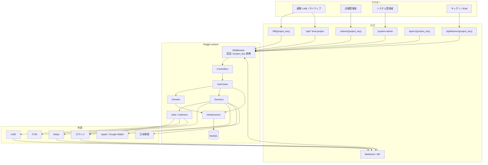

---

## 3. リクエストの標準パイプライン

すべての機能は、原則この一本道です。

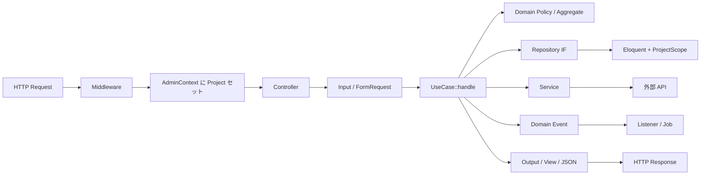

### 層の責務（必守）

| 層 | 置いてよいもの | 置いてはいけないもの |
|----|----------------|----------------------|
| Controller | 受付・バリデーション・Input 組み立て・レスポンス | 業務判断・外部 API 直叩き |
| UseCase | 「何をするか」1 本のオーケストレーション | `Request` 依存、UseCase→UseCase 呼び出し |
| Domain | ルール・Policy・Repository IF・Event | Eloquent / HTTP |
| Infrastructure | Eloquent 実装・Event Listener | 画面ロジック |
| Service | 外部連携・再利用技術処理 | Controller から直呼び（原則 UseCase 経由） |

参照実装の優先順位: **system-admin / Admin 配下** → 顧客 API。

---

## 4. 入口（ルーティングの地図）

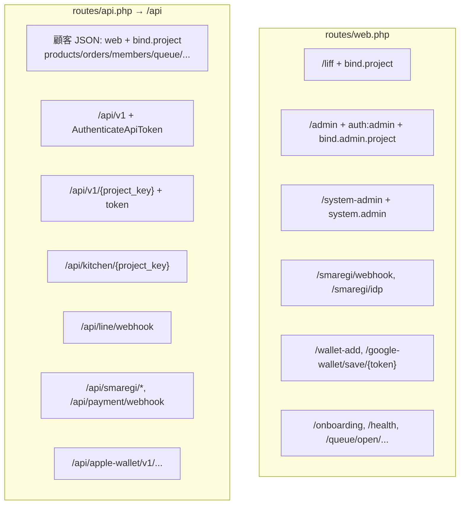

| 入口 | 認証の考え方 | テナント解決 |
|------|--------------|--------------|
| LIFF / 顧客 API | LINE User ID ヘッダ等（Laravel の user guard ではない） | `bind.project` |
| 店舗 Admin | `auth:admin` セッション + `admin.permission` + `admin.plan` | `bind.admin.project` |
| システム Admin | `auth:admin` + `system.admin` | 横断（プロジェクト CRUD） |
| API v1 | Bearer / `X-Api-Token` | トークンの project または URL `{project_key}` |
| Kitchen | project_key で店舗特定 | ルート `project_key` |
| Webhook | 署名検証ミドルウェア等 | ペイロード / 契約 ID から解決 |

登録元: `app/Providers/RouteServiceProvider.php`。

---

## 5. マルチテナント設計

**店舗 = `projects` 1 行。URL / ヘッダの `project_key` で必ず束縛する。**

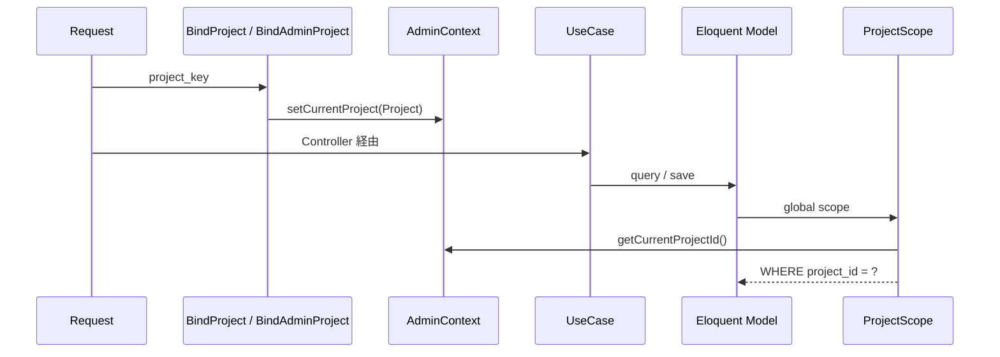

| 部品 | パス | 役割 |
|------|------|------|
| `bind.project` | `app/Http/Middleware/BindProjectFromRequest.php` | 顧客・LIFF・公開系 |
| `bind.admin.project` | `app/Http/Middleware/BindAdminProject.php` | Admin + 権限チェック |
| `AdminContext` | `app/Util/AdminContext.php` | リクエスト内の現在店舗 |
| `ProjectScope` | `app/Models/Scopes/ProjectScope.php` | 他店データ遮断 |
| `BelongsToProject` | `app/Models/Concerns/BelongsToProject.php` | Model に scope + 作成時 project_id |

**デグレ観点:** UseCase / Repository で「別 project_id を明示指定して読む」場合は、スコープ外しが意図的か必ず確認する。

---

## 6. 認証・認可の整理

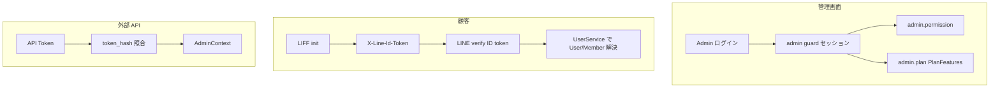

プラン機能ゲート（累積）: `app/Support/PlanFeatures.php`

- `normal` ⊂ `distribution` ⊂ `premium`
- 例: 抽選・Wallet・高度分析・LIFF デザイナー高度は premium 系

---

## 7. バックエンドのディレクトリと依存の向き

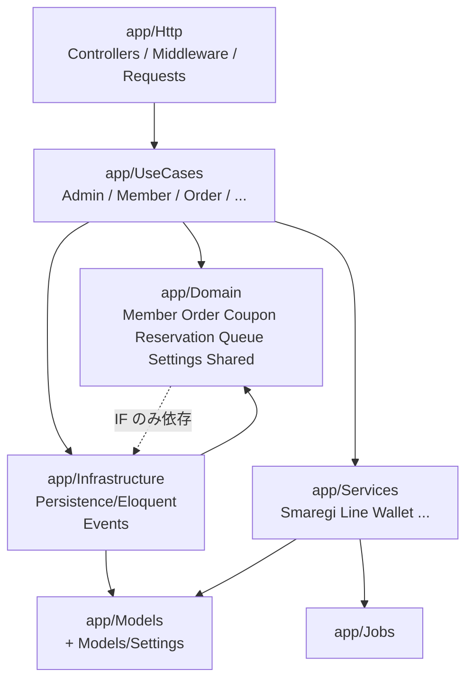

### Bounded Context（Domain）

| Context | 主な関心 |
|---------|----------|
| Member | ポイント台帳、ランク、`PointsEarned` |
| Order | 作成・在庫・決済確定・スタンプ、同期イベント |
| Coupon | 利用・発行・配信セグメント Policy |
| Reservation | 予約・空き枠・ステータス |
| Queue | 順番待ち・呼出・入店 |
| Settings | `ShopSettingRepository`（設定の唯一の入口） |

---

## 8. 設定（Settings）の設計

旧 EAV / `ShopSetting` 静的ファサードは廃止済み。  
**読み書きは必ず `ShopSettingRepository` 経由。**

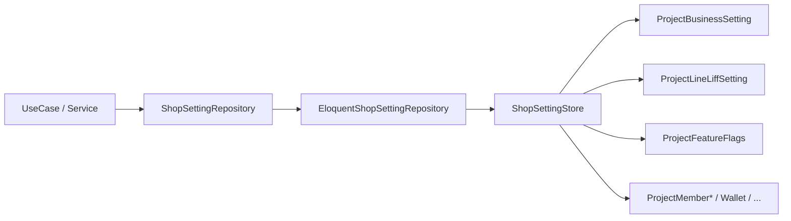

| ファイル | 役割 |
|----------|------|
| `app/Domain/Settings/Repositories/ShopSettingRepository.php` | IF |
| `app/Domain/Settings/ShopSettingKeys.php` | 定数（ORDER_MODE 等） |
| `app/Infrastructure/.../EloquentShopSettingRepository.php` | 実装 |
| `app/Infrastructure/.../ShopSettingStore.php` | KEY → 正規化テーブル |
| `app/Models/Settings/Project*Setting.php` | 1 project = 各テーブル 1 行 |

---

## 9. ドメインイベントと非同期

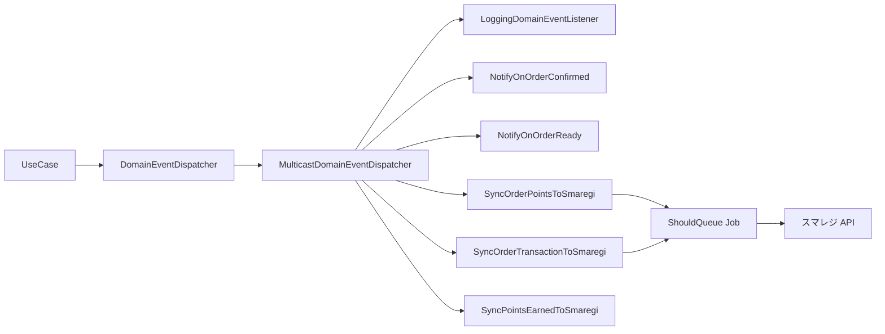

代表イベント:

| Event | 主な副作用 |
|-------|------------|
| `OrderConfirmed` / `OrderReady` | LINE 等通知 |
| `OrderPointsSyncRequested` | 注文ポイントのスマレジ同期（冪等カラムあり） |
| `OrderTransactionSyncRequested` | 取引のスマレジ同期 |
| `PointsEarned` | ポイント変動のスマレジ同期 |

本番の予約配信・同期は **キューワーカー前提**（`QUEUE_CONNECTION=sync` は開発向け）。

---

## 10. フロントエンド設計

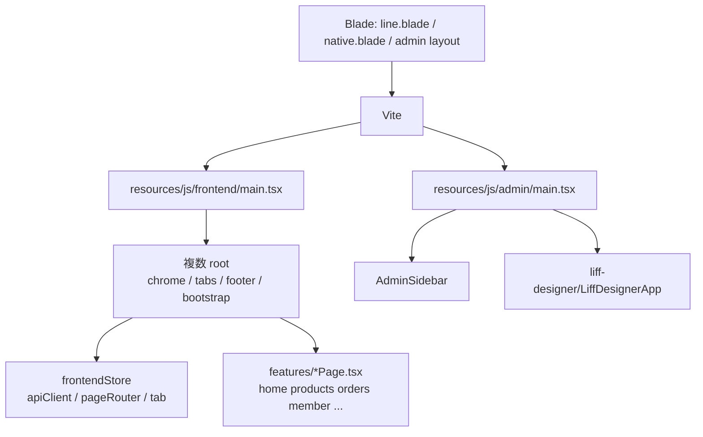

| 領域 | パス | メモ |
|------|------|------|
| LIFF 入口 | `resources/js/frontend/main.tsx` | React タブページ |
| 共有状態 | `resources/js/frontend/context/frontendStore.ts` | 複数 root 間でタブ共有 |
| 機能ページ | `resources/js/frontend/features/*/ ` | タブ単位の UI |
| API クライアント | `resources/js/shared/utils/apiClient.ts` | LINE User ID 付与 |
| Admin デザイナー | `resources/js/admin/liff-designer/` | ブロック編集 UI |

顧客の業務 API は `/api/...`（`bind.project`）を叩く。

---

## 11. 代表ユースケースの流れ

### 11.1 顧客が注文する

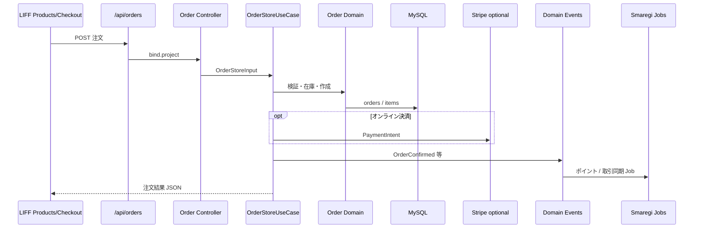

### 11.2 店舗が設定を保存する

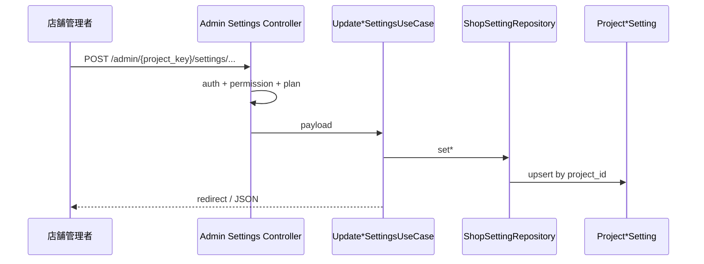

### 11.3 スマレジ連携（双方向のイメージ）

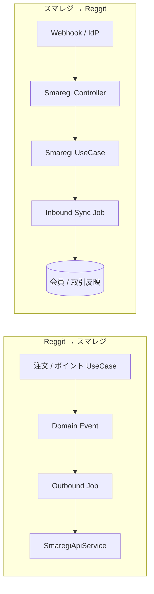

---

## 12. データモデルの中心

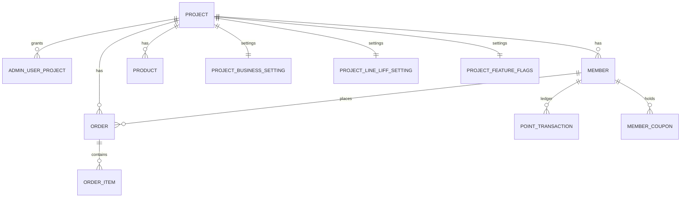

マルチテナントの軸は常に **`projects.id` / `project_key`**。

---

## 13. 設計判断の早見表

| やりたいこと | 置く場所 |
|--------------|----------|
| 画面・API の入口 | `Http/Controllers` |
| バリデーション | FormRequest / Controller（UseCase ではやらない） |
| 業務の一連の流れ | `UseCases/...` |
| 不変条件・権限ポリシー | `Domain/...` |
| DB アクセス抽象 | `Domain/.../Repositories` + `Infrastructure/Persistence` |
| スマレジ・LINE・Wallet | `Services/...`（UseCase から呼ぶ） |
| 店舗設定の読み書き | `ShopSettingRepository` のみ |
| 非同期副作用 | Domain Event → Listener / Job |
| LIFF UI | `resources/js/frontend/features` |
| Admin LIFF デザイン | `resources/js/admin/liff-designer` |

---

## 14. 関連ドキュメント

| ドキュメント | 内容 |
|--------------|------|
| [ARCHITECTURE.md](./ARCHITECTURE.md) | 全体設計図 |
| [PROCESS_FLOWS.md](./PROCESS_FLOWS.md) | **CRUD・機能別の処理フロー図** |
| [CLEAN_ARCHITECTURE.md](./CLEAN_ARCHITECTURE.md) | UseCase / Input / 依存ルール |
| [DDD.md](./DDD.md) | Bounded Context・イベント |
| [FEATURES_SPEC.md](./FEATURES_SPEC.md) | 機能・画面仕様 |
| [PERMISSIONS.md](./PERMISSIONS.md) | Admin 権限 |
| [SMAREGI_SETUP.md](./SMAREGI_SETUP.md) | スマレジ接続 |
| [SECURITY.md](./SECURITY.md) | セキュリティ |
| [CODING_STANDARDS.md](../CODING_STANDARDS.md) | コーディング規約 |

---

*最終更新: 2026-08-07*
