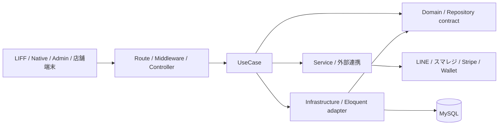

# アーキテクチャ

## 全体構成

Laravel が LIFF、顧客 API、管理画面、店舗端末 API、外部 Webhook を提供します。顧客のネイティブアプリは Skip / SwiftUI、店舗端末は SwiftUI の iPad アプリです。

Domain は HTTP・Eloquent・Infrastructure に依存しません。既存の読み取り専用 UseCase / Service では Eloquent を直接使う箇所もあり、段階的に整理します。

## 層と配置

| 場所 | 責務 |
|---|---|
| `app/Http` | ルートの受付、認証・認可、入力検証、レスポンス |
| `app/UseCases` | 1操作のオーケストレーション。入力は Input / プリミティブ、出力は View / Output / ドメイン型 |
| `app/Domain/{Context}` | 集約・値・Policy・Repository 契約・イベント |
| `app/Infrastructure/Persistence/Eloquent` | ドメイン Repository の永続化実装 |
| `app/Services` | 再利用する処理、外部 API・ストレージ・決済などの技術的境界 |
| `app/Repositories` | 利用者識別・テナント解決・集約以外の読みモデルの既存 Repository |
| `app/Models` | Eloquent モデルと関連 |

新しい業務集約の契約は `Domain/<Context>/Repositories`、実装は `Infrastructure/Persistence/Eloquent/<Context>` に置きます。単純な単一利用者の読み取りに Repository を増やす必要はありません。共有クエリ、集約永続化、差し替えが必要な境界で導入します。

主要 Context は Member、Order、Coupon、Reservation、Queue、Settings、Shared です。Admin の薄い UseCase は HTTP と Service の境界として維持し、Controller から Service を直呼びする形へ統合しません。詳細な実装ルールは [コーディング規約](../CODING_STANDARDS.md) に従います。

## テナントと店舗

`Project` は契約・ブランド・LINE/LIFF・会員基盤、`Store` はその配下の実店舗です。テナント境界は `project_id`、実店舗の取引境界は `store_id` です。

| 制御 | 実装 |
|---|---|
| 顧客のプロジェクト解決 | `BindProjectFromRequest` |
| 管理者のプロジェクト解決と権限 | `BindAdminProject` |
| API トークンと URL の整合 | `AuthenticateApiToken` / `CheckApiProject` |
| プロジェクト検索・作成スコープ | `ProjectScope` / `BelongsToProject` |
| 選択店舗・担当店舗の解決 | `StoreContext` |
| 利用店舗の会員・取引への制限 | `StoreAccessScope` |
| 常駐ワーカーのリクエスト間状態リセット | `ResetTenantContext` |

HTTP 中にプロジェクトが未解決なら `ProjectScope` は検索結果を返しません。プロジェクト解決は暗黙のモデル結合より前に実行します。CLI の横断処理は別途対象を明示します。スコープを外す処理は認可と明示的な `project_id` / `store_id` 条件を確認します。

会員証・ポイント残高・ランク・商品定義はプロジェクト共通です。注文・予約・順番待ち・来店・履歴は店舗に紐づき、会員の利用店舗は `member_stores` に記録します。店舗を選択するだけでは利用関係を作りません。DB では店舗とプロジェクトの複合外部キーなどで混在を防ぎます。

既存プロジェクトには `main` 店舗を作る移行があります。別々のプロジェクトを自動統合しません。運用範囲と設定継承は [運用](OPERATIONS.md) を参照してください。

## 設定

設定の読み書きは `app/Domain/Settings/Repositories/*Settings.php` の用途別契約を使います。共通 Eloquent adapter と `ShopSettingStore` が `Project*Setting` モデルへの保存を隠蔽します。旧 EAV・`Models\ShopSetting`・巨大な `ShopSettingRepository` を再導入しません。

営業時間・予約枠など店舗固有の値は `stores.settings` で上書きし、未設定ならプロジェクト設定を参照します。ブランド・LINE・会員基盤などの共通設定はプロジェクトに保持します。

## 処理フローとイベント

共通経路は「Middleware → Controller / FormRequest → Input → UseCase → Domain / Repository / Service → Output」です。機能フラグ・プラン・権限は入口で確認し、業務上の不変条件は Domain / Service 側で守ります。

- 注文: 本人と店舗を確定し、商品・在庫を検証してトランザクション内で確保する。決済確定では所有者・注文ID・金額・状態を確認する。
- ポイント・スタンプ・クーポン: 台帳と発行元を記録し、取引の再送・取消による重複や他取引への影響を防ぐ。
- 外部同期: `PointsEarned`、`OrderConfirmed`、`OrderPointsSyncRequested` などを Listener / Job へ渡す。コミット後の外部障害で保存済み操作を失敗扱いにしない。
- 配信: 作成者・店舗・対象会員を記録し、実行時も現在の権限と店舗の有効状態を確認する。

`PostCommitDomainEventDispatcher` がコミット後イベントの失敗処理を集約します。配送・同期の完了とローカル保存の完了を区別します。

## フロントエンドと検証

LIFF は `resources/js/frontend`、管理画面は `resources/js/admin`、共通通信・型は `resources/js/shared` です。React feature と既存 Manager が共存しており、画面単位で移行します。React API 層を `window.app` に依存させません。

集約・Policy は DB 不要の Unit、永続化と HTTP 境界は DB を使うテスト、画面は必要な E2E で確認します。依存の向きは `tests/Unit/Architecture/LayerDependencyTest.php`、店舗境界は `MultiStoreTest` などで検証します。
