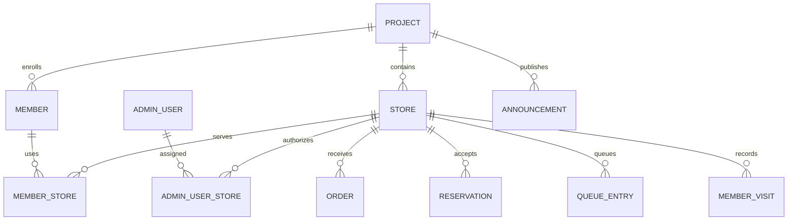

# 1プロジェクト・複数店舗の設計

更新日: 2026-09-28 / 基本機能を実装済み

操作手順と現在の制限は [実装と運用](MULTI_STORE_IMPLEMENTATION.md) を参照。

## 構成

`Project` はブランド・契約・LINE/LIFF・会員基盤の単位。`Store` はその配下の実店舗。プロジェクト間のテナント分離は維持する。

会員証・ポイント・ランクは共通。同じ会員が複数店舗を利用しても会員を複製しない。利用店舗との関係を `member_stores` に記録する。店舗切り替えだけでは関係を追加しない。

## 権限

| 役割 | 店舗追加・担当者割り当て | 閲覧 | 一斉配信 |
|---|---|---|---|
| システム管理者 | 可 | アクセス可能なプロジェクトの全店舗 | プロジェクト全員または選択店舗 |
| プロジェクト管理者 | 可 | 対象プロジェクトの全店舗 | プロジェクト全員または選択店舗 |
| 店舗管理者・スタッフ | 不可 | 担当店舗の会員・取引 | 選択した担当店舗の利用会員 |

既存の機能別権限も必要。担当店舗がない場合は会員・取引を表示しない。複数店舗担当者が取引を作成する際は具体的な店舗選択が必要。本部の「全店舗」は共通設定・会員基盤・配信・集計を扱うモードで、店舗取引の作成には具体的な店舗を選ぶ。

複数店舗に利用関係がある会員は各店舗から確認できる。共通残高は各店舗から確認できるが、他店舗の注文・来店・ポイント履歴・メモは表示しない。共通会員のプロフィール変更・退会、商品や共通配信ルールの編集は本部に限定する。1店舗の間は従来の管理権限を維持する。

## データ

| テーブル | 主な項目・制約 |
|---|---|
| `stores` | `project_id`, `store_key`, `name`, `address`, `phone`, `is_active`, `settings`, スマレジ店舗・端末ID。プロジェクト内キー・スマレジ店舗IDは一意 |
| `admin_user_stores` | `project_id`, `admin_user_id`, `store_id`。担当者と店舗の組は一意 |
| `member_stores` | `project_id`, `member_id`, `store_id`, `memo`。会員と店舗の組は一意 |
| 注文・予約・順番待ち・来店・ポイント履歴・スタンプ履歴・クーポン使用・店舗アプリ認証 | `store_id` を追加。プロジェクトと店舗の複合外部キーで異なるプロジェクトの店舗を拒否 |
| ポイント・スタンプ履歴 | 共通処理は `origin=headquarters`, `store_id=null`、店舗取引は `origin=store` |
| `announcements` | `store_ids` JSON、`visibility`、`created_by_admin_id`、`private_image_path` を追加。受信者は既存の `target_member_ids` を利用 |

順番待ち番号と店舗アプリ認証は店舗単位で一意。注文番号は既存のプロジェクト内連番を維持する。

営業時間・休業日・注文モード・注文通知・予約枠・定員・受付設定は `stores.settings` で上書きし、未設定は既存のプロジェクト設定を参照。商品・在庫・スタンプ定義・クーポン定義・タグ・ブランド・LINE設定は現段階ではプロジェクト共通。

## 店舗選択と境界

リクエストごとの `StoreContext` にプロジェクト、操作店舗、閲覧可能店舗IDを保持する。管理画面はセッションで選択を保存。API・LIFFは `store_id` または `X-Store-Id` を使う。店舗アプリの認証情報は発行店舗に固定する。

`StoreAccessScope` は既存のプロジェクトスコープに追加する。会員は利用関係、取引は実際の取引店舗を条件とする。ゲスト利用者は担当店舗の注文・予約・受付を通じて閲覧を許可する。取引明細・既読情報にも親の店舗境界を適用する。

ポイント口座・ランク集計は店舗スコープを外して同一プロジェクト全体で集計する。店舗別売上は注文・来店に保存した `store_id` を使用する。スマレジ受信は外部店舗IDの対応から店舗を決定し、複数店舗で対応がない場合は同期をスキップする。

## 配信と閲覧

作成時に選択店舗と作成者を記録。対象解決とLINE・Push送信に同じ店舗条件を適用する。支店の「全員」はその店舗に利用関係がある会員のみ。複数店舗を利用した会員を重複送信しない。

限定お知らせは `visibility=recipients` とし、確定した対象会員のみ閲覧可能。非公開画像は公開ストレージに置かず、対象会員または権限のある管理者を確認して返す。通常の公開お知らせはプロジェクト共通または選択店舗に表示する。

予約配信は作成時固定・配信時解決の既存方式を利用する。実行時に作成者のプロジェクト権限・配信権限・担当店舗・対象店舗の有効状態を確認する。失効していれば保留し、対象を自動で広げない。保留配信は本部が対象を確認して新しく作成する。

## 移行

既存プロジェクトごとに `main` 店舗を作り、既存会員・担当者・取引を関連付ける。既存の設定を初期店舗で参照する。2店舗目を追加する際は既存の会員メモを初期店舗のメモに保持する。

異なる既存プロジェクトを自動統合しない。LINE契約・スマレジ契約・会員識別・ポイントの対応を確認する別の移行が必要。

## 検証と今後の拡張

`MultiStoreTest` は店舗追加、担当者割り当て、権限なしアクセス、他店舗会員・ゲストの非表示、配信対象、限定閲覧、共通残高、店舗メモ・営業時間を検証する。既存の管理画面・店舗認証・スマレジ連携テストも確認する。

任意の複数店舗を選ぶ配信、店舗別商品価格・在庫・タグ・通知設定、専用の受信者・送信結果テーブル、プロバイダー側冪等キー、本部再承認ボタンは追加拡張として扱う。
