# Reggit 処理フロー（全体 → 細部）

**上から順に読む想定です。** いきなりドメイン詳細に飛ばず、ズームレベルを下げていきます。

| レベル | 見るもの | この文書の節 |
|--------|----------|--------------|
| **L0 大枠** | アプリ全体で誰が何をするか | [§1](#1-l0-大枠アプリ全体) |
| **L1 レーン** | 顧客 / 店舗Admin / システムAdmin / 外部 | [§2](#2-l1-利用レーンの分解) |
| **L2 共通の型** | リクエストの通る型（CRUD パターン） | [§3](#3-l2-共通パターン) |
| **L3 機能別** | 商品・注文・会員…の CRUD 詳細 | [§4](#4-l3-機能別crud詳細) |
| **L4 確認用** | ミドルウェア表・コードの探し方 | [§5](#5-l4-確認用ミドルウェアとコードの場所) |

全体アーキテクチャの層・依存は [ARCHITECTURE.md](./ARCHITECTURE.md)。権限名は [PERMISSIONS.md](./PERMISSIONS.md)。

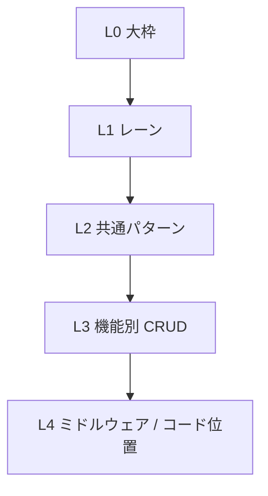

---

## 1. L0 大枠（アプリ全体）

まずこれだけ見れば十分、という一枚です。

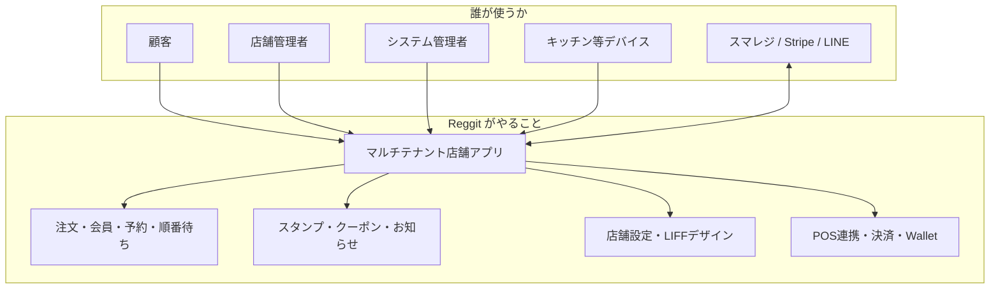

**一文:** 店舗ごとに分かれた LINE 会員・オーダー SaaS。顧客は LIFF、店舗は Admin、運営は system-admin、外部は Webhook / API でつながる。

---

## 2. L1 利用レーンの分解

大枠を **4本のレーン** に分けます。以降の詳細はすべてこのどれかに属します。

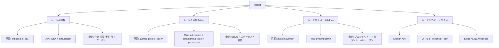

| レーン | 入口の例 | 認証の要点 |
|--------|----------|------------|
| A 顧客 | `/liff/...`, `/api/orders` | `project_key` + LINE User ID |
| B 店舗Admin | `/admin/{pk}/products` | セッション + 権限 +（必要なら）プラン |
| C システム | `/system-admin/projects` | システム管理者のみ |
| D 外部・デバイス | `/api/smaregi/webhook`, `/api/kitchen/...` | 署名 / トークン / project_key |

---

## 3. L2 共通パターン

レーンの中で、処理の「型」はほぼ次の2〜3種類です。

### 3.1 すべてのリクエストが通る一本道

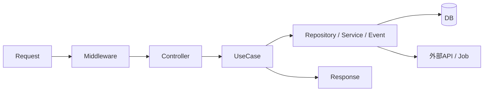

### 3.2 型① Admin CRUD（一覧・作成・更新・削除）

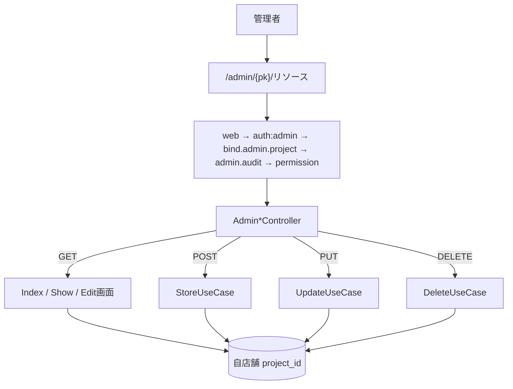

当てはまる例: **商品・スタンプ・クーポン・お知らせ・ギャラリー・（一部）予約**

### 3.3 型② 顧客 API（読み取り / 自分の操作）

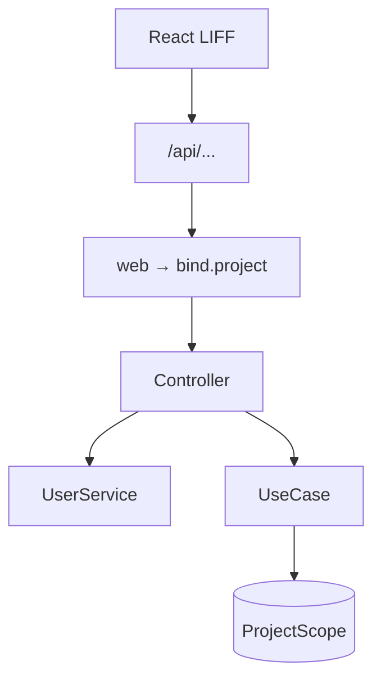

当てはまる例: **商品一覧、自分の注文、会員 me、マイクーポン**

### 3.4 型③ 状態遷移（CRUD の U がステータス）

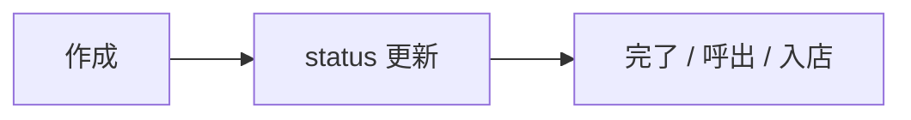

当てはまる例: **注文・順番待ち・（予約の status/complete）**

### 3.5 型④ 設定 Save（Repository 経由）

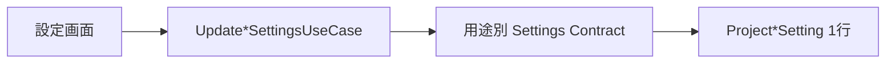

---

## 4. L3 機能別 CRUD 詳細

ここからが細部です。上の **型①〜④のどれか** に対応しています。

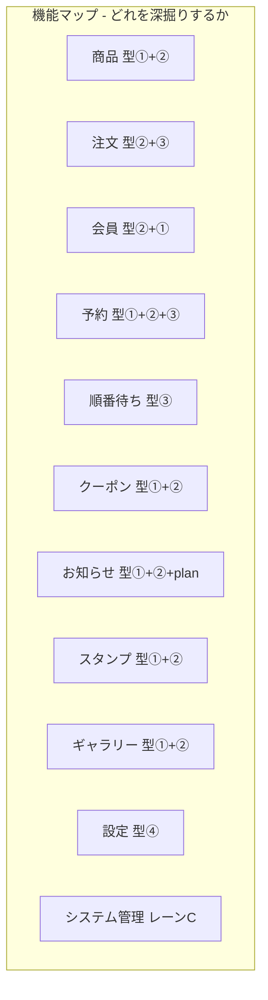

---

### 4.1 商品 Products（型① + ②）

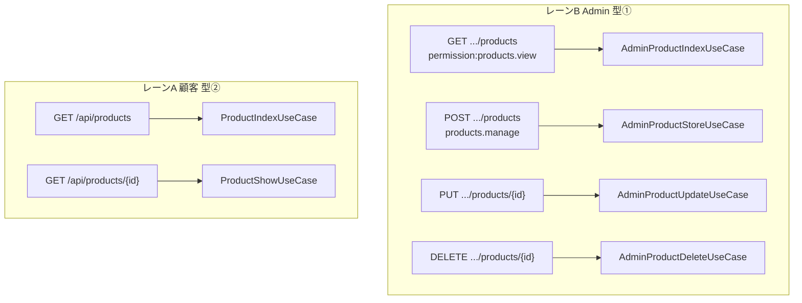

| CRUD | Admin | 顧客 |
|------|-------|------|
| C | POST `.../products` | — |
| R | GET 一覧・編集画面 | GET `/api/products` |
| U | PUT `.../{id}` | — |
| D | DELETE `.../{id}` | — |

---

### 4.2 注文 Orders（型② + ③）

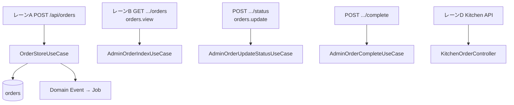

| 操作 | 誰 | 経路 |
|------|-----|------|
| C 作成 | 顧客 | `POST /api/orders` |
| R 一覧/詳細 | 顧客・Admin | `/api/orders`, `.../orders` |
| U 状態 | Admin / Kitchen | status / complete |
| D | 実質キャンセル系 | cancel-unpaid 等 |

---

### 4.3 会員 Members（型② + ①）

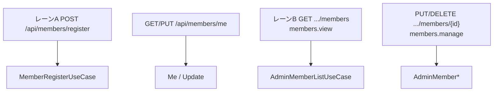

| CRUD | 顧客 | Admin |
|------|------|-------|
| C | register | — |
| R | me / points | 一覧・詳細 |
| U | me update | 編集・付帯操作 |
| D | withdraw | delete |

---

### 4.4 予約 Reservations（型① + ② + ③）

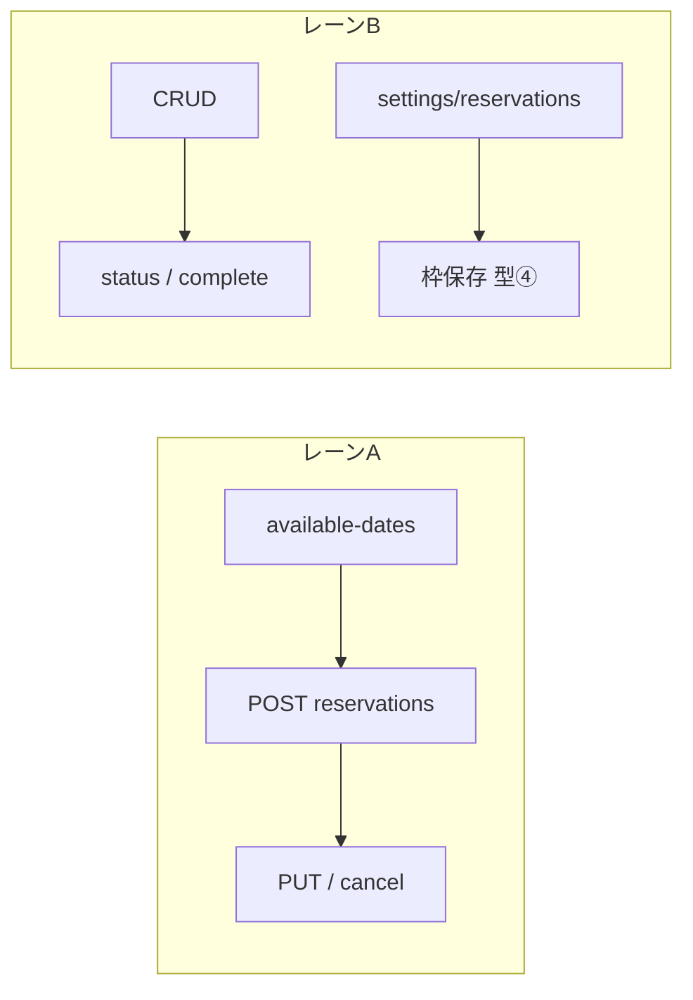

権限: `reservations.view` / `update`。枠は `settings.manage`。

---

### 4.5 順番待ち Queue（型③）

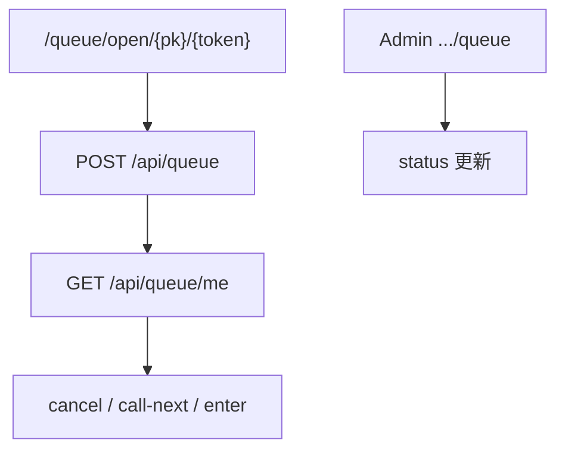

CRUD というより **登録 → 呼出 → 入店** の状態機械。

---

### 4.6 クーポン Coupons（型① + ②）

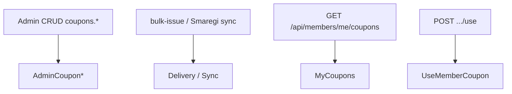

---

### 4.7 お知らせ Announcements（型① + ② + plan）

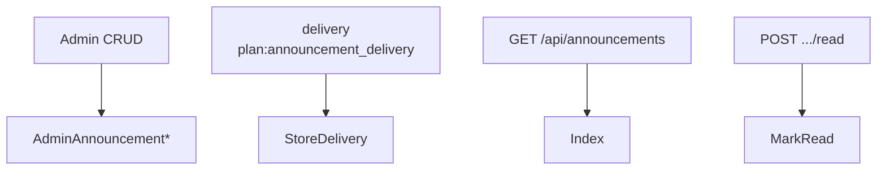

---

### 4.8 スタンプ / ギャラリー

**スタンプ:** Admin 型① CRUD（`stamps.*`）+ 顧客 `GET /api/stamps`。付与は注文完了等からも。

**ギャラリー:** Admin categories/items 型① + 顧客 `GET /api/gallery`。

---

### 4.9 設定 Settings（型④）

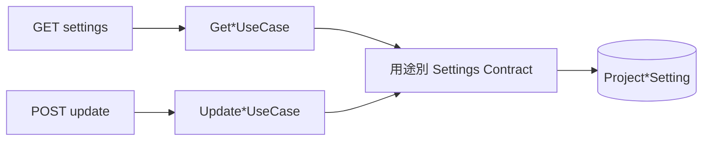

LIFF デザイナーは追加で `liff_designer.manage` + `plan:liff_designer_advanced`。

---

### 4.10 システム管理（レーンC）

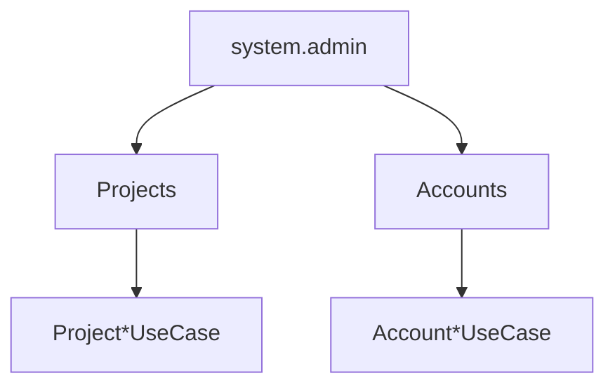

---

## 5. L4 確認用（ミドルウェアとコードの場所）

### 5.1 ミドルウェア帯

| レーン / 型 | 並び |
|-------------|------|
| B Admin CRUD | `web` → `auth:admin` → `bind.admin.project` → `admin.audit` → `admin.permission:*` |
| B + プラン | 上記 + `admin.plan:*` |
| A 顧客 API | `/api` + `web` → `bind.project` |
| C システム | `web` → `auth:admin` → `system.admin` → `admin.audit` |
| D Kitchen / Waiting | `auth:sanctum` → `store-app.auth:{kitchen|waiting}`（Bearer + 端末鍵） |
| D スマレジ WH | `verify.smaregi.webhook` |

定義: `app/Http/Kernel.php` / `app/Http/Middleware/`。

### 5.2 コードの探し方

| 知りたいこと | 見る場所 |
|--------------|----------|
| ルートと permission | `routes/web.php`, `routes/api.php` |
| Controller → UseCase | `app/Http/Controllers/...` |
| 業務 | `app/UseCases/...` |
| 設定保存 | 用途別 Settings contract |
| 注文の副作用 | Domain Event → Jobs |

---

## 6. 関連ドキュメント

| ズーム | ドキュメント |
|--------|--------------|
| 全体設計・層 | [ARCHITECTURE.md](./ARCHITECTURE.md) |
| 機能仕様 | [FEATURES_SPEC.md](./FEATURES_SPEC.md) |
| 権限キー | [PERMISSIONS.md](./PERMISSIONS.md) |
| UseCase 規約 | [CLEAN_ARCHITECTURE.md](./CLEAN_ARCHITECTURE.md) |

*最終更新: 2026-08-07*
